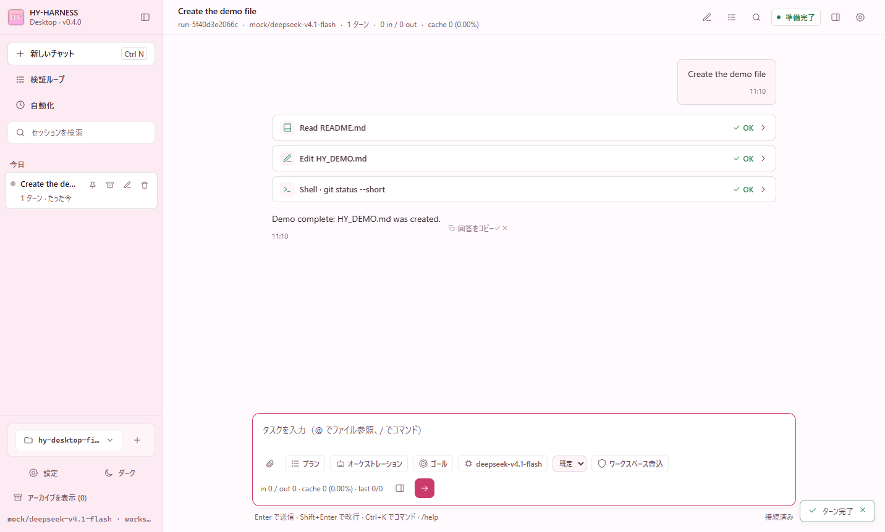
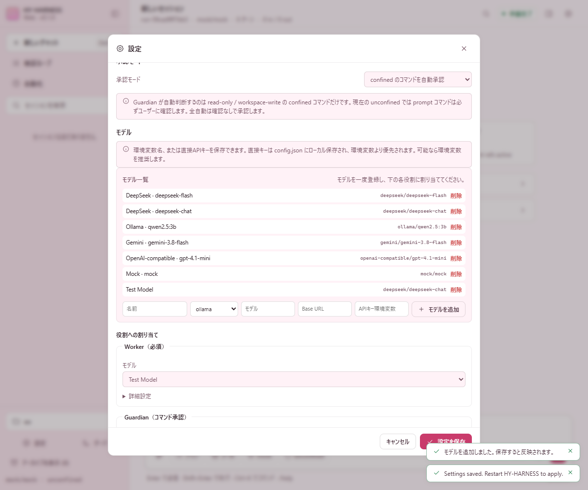
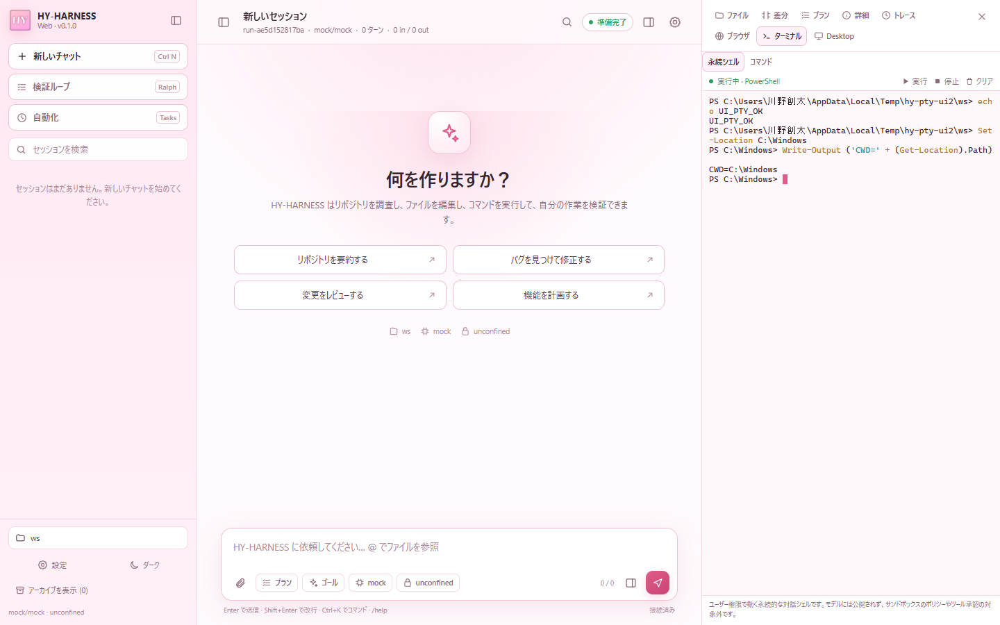
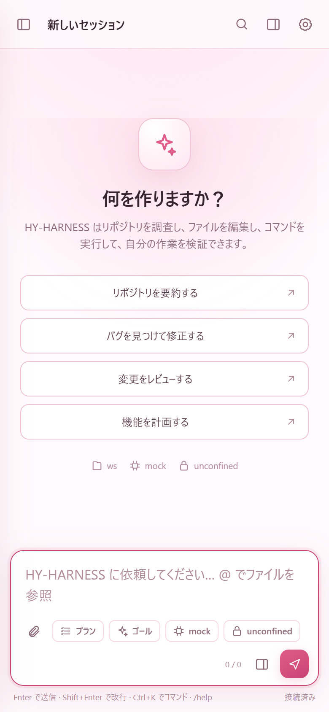

# HY-HARNESS

Windows 10-first autonomous coding agent harness. TypeScript control plane
(`packages/*`) + Rust execution daemon (`crates/hy-exec-server`) over
newline-delimited JSON-RPC 2.0.

**Status: Phases 0–8 + Codex/DSH core feature parity + all Rev 3.1 verification items + the DSH-compatible desktop/web GUI completed for the approved scope.** The design is Rev 3.1 (approved). The
Windows confined-token sandbox (`--sandbox workspace-write`), Guardian
(`--guardian`), the AppContainer `run_code` worker, spill/compaction/ledger,
verifier-gated `hy ralph` with Budget4D, `$/cancelRequest` in-flight cancellation,
oversized (> 50 MiB) untracked checkpoint exclusion (`unprotected`), and the
`cordis` service wrapper are implemented; the sandbox is **on by default**
(`workspace-write`; `--unsafe-unconfined` opts out). See
[docs/implementation_status.md](docs/implementation_status.md) for details,
[docs/feature-parity.md](docs/feature-parity.md) for Codex/DSH parity, and
[docs/enforcement-gaps.md](docs/enforcement-gaps.md) for every known gap.

**Documentation**

- 日本語の入口: [README.ja.md](README.ja.md)
- Setup, migration and failures: [docs/troubleshooting.md](docs/troubleshooting.md),
  [docs/migration.md](docs/migration.md) (both English + Japanese)
- Per-package notes: [packages/core](packages/core/README.md),
  [packages/seams](packages/seams/README.md),
  [packages/hy-cli](packages/hy-cli/README.md),
  [packages/desktop](packages/desktop/README.md),
  [packages/sdk](packages/sdk/README.md), [python](python/README.md)
- DSH gap analysis and its adoption plan:
  [docs/dsh-gap-analysis.md](docs/dsh-gap-analysis.md),
  [docs/dsh-adoption-plan.md](docs/dsh-adoption-plan.md),
  [docs/dsh-adoption-progress.md](docs/dsh-adoption-progress.md)
- Codex implementation analysis, the full gap list (119 items) and the
  implementation plan: [docs/codex-gap-analysis.md](docs/codex-gap-analysis.md),
  [docs/codex-adoption-plan.md](docs/codex-adoption-plan.md),
  [docs/codex-adoption-progress.md](docs/codex-adoption-progress.md)
- hy-protocol/1 (CLI, daemon, SDKs, ACP): [docs/protocol.md](docs/protocol.md);
  release signing and package manifests: [docs/release-signing.md](docs/release-signing.md);
  single-binary decision: [docs/adr/0003-single-binary.md](docs/adr/0003-single-binary.md)

## Completion criteria (approved scope)

This project treats the GUI as complete for the approved scope when all of the
following hold:

- The implemented surfaces are present: three-column sessions/chat/panels,
  tool cards, approvals and `ask_user`, goals, plan mode, jobs, subagents,
  Orchestration A+ (plan-only orchestrator + scoped ordinary workers),
  Files / Diff / Plan / Details / Trace / Browser / Terminal / Desktop,
  Browser and Desktop automation, schedules/Webhooks, persistent PTY,
  English/Japanese/Chinese UI, and Tailscale phone access.
- The approved exclusions are recorded and unchanged: plugin market/Creator,
  SSH to remote machines, cloud execution, multi-user/public hosting, and the
  IDE extension ([desktop-gui.md §8](docs/designs/desktop-gui.md)).
- `pnpm build`, `pnpm typecheck`, `pnpm test`, `pnpm test:integration` and
  `pnpm desktop:screenshot` pass.
- `pnpm desktop:package` produces `release\HY-HARNESS.exe` and
  the packaged app starts, opens its workspace, and can run the persistent PTY
  and browser automation.
- The web/Electron smoke tests in [desktop-gui.md §7](docs/designs/desktop-gui.md)
  pass, including the PTY, Browser and Desktop panels.

This is a **DSH-compatible GUI for the approved scope**, not a claim that every
DSH-only surface has been implemented.

## Build

```powershell
cd F:\HY-HARNESS
cargo build -p hy-exec-server
pnpm build
```

## Run

```powershell
# Local Ollama (default: qwen2.5:3b), commands confined to the workspace
node packages\hy-cli\dist\main.js run "Read README.md and write a summary to NOTES.md" `
  --cwd C:\work\my-repo --provider ollama --model qwen2.5:3b --sandbox workspace-write --yes

# Offline / deterministic demo
node packages\hy-cli\dist\main.js run "Create HY_DEMO.md" --cwd C:\work\my-repo --mock --yes

# Verifier-gated Ralph loop: claim_complete -> tamper check -> Gate 1 -> Gate 2
node packages\hy-cli\dist\main.js ralph "Make the tests pass" `
  --verify-cmd "npm test" --cwd C:\work\my-repo --provider ollama --model qwen2.5:3b `
  --yes --trust --max-rounds 3 --max-cost-usd off

# Remove a run's checkpoint refs
node packages\hy-cli\dist\main.js checkpoint prune run-xxxxxxxx --cwd C:\work\my-repo

# Undo a finished run (restores the base checkpoint)
node packages\hy-cli\dist\main.js undo run-xxxxxxxx --cwd C:\work\my-repo

# Sandbox grant state, and removing every ACL change
node packages\hy-cli\dist\main.js sandbox status --cwd C:\work\my-repo
node packages\hy-cli\dist\main.js sandbox revoke --cwd C:\work\my-repo

# Diagnostics
node packages\hy-cli\dist\main.js policy-test "git status" --cwd C:\work\my-repo
```

## Desktop GUI

The Electron app is a DSH-style three-column console: sessions on the left, the
conversation and composer in the middle, and files / diff / plan / details /
trace plus Browser, Terminal and Desktop panels on the right. It runs the same
local API as `hy web`.

```powershell
pnpm desktop          # build, then start the Electron app
pnpm desktop:dev      # same, with DevTools
pnpm desktop:screenshot  # mock demo run + screenshots/desktop.png
```

If `pnpm install` did not download the Electron binary (some pnpm
configurations skip dependency install scripts), run
`pnpm desktop:install` once.

### Windows exe

Build a standalone, double-clickable Windows executable (Node and pnpm are
only needed to build it, not to run it):

```powershell
pnpm desktop:package
# release\HY-HARNESS.exe   (fixed name; the version is in the app and the feed)

pnpm desktop:package:dir
# release\win-unpacked\HY-HARNESS.exe
```

The portable exe extracts itself to a temporary directory at launch and then
opens the same Electron GUI. The first launch asks for a workspace. The
execution server (`hy-exec-server.exe`), `node-pty`, xterm.js and the optional
Playwright / agent-desktop MCP servers are bundled.

The file name is deliberately fixed: an update replaces the running exe in
place, so the name must not change between releases. The version is shown in
the sidebar (`HY-HARNESS / Desktop · v0.4.1 · <commit> · <build time>`), reported by
`GET /api/bootstrap`, and published in the signed release feed.

The executable is not code-signed, so Windows SmartScreen may show a warning.
For distribution, sign it with your own code-signing certificate.

### Portable exe self-update

One command builds everything (Rust release binaries, TypeScript, version
check, unit tests) and packages the result:

```powershell
pnpm release:local                 # automatically advances the patch version (0.5.0 -> 0.5.1)
pnpm release:local --bump minor    # choose a minor release instead, once per build
# options: --bump patch|minor|major|x.y.z, --skip-tests, --stage, --replace
```

`pnpm build` also advances the patch version before compilation and keeps all
package versions and `HARNESS_VERSION` synchronized. Use `pnpm typecheck` when
you only want to check the code without creating a new version.

While the app is running it stages the build as
`release\next\HY-HARNESS-<version>-<YYYYMMDD-HHMM>.exe` with a `.sha256` and a
`.json` (version, commit, build time) next to it; otherwise it writes
`release\HY-HARNESS.exe`. The sidebar shows which build is running
(`v0.4.1 · bd1b0ae · 11/06 06:22`; `+` = built with uncommitted changes).

The running app checks for a staged build on start and when its window regains
focus, and shows **Update ready** in the sidebar (also **Settings → Update →
Restart and apply update**). A higher version wins; the same version is applied
only as a newer rebuild; an older version is refused, never installed. The app
registers an interactive scheduled task and quits. The task waits for the old
process to exit, keeps the old exe as `*.bak-<timestamp>.exe` (only the newest
backup is kept), replaces it with the staged build, verifies its SHA-256, and
restarts with the same workspace. Running turns are interrupted. The task runs from
`C:\Users\Public\hy-harness-update`, outside the portable app's process job and
temporary extraction directory, and removes itself after starting the new exe.
The updater log is `C:\Users\Public\hy-harness-update\update.log`.

The app searches `<portable exe dir>\next`, `<workspace>\release\next`, the
user-data `update` folder, and `HY-HARNESS.next.exe` next to the running exe. A
staged build is accepted when its content differs from the running exe, or when
it is newer (so a fresh identical build can restart for testing). The ordinary
`release` folder must be newer, which prevents an accidental downgrade.
Self-update is available only from the portable exe, not from
`release\win-unpacked\HY-HARNESS.exe`.



Browser-only launch (the same UI):

```powershell
node packages\hy-cli\dist\main.js web --cwd C:\work\my-repo
node packages\hy-cli\dist\main.js web --cwd C:\work\my-repo --port 0 --no-open
```

The GUI supports local sessions, session pin/archive, streaming tool cards,
approvals and `ask_user`, a session goal, plan mode, model switching, a
per-chat sandbox-mode switch (read-only / workspace-write / unconfined), `/undo`,
`/review`, `/init`, `/export`, image attachments, `@file` references,
background jobs, subagents, MCP/plugin/memory catalogs, plugin reload, a raw
trajectory view, schedule/Webhook management, a sandboxed browser preview, a
persistent PTY terminal, a Ctrl+K command palette, English/Japanese/Chinese UI,
and the verifier-gated Ralph loop.

### Added in the DSH-adoption milestones (M2–M6)

- **Steering and a durable queue**: a message sent mid-turn reaches the model at
  its next step, or waits for the turn end in a queue that survives a restart.
- **Background subagents**: `delegate { background }` returns an id you can talk
  to, list, interrupt and close.
- **Generated chat names**: the model proposes a name (with an offline fallback),
  and a manual name always wins. Rename dialog → *Generate name*.
- **Session timings**: steps, provider time, tool time and time-to-first-answer,
  measured live and persisted per turn; Details → *Timings*.
- **Fork**: copy a chat (same history, new run) and continue independently.
- **`@session:` references**: `@` offers earlier chats as well as files; the
  referenced chat is injected as a bounded, clearly-marked untrusted block.
- **Turn outline**: jump to any user turn in a long chat.
- **Feedback**: ✓/✗ with seven categories, stored in
  `<stateDir>\feedback.jsonl`; nothing is sent.
- **Appearance**: light/dark/system theme, text and code fonts, editable
  keyboard shortcuts, and display-only masking of API keys.
- **Open In**: detected editors and terminals for the selected file
  (local requests only).
- **ACP and SDK**: `hy acp` for editors and `hy serve --sdk` with TypeScript
  (`packages/sdk`) and Python (`python/`) clients.
- **Signed updates and onboarding**: an Ed25519-verified release feed,
  `hy update`, a verified swap with rollback, and a three-step first-run wizard.
- **Opt-in OTel**: local OTLP spans with identifiers and timings only.

### Orchestration A+

Start **Orchestration** from the sidebar. The orchestrator is a normal session
that stays in plan mode and manages ordinary worker sessions. Each worker has a
disjoint repository-relative scope and keeps the normal `delegate` tool, so it
can use subagents inside that scope. Workers are read-only chats from the user's
side; their reports wake the orchestrator automatically. The A+ version shares
one workspace and adds scope checks, a serialized worker shell, disabled worker
checkpoints/git commands, and a 5-worker limit. Dedicated role prompts live in
[`packages/hy-cli/prompts/orchestrator.md`](packages/hy-cli/prompts/orchestrator.md)
and [`packages/hy-cli/prompts/worker.md`](packages/hy-cli/prompts/worker.md).
There is no per-turn tool-call or step budget (the same policy as DSH's agent
loop): a turn continues through tool calls until the model finishes, the user
stops it, or a goal round cap is reached. Workers and the orchestrator are
bounded by Stop, cancellation, provider errors and goal rounds rather than an
arbitrary step count.

### Goals

A goal is one persisted long-running objective per session with four phases:
`active`, `paused`, `blocked`, `complete`. `/goal <objective>` creates and arms
it; the host then starts autonomous `<goal_round>` turns whenever the session is
idle. Each round names the objective and `round/maxGoalRounds` (256 by default).
The model marks completion with `update_goal complete`; the configured Grader
verifies the objective against recent tool evidence and returns unmet criteria,
which automatically continue the goal. `blocked` requires the same condition for
three consecutive rounds. Plan mode pauses autonomous rounds. Resume, fork or
restart leaves an active goal disarmed until `/goal resume`. Use `/goal`,
`/goal pause`, `/goal resume`, `/goal clear`, or the goal dialog.

Worker scopes are repository-relative directories. A root-level or single file
uses a `file:` scope, for example `file:project.md` (added roots:
`file:root-2:README.md`). A file scope owns exactly that file and does not
overlap its siblings.

Worker lifecycle is explicit. `running` has an active turn, `waiting` means the
worker reported `STATUS: done` but the orchestrator has not reviewed it, and
`done` is closed. A waiting worker still owns its scope, so a new worker cannot
take that directory. `orchestrator_workers` lists every open worker in a compact
form (closed workers are opt-in), and every orchestrator turn starts with the
same open-worker digest, so a scope cannot be stranded invisibly. Review the
diff and close the worker, or send the next concrete step. A running worker must
be stopped before it can be closed, so in-flight edits cannot race the next
owner. After a restart, a persisted `running` or `queued` worker becomes
`interrupted` and requires review instead of pretending to still run.
Per-worker `git worktree` isolation is deliberately a later stage. The default theme is white with sakura accents (a
night-sakura dark mode is also available), and the app uses `HY_icon.png` for
the Electron window/taskbar icon, the web favicon/PWA icon, and the sidebar
mark. The server binds to loopback, exchanges a random launch token for an
HttpOnly `SameSite=Strict` cookie, and the Electron renderer is sandboxed with
`contextIsolation` and no Node integration. See
[docs/designs/desktop-gui.md](docs/designs/desktop-gui.md) for the architecture,
API and security notes.

### Work modes

Choose **Fast** (default) or **Thorough** beside the composer. Fast focuses on essential checks and prompt delivery; Thorough examines relevant details and failure paths more carefully. In chat, use `/work-mode fast` or `/work-mode thorough`; when starting `hy run` or `hy chat`, use `--work-mode fast|thorough`. Changes take effect on the next turn and are restored when the session resumes. Work mode does not change permissions or the model.

### Model presets and API keys

Open **Settings → Models** once. Register providers/models in the **Model
list**, then assign one to each role (Worker, Guardian, Grader, Compactor) with
the dropdown under **Assign models to roles**. Selecting a model fills its
provider, model, base URL and API-key setting. The context window / max output
are applied automatically from the selected model; the fields are read-only.

DeepSeek V4.1 Flash supports up to 384K output tokens natively, while OpenCode
Go caps completion tokens at 131,072. The preset uses 131,072 so thinking does
not consume the whole output budget and truncate tool calls. Other presets use
their published limits: Gemini 3.8 Flash 65,536, GPT-6.1 Terra 128,000, GPT-4.1
32,768, and Qwen2.5 3B 8,192. If a provider enforces a lower cap, lower that
role's `maxOutputTokens` in `config.json`.

**Approval mode** chooses manual approval, automatic approval for confined
commands, or full auto approval. Guardian only judges confined commands
(read-only / workspace-write); with the default unconfined sandbox, prompt
commands always ask the user.

The model chosen in the `/model` dialog is also saved as the default for new
sessions. Settings are stored in `%APPDATA%\hy-harness\config.json`.

The header and composer show the **actual provider-reported token counts**
(with thousands separators), including the last turn's input/output counts.
Mock runs report zero, as expected.

Each role can use an **environment variable name**, a **direct API key**
(under Advanced) or a **stored secret** (CP-08). A direct key is stored
locally in `config.json` and takes precedence; an environment variable is
safer when possible. The recommended form is the DPAPI store:

```powershell
# The value is read from stdin, never from argv.
"sk-..." | node packages\hy-cli\dist\main.js secret set openai
# Then set roles.worker.apiKeySecret to "openai" in config.json.
node packages\hy-cli\dist\main.js secret list
```

`hy secret set` writes `secrets.<name> = "dpapi:..."`; the ciphertext is bound
to the current Windows user, so copying `config.json` elsewhere does not
reveal the key. `hy config dump` masks it unless `--show-secrets` is given.
`DEEPSEEK_API_KEY` is already set as a Windows user environment variable on
this machine.



### Browser and desktop automation

The Browser panel has two modes: **Preview** (sandboxed iframe) and
**Playwright** (drive a real browser through
[Playwright MCP](https://github.com/microsoft/playwright-mcp)). The Desktop panel
drives Windows applications through the bundled `agent-desktop` MCP wrapper.
Both are opt-in in `%APPDATA%\hy-harness\config.json`:

```json
{
  "automation": {
    "browser": { "enabled": true, "browser": "chrome", "headless": false },
    "desktop": { "enabled": true }
  }
}
```

Restart after changing this. The default browser is **Chrome**; set
`"browser": "msedge"`, `"chromium"`, `"firefox"` or `"webkit"` to use another
engine. The Playwright panel provides Navigate, Snapshot, Click, Type and Press;
refs such as `f3e4` come from Snapshot. The Desktop panel
lists running apps, snapshots their accessibility tree, and sends Click, Type
and key combos. The GUI's direct MCP endpoint is restricted to these two
servers; every action is user-initiated and shown in the panel output.

### Persistent terminal

The Terminal tab has two modes. **Persistent shell** keeps one interactive
PowerShell (or `$SHELL` on other platforms) alive through `node-pty` and renders
it with xterm.js, so `cd`, environment variables, virtualenv activation and
interactive programs survive between commands. **One-shot commands** keeps the
older `exec/command` path, which follows the session's policy and sandbox.

The persistent shell is started only by the GUI user and is never exposed to the
model as a tool. It runs directly as your Windows user, so it is **not** covered
by the sandbox policy or tool approvals; use Stop when finished. It is local
only — SSH to another machine is not included.



### Steering a running turn

A message sent while the agent is working does not have to wait. The composer
keeps the send button active and inserts the text into the running turn at the
model's next step, marked in the transcript as a steering message. The chip next
to the queue badge switches the default to **after the turn**, which uses the
durable turn queue instead (it survives a restart; steering does not leave the
current step behind). `POST /api/sessions/:id/steer` exposes the same thing to
clients; an idle session answers 400 with `hint: "turn"` so a client can fall back
to `POST /turn`.

### Phone access over Tailscale

**From the desktop app (recommended).** Settings › Phone › **Turn on** adds a
listener on this PC's Tailscale address next to the local one, so the phone
sees the same live chats. With HTTPS certificates enabled for the tailnet
(Tailscale admin console › DNS) the app fetches one with `tailscale cert`
(this publishes the machine's `*.ts.net` name in Certificate Transparency logs)
and serves `https://<pc>.<tailnet>.ts.net:3443/`; otherwise it serves
`http://100.x.y.z:3443/` and notifications are unavailable. The setting is
remembered (`phone.enabled`, `phone.port` in `config.json`).

- **Pairing.** **Add a phone (QR code)** shows a single-use code that expires in
  five minutes. Scanning it on the phone (with Tailscale connected) gives that
  phone its own long-lived key as an HttpOnly cookie; only a hash is stored in
  `%APPDATA%\hy-harness\phone-devices.json`. The list under **Paired phones**
  shows each phone and when it was last seen; **Revoke** disconnects it at once,
  open streams included. A phone can use the app but cannot pair others or
  change phone access.
- **Notifications.** On the phone, Settings › Phone › **Turn on notifications**
  (iPhone: first Share › Add to Home Screen and open it from there). The phone
  is notified when an approval or a question is waiting and when a turn
  finishes or fails; tapping opens that chat. Delivery is standard Web Push
  (RFC 8291/8292, VAPID key in `%APPDATA%\hy-harness\vapid.json`); the push
  service sees only ciphertext.
- **Phone layout.** Pending approvals and questions are pinned to the top of
  the chat, and decisions are thumb-sized buttons.
- **Keep running.** Settings › Phone › Keep running (also in the tray icon's
  menu): closing the window keeps the app in the tray so the phone can still
  reach it, and **Start at Windows login** starts it in the tray without a
  window (packaged exe only).

**From the command line.** `hy web --tailscale` binds to this PC's Tailscale
IPv4 and prints a URL that a phone on the same tailnet can open:

```powershell
node packages\hy-cli\dist\main.js web --tailscale --cwd C:\work\my-repo
# http://100.x.y.z:3080/?token=...
```

Install Tailscale on the phone too, open the printed URL, then use **Add to Home
Screen** (the UI ships a PWA manifest and Apple touch icon). This is private
tailnet access, not a public tunnel: do not enable Funnel. The launch token is
regenerated on every server start, so reopen the current URL after a restart;
the browser cookie remains valid for one year. The URL is a credential — anyone
with it and tailnet access can use the session.

The first phone connection may be blocked by Windows Firewall. Allow the app
(HY-HARNESS.exe, or Node.js for `hy web`) on the Private/Tailscale profile when
Windows asks. To add the rule up front from an elevated PowerShell (the desktop
app's phone listener uses port 3443; replace the port and program as needed):

```powershell
New-NetFirewallRule -DisplayName "HY-HARNESS Tailscale" -Direction Inbound `
  -Action Allow -Protocol TCP -LocalPort 3080 -RemoteAddress 100.64.0.0/10 `
  -Profile Private -Program "C:\Program Files\nodejs\node.exe"
```



## Options

`--provider ollama|deepseek|openai-compatible|mock`, `--model`,
`--base-url`, `--api-key-env`, `--sandbox workspace-write|read-only|unconfined`, `--approval untrusted|on-request|on-failure|never`,
`--guardian`, `--rule`, `--ptc`, `--yes`, `--trust`, `--exec-server`,
`--state-dir`; for `web`: `--port`, `--host`, `--tailscale`, `--no-open`,
`--tls-cert <pem> --tls-key <pem>` (serve HTTPS), `--trusted-host <authority>`
(repeatable; also accept this Host), `--public-url <url>` (advertise a root behind
a prefix-stripping proxy; name it with `--trusted-host` to accept it); for `ralph`: `--verify-cmd` (repeatable), `--max-rounds`,
`--max-total-tokens`, `--max-cost-usd <n|off>`, `--max-wall-clock-ms`,
`--round-timeout-ms`, `--no-grader`, `--unattended-ok`, `--allow-protected-edits`; for `config`:
`dump` (resolved config, secrets redacted; `--show-secrets` prints them) and `schema`
(the user-config JSON Schema). `low-integrity` is set per command in user policy
(`%APPDATA%\hy-harness\policy.star`) for tools that pipe child processes.

## Tests

```powershell
$env:CARGO_INCREMENTAL='0'
cargo test --workspace
cargo clippy --workspace --all-targets -- -D warnings
pnpm test:regression   # K1..K14 golden invariants + curated system tests
pnpm test:integration
pnpm check:config-schema   # docs/config.schema.json matches packages/core
pnpm bench:startup         # startup / one-turn baseline (docs/bench-baseline.md)
```

## Current limitations

- The sandbox is on by default (`workspace-write`); `--unsafe-unconfined`
  opts out. It confines writes and, for the paths listed in
  `sandbox.denyRead` (or a permission profile's `denyRead`), reads; paths in
  `sandbox.readOnly` (or a profile's `readOnly`) stay readable but unwritable
  (`enforcement: "partial"`): all other reads and the network are not
  confined. On volumes without ACLs
  (exFAT/FAT32, e.g. `F:` and `G:` here) `workspace-write` runs like Codex:
  the whole volume is writable, while NTFS paths outside the workspace stay
  restricted. The gap is kept in the API/CLI diagnostics but is not shown in
  the desktop GUI.
- Workspaces must be outside directories that carry AppContainer package ACEs
  (here: `%USERPROFILE%\AppData`); otherwise the confined modes refuse to
  start and name the directory.
- Orchestration A+ shares one working tree. Worker scopes and the serialized
  worker shell prevent normal collisions, but this is not per-worker git
  worktree isolation; worktrees and automatic merging are a later stage.
- Jest's and Vitest's default invocations and `esbuild`'s Node API (`esbuild.build()`) fail in `workspace-write` (their
  child-process workers need pipes/IPC; measured with Jest 30.5, Vitest 5.0, and esbuild 0.25.0).
  Run Jest/Vitest with thread workers (`--runInBand` / `--workerThreads`,
  `--pool=threads`), use the `esbuild` CLI binary directly, or mark them `low-integrity` in user policy.
- The control plane provides a typed `cordis` (`4.0.0-rc.12`) service wrapper (`packages/core/src/cordis.ts`, `HarnessContext`) managing `execRpc`, `sessionLog`, `ledger`, `spillStore`, `tools`, `contextManager`, and `modelRouter`.
- `run_code` (PTC) runs in a capability-less AppContainer worker (no workspace,
  network or process access; sub-calls are relayed and checked like direct
  calls). Its `tools` SDK (`readFile`, `applyPatch`, `shell`, `search.*`,
  `jobs.*`) is generated from the same JSON Schemas that validate every call;
  the four wire tools measure about 320 prompt tokens and tools + SDK about
  1,200 tokens (budget 12,000) with `qwen2.5:3b`.
- Large tool outputs are spilled to the state directory (readable via
  `read_file("spill://…")`); at 75 % of the context window old outputs are
  pruned and older turns summarized by the `compactor` role. `AGENTS.md`,
  `--rule` constraints and the model's `tools.rationale` notes are re-rendered
  verbatim into every request. Live evaluation on `qwen2.5:3b` (`scripts/eval-ollama.mjs`, `spikes/win-sandbox/results/ollama-live-eval.json`) verified Tier 1 + Tier 2 compaction with 100 % constraint/ledger recall, 5/5 Guardian accuracy, and Gate 2 Grader prompt-injection resistance.
- The DeepSeek key in this environment returned HTTP 402 (insufficient balance);
  the default provider is local Ollama.
- `hy ralph` refuses untrusted projects unless `--trust` or `--unattended-ok`;
  workers finish only through `claim_complete`; Gate 2 (the grader) runs by
  default. Round timeouts and Ctrl-C immediately cancel in-flight RPC calls via `$/cancelRequest` and terminate active Job Objects.
- Budget4D counts every role; a USD cap needs `pricing` for cloud roles
  (Ollama and mock count as free).
- `pnpm bench:checkpoint` (10,000 files, 200 changed, Defender on) passes:
  create ~625 ms (target < 750 ms) and rollback ~265 ms (target < 500 ms). The
  create target was relaxed from 500 ms on 2026-11-03, because hashing the
  changed files and writing new objects, each scanned by Defender, does not
  fit in 500 ms.
- Pure-logic coverage exceeds the 85 % target in both languages: TypeScript is 98.9 % lines / 90.6 % branches (`pnpm coverage:ts`) and Rust pure-logic modules are 89.2 % lines / 88.6 % regions (`pnpm coverage:rust`).
- The desktop GUI binds to loopback by default; `--tailscale` is an explicit opt-in that binds only the Tailscale IPv4 (no Funnel/public internet). Settings written from the GUI require a restart; plugin modules, MCP servers and role pricing are still configured in `%APPDATA%\hy-harness\config.json`. Browser automation and desktop automation are opt-in MCP presets; the Browser tab also keeps a sandboxed iframe preview. The Terminal tab provides a persistent local PTY (started from the tab) and one-shot commands; the persistent shell runs as the user and is not sandboxed. DSH-only surfaces that remain excluded (approved as out of scope on 2026-11-03) are the plugin market/Creator mode, SSH to remote machines, cloud execution, multi-user/public hosting (personal tailnet access is supported), and the IDE extension. UI translations cover the main labels, not tool names or raw log text. The verifier loop starts `hy ralph` as a child process and passes `--unattended-ok`; auto-approval is opt-in per launch.
- `.github/workflows/ci.yml` defines both GitHub-hosted (`windows-latest`) and self-hosted (`windows-10-22h2`) CI jobs. Standard-user (`is_admin_member == false`) and UAC-admin (`is_admin_member == true`) token construction paths are unit-tested in `crates/hy-sandbox-windows/src/token.rs`; interactive OS login under a separate standard-user or built-in `Administrator` account has not been run on this machine because only the UAC-filtered admin account is active. The Phase 1 spike and its
  decisions are in [docs/adr/0001-windows-sandbox.md](docs/adr/0001-windows-sandbox.md).

## Benchmarks

```powershell
$env:HY_EXEC_SERVER='F:\HY-HARNESS\target\release\hy-exec-server.exe'
pnpm bench:checkpoint
```

## Layout

- `design_draft_rev3.md` — approved design, Rev 3.1 (source of truth)
- `docs/designs/hy-harness-implementation-plan.md` — Japanese implementation plan
- `docs/implementation_status.md` — current status, how to run, gaps
- `crates/hy-sandbox-windows` — confined tokens, ACL grant/revoke, confined spawn
- `crates/hy-exec-server` — execution daemon (RPC, jobs, patch, checkpoints, sandbox)
- `packages/core` — config, LLM router, tools, agent loop, PTC worker
- `packages/seams` — Guardian, Spill/Compaction, Budget4D, verifier-ralph
- `packages/hy-cli` — `hy run` / `web` / `desktop` server / `ralph` / `undo` / `checkpoint prune` / `sandbox` / `policy-test`
- `packages/hy-cli/web` — the shared three-column GUI (TypeScript + CSS, no UI framework)
- `packages/desktop` — Electron main process, preload bridge, native menu and workspace picker
- `tests/integration` — mock E2E, Ralph/undo, PTC (AppContainer), Windows sandbox, Guardian
- `spikes/win-sandbox` — Phase 1 sandbox spike (throwaway) and its results
- `docs/adr/` — architecture decision records
