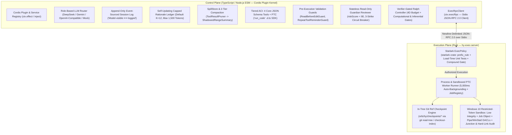

# HY-HARNESS

*   **Author:** Antigravity & User
*   **Status:** Approved (Post-EGM Review & Resolution)
*   **Date:** 2026-11-02

--------------------------------------------------------------------------------

## Overview

HY-HARNESS is a Windows 10-first autonomous coding agent harness that pairs a TypeScript control plane (built on the `cordis` plugin kernel) with a Rust execution daemon (`hy-exec-server`). It provides an extensible runtime for autonomous software engineering that prevents side-effect leaks on Windows 10, reduces prompt token consumption through tiered Programmatic Tool Calling (`PTC`), preserves project constraints across context compactions, and enforces independent verification gates before accepting task completion.

## The Problem

Existing open-source coding agent harnesses fail under five specific operational conditions:

1.  **Windows 10 Sandbox Incompleteness and Process Crashes:** OpenAI Codex (`openai/codex`) relies on a monolithic Rust core that requires recompilation to extend, and its Windows container backend (Microsoft xContainers / MXC) requires Windows 11 24H2+. DeepSeek Harness (`deepseek-ai/deepseek-harness`) runs on Windows 10 via `WRITE_RESTRICTED` tokens and Low Integrity levels, but exhibits four documented defects: (a) Node.js (`libuv`) grandchild processes fail with `EPERM` on stdio pipes, (b) child processes crash with `STATUS_DLL_INIT_FAILED` (`0xC0000142`) due to missing `WinSta0` and desktop read permissions, (c) pre-existing NTFS hard links or directory junctions inside the workspace can modify files outside the workspace, and (d) eager full-tree ACL traversal stalls startup for tens of seconds on large repositories.
2.  **Multi-Step Tool Token Bloat:** Exposing dozens of tools as individual JSON Schemas in the Agent-Computer Interface (`ACI`) consumes thousands of prompt tokens per turn and forces the model to round-trip every intermediate search or file-read output through the conversation history.
3.  **Context Rationale Erosion:** When a long conversation is compacted into a summary, the summarizer often keeps surface actions while dropping the underlying reasoning or constraints (`Context Rationale Erosion`). In subsequent turns, the model violates constraints it previously honored.
4.  **Unverified Worker Self-Declaration:** Goal-driven fresh-agent loops such as DeepSeek Harness's `ralph` rely on the worker model's self-declaration to end the loop. Without an independent verifier or hard token/cost/time budgets, a worker can claim completion while tests fail or recurse indefinitely.
5.  **Side-Effect Leakage on Cancellation or Failure:** When a delegated turn or subagent times out or crashes mid-execution, partial file edits remain in the working tree, leaving the repository in a broken state. Creating full `git worktree` copies on every sequential round on Windows NTFS introduces high disk I/O overhead and invalidates untracked build caches (`node_modules`, `target`).

HY-HARNESS addresses these problems by combining a `cordis`-based TypeScript control plane with a Rust execution daemon (`hy-exec-server`) over JSON-RPC 2.0. The Rust daemon enforces Starlark command policies with load-time unit tests, applies Windows 10 Restricted Tokens with explicit pipe/desktop DACLs and junction/hard-link checks, auto-backgrounds shell commands after 5,000 ms (configurable default), and takes in-tree Git ref checkpoints (`refs/hy/checkpoints/`) for sub-500 ms rollback without mutating `HEAD` or losing untracked build caches.

## Goals

*   **Zero-Admin Windows 10 Process Confinement:** Execute child processes under non-elevated Windows 10 Restricted Tokens, Low Integrity levels, and Job Objects without triggering `libuv` pipe `EPERM` or `STATUS_DLL_INIT_FAILED` errors, while blocking writes through cross-boundary NTFS directory junctions (`std::fs::canonicalize`) and hard links (`nNumberOfLinks > 1`) and failing closed on unsupported split-filesystem policies.
*   **Token-Saving Tiered Tool Presentation:** Limit wire-level JSON Schema tools to 4 atomic operations (`read_file`, `apply_patch`, `bash`, `run_code`) and expose all extended capabilities (`search`, `jobs`, `rationale`, `objective`) as compact TypeScript `.d.ts` declarations executed inside an isolated `run_code` subprocess.
*   **Deterministic Rationale Preservation Across Compactions:** Provide a model-updatable Capped Rationale Ledger (`tools.rationale.upsert`, `tools.rationale.supersede`, defaulting to $K=12$ active entries and 1,500 tokens max) that bypasses summarization and re-projects directly below the system prompt after compaction.
*   **Deterministic & Inferential Completion Gates:** Reject worker self-declared completion in `verifier-ralph` unless both a Computational Gate (test suite, typechecker, linter) and an Inferential Gate (a read-only `Grader` model reviewing the objective, Rationale Ledger, and fenced `git diff`) pass within a 4-dimensional budget (rounds, tokens, USD cost, wall-clock time).
*   **Fast (< 500 ms) In-Tree Rollback on Windows NTFS:** Snapshot and restore workspace state on round timeout or crash using Git ref checkpoints (`refs/hy/checkpoints/<run-id>/r<N>`) via `git read-tree` and `git checkout-index -f -a` while preserving `HEAD` and untracked `node_modules` and `target` directories.
*   **Role-Based Multi-Provider LLM Routing:** Allow independent configuration of DeepSeek, Gemini, and OpenAI-compatible models for `worker`, `guardian`, `grader`, and `compactor` roles in `.hy-harness/config.json`.

## Non-Goals

*   **Browser Web GUI:** Building a React/Vite web frontend or browser slot system is out of scope for the initial implementation.
*   **Always-On Webhook Daemon (`hy-superagent`):** Polling external GitHub/Feishu webhooks and managing a SQLite ticket outbox are deferred; the initial deliverable is a local CLI and JSON-RPC 2.0 server (`hy-cli`).
*   **Mandatory Windows 11 MXC Dependency:** Requiring Windows 11 24H2+, Hyper-V, or WSL2 to run sandboxed commands is a non-goal (MXC is treated only as a future optional backend when present).

## Open Questions

*   None (all baseline architectural questions and Goldfish review findings have been resolved).

## Critical User Journeys (CUJs)

### CUJ 1: Multi-Step Codebase Refactoring via Tiered PTC (`run_code`)

*   **Given**: A user runs `hy-cli` on a Windows 10 repository with a configured `worker` model and requests a multi-file interface refactoring.
*   **When**: The model needs to locate matching files, search symbol occurrences, and inspect signatures. Instead of issuing 15 separate turns, the model invokes `run_code` with an async TypeScript script calling `tools.search.glob()` and `tools.search.grep()`.
*   **Then**: The control plane transpiles the TypeScript code to JavaScript and requests `hy-exec-server` (`ptc/run`) to spawn the `hy-ptc-worker` subprocess under a Restricted Token, Job Object, and `--permission --allow-fs-read=<worker_runtime_dir>`. Each `tools.*` sub-call is multiplexed as newline-delimited JSON-RPC 2.0 over the worker's DACL-configured `stdin`/`stdout` pipes back to the host's `ToolRuntime` pipeline, returning only the script's final `return` value and captured `logs` to the model's context log.

### CUJ 2: Self-Updating Rationale Preservation Across Compaction

*   **Given**: During a long debugging session, the model discovers that a legacy module must not import ESM-only packages and records this rule via `tools.rationale.upsert({ key: "legacy-cjs-constraint", rule: "...", rationale: "..." })`.
*   **When**: Conversation history exceeds 75% of the model's context window (configurable default) and triggers Compaction (`ToolResultPruner` -> `ShadowedRangeSummary`).
*   **Then**: Older turns are shadowed in the JSONL log by a `compaction/summary` event, while the active Capped Rationale Ledger ($K \le 12$) is injected verbatim below the system prompt on the next turn without passing through the summarizer LLM.

### CUJ 3: Verifier-Gated Objective Loop with Timeout Rollback & Gate Handoff

*   **Given**: A user launches an autonomous objective via `hy ralph` (`verifier-ralph`) with a verification command (`npm test`), a 5-round limit, and a \$2.00 cost budget.
*   **When**: Round 1's fresh child worker modifies 4 files and either times out/crashes mid-edit, or finishes its turn (`claim_complete`).
*   **Then**:
    *   **If the worker times out or crashes:** `hy-exec-server` terminates the round's Job Object, restores tracked files from `refs/hy/checkpoints/<run-id>/r1` via `git read-tree` + `git checkout-index -f -a`, removes newly created untracked files while keeping `node_modules` intact, and discards Round 1's uncommitted session events.
    *   **If the worker claims completion:** HY-HARNESS runs the Stage 1 Computational Gate (`npm test`) followed by the Stage 2 Inferential Gate (read-only `Grader` inspecting `<untrusted_git_diff>` and `<untrusted_test_output>`). If both gates pass, `verifier-ralph` finalizes the working tree state and prunes `refs/hy/checkpoints/<run-id>/*`. If either gate fails, completion is rejected: working tree edits are retained (unless `Grader` sets `rollbackRecommended: true`), `refs/hy/checkpoints/<run-id>/r2` is snapshotted, Round 1's rationale entries are prefixed with `[Round 1]`, and the structured failure digest is passed to Round 2's fresh child worker.

--------------------------------------------------------------------------------

## Technical Plan (Architecture)

HY-HARNESS splits responsibilities across two fault-isolated physical planes connected by a newline-delimited JSON-RPC 2.0 stream over standard I/O:

1.  **Control Plane (`packages/*`, TypeScript / Node.js ESM):** Built on the published `cordis` npm plugin framework, where every subsystem is a plugin registering services, typed events, and revertible cleanup effects (`ctx.effect`). Capabilities follow a 3-part seam contract: **Service Definition** (interfaces), **Service Provider** (implementation), and **Consumer** (model-facing tools or CLI commands).
2.  **Execution & Isolation Plane (`crates/*`, Rust 2024 Edition):** A compiled native binary (`hy-exec-server`) enforcing `#![deny(clippy::unwrap_used, clippy::expect_used, clippy::print_stdout, clippy::print_stderr)]` and logging diagnostics exclusively to `std::io::stderr` via `tracing-subscriber`. It owns Starlark policy evaluation, Windows 10 process sandboxing, 5,000 ms command auto-backgrounding, unified-diff patching, and Git ref checkpoint management.



### 1. Cordis Kernel Wrapper, Configuration & Event-Sourced Session Log (`packages/core`)

*   **Cordis Lifecycle & Service Seams:** `packages/core` imports `cordis` from npm and registers typed services (`ctx.execRpc`, `ctx.llm`, `ctx.sessionLog`, `ctx.tools`, `ctx.spillStore`, `ctx.guardian`). Every plugin mounts via `apply(ctx)` and registers prompt sections, tools, or event listeners through `ctx.effect(() => { ...; return disposer; })`.
*   **Configuration Contract (`.hy-harness/config.json`):** Configuration is resolved in precedence order: CLI flags > environment variables > `.hy-harness/config.json` > built-in defaults.
    ```typescript
    export interface HyConfig {
      roles: Record<"worker" | "guardian" | "grader" | "compactor", {
        provider: "deepseek" | "gemini" | "openai-compatible" | "mock";
        model: string;
        apiKeyEnv?: string;
        baseUrl?: string;
      }>;
      policyPath: string; // default: ".hy-harness/policies/default.star"
      limits: {
        rationaleMaxEntries: number;   // default: 12
        rationaleMaxTokens: number;    // default: 1500
        foregroundTimeoutMs: number;   // default: 5000
        spillThresholdBytes: number;   // default: 32768 (32 KB)
        spillThresholdTokens: number;  // default: 8000
        compactionTriggerRatio: number;// default: 0.75 (75% of model context window)
        maxParallelSubCalls: number;   // default: 10
      };
      budget4D: {
        maxRounds: number;      // default: 5
        maxTotalTokens: number; // default: 500000
        maxCostUsd: number;     // default: 2.00
        maxWallClockMs: number; // default: 1800000 (30 min)
      };
    }
    ```
*   **Append-Only Session Log & Typed Events:** The single source of truth for a conversation is `session.v1.jsonl`. Every model request is constructed by a pure projection function `deriveMessages(events)`. Token counts for budget and ledger caps are estimated deterministically via `estimateTokens(text) = Math.ceil(Buffer.byteLength(text, "utf8") / 4)`.
    ```typescript
    export interface RationaleEntry {
      key: string;
      rule: string;
      rationale: string;
      updatedAtStep: number;
      roundPrefix?: string; // e.g. "[Round 1]" when retained across a rejected round
    }

    export interface SessionEventMap {
      "turn/start": { turnId: string; round?: number; timestamp: number };
      "turn/end": { turnId: string; status: "completed" | "cancelled" | "error"; timestamp: number };
      "step/start": { stepIndex: number; timestamp: number };
      "step/end": { stepIndex: number; usage: { inputTokens: number; outputTokens: number; costUsd: number } };
      "user/message": { content: string };
      "assistant/message": { content: string; reasoningContent?: string; toolCalls?: Array<{ id: string; name: string; args: unknown }> };
      "tool/call": { callId: string; name: string; args: unknown; stepIndex: number };
      "tool/result": { callId: string; name: string; output: string; isError: boolean; spillRef?: SpillRef };
      "rationale/upsert": { key: string; rule: string; rationale: string; stepIndex: number; roundPrefix?: string };
      "rationale/supersede": { oldKey: string; newKey: string; rule: string; rationale: string; stepIndex: number };
      "compaction/summary": { shadowedUpToStep: number; summaryMarkdown: string; stepIndex: number };
    }
    ```
*   **Capped Rationale Ledger:** `deriveActiveRationaleLedger(events)` folds `rationale/upsert` and `rationale/supersede` events into an active map of at most $K=12$ entries ($\le 1,500$ tokens). When inserting a new key would exceed $K=12$ or 1,500 tokens, the entry with the lowest `updatedAtStep` (`least-recently-updated`) is evicted from the active map. During compaction, active ledger entries bypass the summarizer LLM and are rendered verbatim into the `system:rationale-ledger` prompt section.

### 2. Token-Saving Tiered ACI & Isolated PTC Runtime (`packages/core`, `packages/seams`)

*   **4 Core JSON Schema Tools:** Only four atomic tools are serialized into the LLM API's `tools` array:
    1.  `read_file({ path: string, startLine?: number, endLine?: number }) -> { content: string, totalLines: number, truncated: boolean }` (also reads `.hy-harness/spill/*` files).
    2.  `apply_patch({ patch: string }) -> { appliedFiles: string[], summary: string }`: Enforces `ReadBeforeEditGuard` (rejecting modifications to existing files not yet read via `read_file` in the current session, while exempting newly created files that do not yet exist on disk) and delegates unified-diff application, UTF-8/line-offset verification, and built-in `.json`/`.toml` syntax validation to `hy-exec-server`.
    3.  `bash({ command: string, cwd?: string, timeoutMs?: number }) -> { status: "completed" | "backgrounded", exitCode?: number, stdout: string, stderr: string, jobId?: string }`: Enforces the 5,000 ms foreground deadline; commands still running after 5,000 ms transition into `JobRegistry` and return `{ status: "backgrounded", jobId, stdout, stderr }`.
    4.  `run_code({ code: string, description: string }) -> { status: "ok" | "error", value?: unknown, error?: string, logs: string[] }`: Executes a TypeScript programmatic tool calling (`PTC`) script against the `tools` namespace.
*   **`tools:sdk` and Sandboxed `run_code` Execution over Stdio JSON-RPC:** Extended tools (`tools.search.grep`, `tools.search.glob`, `tools.jobs.status`, `tools.jobs.wait`, `tools.jobs.kill`, `tools.rationale.upsert`, `tools.rationale.supersede`, `tools.objective.claimComplete`) are rendered into TypeScript `.d.ts` declarations (`declare namespace tools { ... }`) by `jsonSchemaToTs()` and injected into the system prompt. When `run_code` is invoked:
    1.  The host strips TypeScript types (`ts.transpileModule` / `stripTypeScriptTypes`) to produce plain JavaScript.
    2.  `hy-exec-server` (`ptc/run`) spawns `node --permission --allow-fs-read=<worker_runtime_dir> worker.mjs` under the Windows 10 Restricted Token (`ReadOnly` policy) and Job Object, with zero network (`--allow-net` omitted) or child-process permissions.
    3.  `worker.mjs` communicates with `hy-exec-server` over its DACL-configured `stdin`/`stdout` pipes using newline-delimited JSON-RPC 2.0 (`ptc/toolCall`, `ptc/toolResult`, `ptc/log`, `ptc/complete`), avoiding Win32 `fd 3` incompatibilities and Node `--permission` Named Pipe blocks.
    4.  The host's `ToolRuntime` synchronizes concurrent sub-calls using an async Reader-Writer lock (`RwLock`): up to `maxParallelSubCalls = 10` concurrent read-only calls (`isConcurrencySafe: true`) may run in parallel, while mutating calls acquire an exclusive write lock.

### 3. JSON-RPC 2.0 Wire Contract, Windows 10 Sandbox & Starlark ExecPolicy (`crates/*`)

*   **JSON-RPC 2.0 Protocol (`crates/hy-protocol`):** Communication between TypeScript (`ctx.execRpc`) and `hy-exec-server` uses newline-delimited JSON-RPC 2.0 over `stdio`:
    *   Methods: `exec/command`, `job/status`, `job/wait`, `job/kill`, `patch/apply`, `checkpoint/create`, `checkpoint/rollback`, `policy/evaluate`, `ptc/run`.
    *   Standard Error Codes: `-32001` (`PolicyDenied`), `-32002` (`SandboxViolation`), `-32003` (`PatchConflict`), `-32004` (`CheckpointError`).
*   **Starlark Policy with Load-Time Unit Tests & Compound Operator Gate (`crates/hy-execpolicy`):** Uses the `starlark` crate to evaluate `.star` policy files (`prefix_rule(pattern, decision, justification, match, not_match)` and `host_executable(name, paths)`).
    *   At startup, `load_and_verify_policy(path)` runs all embedded `match` and `not_match` test cases and fails closed by returning an error if any assertion mismatches.
    *   `pub fn evaluate(&self, command: &str) -> PolicyDecision` (`Allow`, `Prompt`, `Deny`) enforces a **Fail-Closed Compound Operator Gate**: if `command` contains any shell chaining, pipeline, redirection, or subshell characters (`&`, `|`, `;`, `` ` ``, `$(`, `>`, `<`), it immediately returns `PolicyDecision::Prompt` (unless matched by an explicit `Deny` rule). Simple single commands are tokenized into `argv` and matched against `prefix_rule` patterns (`Deny > Prompt > Allow`, defaulting unmatched commands to `Prompt`).
*   **Windows 10 Non-Elevated Confinement (`crates/hy-sandbox-windows`):**
    1.  **Token & Integrity:** Duplicates the primary process token via `CreateRestrictedToken` (`DISABLE_MAX_PRIVILEGE | WRITE_RESTRICTED`, omitting `LUA_TOKEN` for Windows 10 Built-in Administrator compatibility) and sets the integrity level to Low (`S-1-16-4096`).
    2.  **Suspended Spawn & Job Object Binding:** Strips sensitive host environment variables (`*_API_KEY`, `*_TOKEN`, `*_SECRET`, `AWS_*`, `GITHUB_TOKEN`), spawns the child process via `CreateProcessAsUserW` with `CREATE_SUSPENDED | CREATE_UNICODE_ENVIRONMENT`, binds the process handle to a Windows Job Object (`JOB_OBJECT_LIMIT_KILL_ON_JOB_CLOSE`), and then calls `ResumeThread` so no grandchild process can escape before Job Object assignment.
    3.  **Explicit Pipe & Desktop DACLs:** Constructs explicit `SECURITY_DESCRIPTOR` DACLs on the child's `stdin`/`stdout`/`stderr` pipes and grants `WINSTA_READATTRIBUTES | WINSTA_ACCESSGLOBALATOMS` on `WinSta0` and `DESKTOP_READOBJECTS | DESKTOP_ENUMERATE` on the active desktop to the restricted logon SID and Low Integrity SID, preventing `libuv` pipe `EPERM` and `STATUS_DLL_INIT_FAILED` (`0xC0000142`).
    4.  **`WorkspaceWrite` Brokering, NTFS Junction Canonicalization & Hard-Link Audit:** Instead of running slow $O(N)$ recursive ACL traversals over `node_modules/`, child shell processes receive write DACL + Low Mandatory Integrity ACE only on `.hy-harness/tmp`. All workspace file modifications go through `patch/apply` in `hy-exec-server`, which first checks `std::fs::canonicalize(target).starts_with(canonical_workspace_root)` (blocking NTFS directory junctions `mklink /J`) and then queries `GetFileInformationByHandle`. If `nNumberOfLinks > 1`, it enumerates all links via `FindFirstFileNameW` / `FindNextFileNameW`, prepends the volume drive root from `GetVolumePathNameW`, and rejects the operation with `-32002` (`SandboxViolation`) if any link resolves outside `workspace_root`.

### 4. Stateless Guardian Reviewer & Verifier-Gated Ralph Loop (`packages/seams`, `crates/hy-exec-server`)

*   **Stateless Read-Only Guardian Reviewer:** Commands returning `PolicyDecision::Prompt` from `hy-execpolicy` are routed to `ctx.guardian`. `Guardian` executes a single-turn, stateless read-only classification call using the `guardian` role model (`approval_policy = never`, zero mutating tools) and returns `{ approved: boolean, riskScore: number, reason: string }` (approving when `riskScore < 80`). After 3 consecutive rejections (`TooManyDenials`), `Guardian` escalates to an interactive terminal prompt in CLI mode or aborts the round in headless `ralph` mode.
*   **In-Tree Git Ref Checkpoints:** Before each round $N$ of `verifier-ralph`, `hy-exec-server` (`checkpoint/create`) copies `.git/index` to `.git/hy-checkpoints/<run-id>/r<N>.index`, sets `GIT_INDEX_FILE` to that path, runs `git add -u` + `git write-tree` + `git commit-tree` stored at `refs/hy/checkpoints/<run-id>/r<N>`, and records pre-existing untracked paths (`git ls-files --others --exclude-standard`) to `.git/hy-checkpoints/<run-id>/r<N>.untracked.json`.
    *   To roll back (`checkpoint/rollback`), `hy-exec-server` first terminates all processes in the round's Job Object to release open file handles, then runs `git read-tree refs/hy/checkpoints/<run-id>/r<N>` + `git checkout-index -f -a` and deletes newly created untracked files in a 3-attempt loop with a 100 ms sleep, leaving `HEAD` and ignored build caches (`node_modules/`, `target/`) untouched.
*   **Two-Stage Independent Verification Gate:** A fresh child worker signals `claim_complete` either by finishing a turn with zero tool calls or by invoking `tools.objective.claimComplete({ summary })` inside `run_code`. `verifier-ralph` evaluates the claim through two sequential stages:
    1.  **Stage 1 (Computational Gate):** Runs the configured verification commands (`--verify-cmd`, e.g., test suite, typechecker, linter) via `hy-exec-server`.
    2.  **Stage 2 (Inferential Gate):** Invokes the `grader` role model in a read-only context with the original Objective, active `Rationale Ledger`, and XML-fenced `<untrusted_git_diff>` and `<untrusted_test_output>` blocks, enforcing the JSON response schema `{ pass: boolean, unmetCriteria: string[], rollbackRecommended: boolean, reasoning: string }`.

--------------------------------------------------------------------------------

## Alternatives Considered

### Alternative A: Pure TypeScript / Node.js Monolith (No Rust Execution Daemon)

*   **Pros**: Single language toolchain (`pnpm`), no JSON-RPC IPC boundary, simpler packaging.
*   **Cons**: Managing Windows 10 Win32 Security APIs (`CreateRestrictedToken`, `CreateProcessAsUserW`, `SetEntriesInAclW`, `GetFileInformationByHandle`, `FindFirstFileNameW`, Job Objects, `WinSta0` DACLs) from Node.js requires custom C++ native addons requiring external build toolchains (`node-gyp`) or high-overhead PowerShell invocations. As documented in DeepSeek Harness's Windows sandbox notes, this leads to `libuv` pipe `EPERM` failures and multi-second startup stalls.
*   **Reason for Rejection**: Rejected because Windows 10 process confinement, junction/hard-link auditing, and Starlark policy evaluation with compiler-enforced invariants (`deny(unwrap_used)`) require native systems programming APIs provided by a compiled Rust daemon (`hy-exec-server`).

### Alternative B: Pure Rust Monolith (OpenAI Codex Style)

*   **Pros**: Single compiled binary, uniform memory model, zero IPC overhead between the agent loop and OS sandbox.
*   **Cons**: Every change to prompt assembly, compaction heuristics, LLM provider adapters, or validation guards requires recompiling the Rust workspace. It forfeits `cordis`'s dynamic plugin lifecycle and revertible cleanup effects (`ctx.effect`) and requires implementing cross-language FFI bindings to generate and bridge TypeScript `.d.ts` SDKs for PTC (`run_code`).
*   **Reason for Rejection**: Rejected because a TypeScript/`cordis` control plane avoids binary recompilation during control-plane and prompt iteration and provides native TypeScript SDK generation.

### Alternative C: Full `git worktree` Duplication for Every Ralph Round

*   **Pros**: Complete directory isolation per round without mutating the primary working tree until final completion.
*   **Cons**: On Windows 10 NTFS, checking out a new worktree for a large repository takes seconds to minutes, triggers Windows Defender real-time scanning across thousands of files, and leaves the new worktree without untracked `node_modules/` or Rust `target/` caches—forcing every fresh child round to re-run package installation and cold builds.
*   **Reason for Rejection**: Rejected for sequential rounds in favor of in-tree Git ref checkpoints (`refs/hy/checkpoints/`), which snapshot and restore tracked files in under 500 ms without mutating `HEAD` while preserving local build caches.

### Alternative D: Simultaneous Full JSON Schema + Full PTC Exposure (`Hybrid` All-Tools Mode)

*   **Pros**: The model can invoke any tool either directly via JSON tool-call blocks or programmatically inside `run_code`.
*   **Cons**: Doubles system prompt token consumption by sending both full JSON Schemas and full TypeScript `.d.ts` declarations on every turn, and causes models to oscillate between single-step calls and scripts.
*   **Reason for Rejection**: Rejected in favor of **Tiered PTC** (only 4 core JSON Schema tools on the wire; all extended tools exposed exclusively as `.d.ts` declarations inside `run_code`), prioritizing token economy and clear tool-selection heuristics.

--------------------------------------------------------------------------------

## Risks & Mitigations

| Risk / Failure Mode | Impact | Concrete Mitigation in HY-HARNESS |
| :--- | :--- | :--- |
| **1. Windows 10 Low-Integrity Ambient Read & Outbound Network Access** | Low Integrity (`S-1-16-4096`) blocks writes to Medium Integrity objects, but Windows 10 does not block reads of world/user-readable files or outbound TCP sockets at the token level. | Strip all host secret environment variables (`*_API_KEY`, `*_TOKEN`, `*_SECRET`, `AWS_*`, `GITHUB_TOKEN`) before spawning child processes; enforce Starlark rules blocking network exfiltration binaries (`curl`, `Invoke-WebRequest`, `ssh`, `scp`) unless approved; disable `--allow-net` in `hy-ptc-worker`. |
| **2. NTFS Directory Junctions (`mklink /J`) & Hard-Link Escapes** | A file inside a directory junction has `nNumberOfLinks == 1` yet points outside `workspace_root`; hard links (`nNumberOfLinks > 1`) can cross workspace boundaries. | Check `std::fs::canonicalize(target).starts_with(canonical_workspace_root)` before every write/patch to block directory junctions, and audit `GetFileInformationByHandle` (`nNumberOfLinks > 1`) + `FindFirstFileNameW` (with `GetVolumePathNameW` drive prefix) to block cross-boundary hard links. |
| **3. Windows NTFS File Locking (`ERROR_SHARING_VIOLATION`) During Rollback** | Backgrounded build/test processes or Windows Defender holding open file handles cause `git checkout-index` or file deletion to fail with `0x20` (`EBUSY`). | Terminate the current round's Windows Job Object (`JOB_OBJECT_LIMIT_KILL_ON_JOB_CLOSE`) before initiating rollback to close all child file handles immediately, then run file restoration in a 3-attempt loop with a 100 ms delay. |
| **4. Shell Command Chaining Bypass in `execpolicy`** | Raw string prefix rules can be bypassed via `safe_cmd && dangerous_cmd`, pipelines (`|`), or subshells (`$()`). | Enforce a Fail-Closed Compound Operator Gate in `hy-execpolicy`: any command string containing `[&|;`$()<>]` immediately returns `PolicyDecision::Prompt` (or `Deny`). |
| **5. Indirect Prompt Injection Against the Stage 2 `Grader`** | Malicious or hallucinated comments in modified code or test output attempt to instruct `Grader` to output `pass: true`. | Wrap `git diff` and test logs in `<untrusted_git_diff>` and `<untrusted_test_output>` XML tags with system instructions to ignore embedded directives, and validate `Grader` output against a strict JSON schema. |

--------------------------------------------------------------------------------

## Non-Functional Requirements

*   **Security & Confinement:**
    *   `hy-exec-server` must fail closed by returning an error if any Starlark `match` / `not_match` unit test fails at load time or if a requested filesystem policy cannot be enforced by the active OS backend.
    *   `run_code` scripts must execute in a separate Restricted-Token subprocess (`node --permission --allow-fs-read=<worker_runtime_dir>`) with direct network and child-process APIs disabled.
*   **Performance & Token Budget:**
    *   Wire-level tool schema overhead must remain under 1,200 tokens per turn (4 core tools + compact `tools:sdk` `.d.ts` declarations).
    *   The Capped Rationale Ledger defaults to at most $K=12$ active entries and 1,500 tokens.
    *   In-tree Git ref checkpoint creation and rollback target $< 500\text{ ms}$ on repositories with up to 10,000 tracked files in benchmark runs.
*   **Reliability & Process Hygiene:**
    *   Foreground shell commands exceeding 5,000 ms (configurable default) must automatically transition to background jobs without blocking the event loop.
    *   Terminating a job, cancelling a turn, rolling back a round, or shutting down `hy-exec-server` must terminate the entire descendant process tree via the Windows Job Object (`JOB_OBJECT_LIMIT_KILL_ON_JOB_CLOSE`).
*   **Rollout & Operational Recovery:**
    *   All session logs (`session.v1.jsonl`), spill files (`.hy-harness/spill/`), and temporary Git index files (`.git/hy-checkpoints/`) are scoped to local project directories and can be cleanly reset by removing `.hy-harness/` and `git update-ref -d` on `refs/hy/checkpoints/*`.
    *   `hy policy-test <path.star>` validates custom Starlark policy files offline before agent execution begins.

--------------------------------------------------------------------------------

## Additional Resources

*   **Deep Research Report:** [report.md](file:///C:/Users/%E5%B7%9D%E9%87%8E%E5%89%B5%E5%A4%AA/research/hy-harness/report.md)
*   **Mechanically Verified Source Extracts:** [report.html](file:///C:/Users/%E5%B7%9D%E9%87%8E%E5%89%B5%E5%A4%AA/research/hy-harness/report.html)
*   **EGM Brainstorm Concept Brief:** [concepts_brief.md](file:///g:/%E3%83%9E%E3%82%A4%E3%83%89%E3%83%A9%E3%82%A4%E3%83%96/HY-HARNESS/concepts_brief.md)
*   **Japanese Implementation Plan (v2.0):** [hy-harness-implementation-plan.md](file:///g:/%E3%83%9E%E3%82%A4%E3%83%89%E3%83%A9%E3%82%A4%E3%83%96/HY-HARNESS/docs/designs/hy-harness-implementation-plan.md)

## Future Improvements

*   **POSIX Sandbox Backend (`crates/hy-sandbox-posix`):** Add Linux Bubblewrap (`bwrap`) + Seccomp and macOS Seatbelt (`/usr/bin/sandbox-exec`) adapters behind the execution daemon's sandbox trait.
*   **Multi-Language Stdio LSP Seam (`packages/seams/lsp`):** Add optional stdio language server lifecycle management (`typescript-language-server`, `rust-analyzer`, `pyright`) exposing `tools.lsp.*` inside `run_code`.
*   **Web GUI & Slot Architecture:** Add a browser client consuming the JSON-RPC event stream to visualize `SessionEvent` trees, `Guardian` risk scores, and `verifier-ralph` round diffs.
*   **Proactive Repository Daemon (`hy-superagent`):** Add a SQLite transactional `Engine` and durable `Outbox` plugin to listen to GitHub webhooks and open pull requests only after automated gate verification passes.
*   **Windows 11 24H2+ MXC Process Container Backend:** Automatically detect `IsProcessContainerSupported` on Windows 11 24H2+ hosts to enable kernel process-container read isolation alongside the Windows 10 Restricted-Token backend.

--------------------------------------------------------------------------------

## Detailed Implementation Plan

The implementation is partitioned into **6 sequential phases (Phase 0–Phase 5)** across **4 Rust crates** and **3 TypeScript packages** (consolidated per `ACT-M1` to eliminate monorepo boilerplate while preserving `cordis` plugin modularity). Each phase ends with a mandatory build and test checkpoint.

### Phase 0: Monorepo Foundation & JSON-RPC 2.0 Protocol

#### 1. `Cargo.toml` ([Create])

*   **Type / Scope**: Rust Workspace Manifest
*   **Proposed Changes**:
    *   Define workspace members: `crates/hy-protocol`, `crates/hy-execpolicy`, `crates/hy-sandbox-windows`, `crates/hy-exec-server`.
    *   Define shared workspace dependencies: `serde`, `serde_json`, `tokio` (`full`), `starlark`, `tracing`, `tracing-subscriber` (`env-filter`, `fmt`), `sha2`, `tempfile`, and `windows-sys` (with features `Win32_Foundation`, `Win32_Security`, `Win32_Security_Authorization`, `Win32_Storage_FileSystem`, `Win32_System_JobObjects`, `Win32_System_Threading`, `Win32_System_StationsAndDesktops`).
    *   Configure workspace-wide Clippy lints: `unwrap_used = "deny"`, `expect_used = "deny"`, `print_stdout = "deny"`, `print_stderr = "deny"`.

#### 2. `package.json` & `pnpm-workspace.yaml` & `tsconfig.base.json` ([Create])

*   **Type / Scope**: TypeScript Monorepo Root Configuration
*   **Proposed Changes**: Configure `pnpm` workspaces for `packages/core`, `packages/seams`, and `packages/hy-cli`. Set strict TypeScript ESM compiler options (`module: "NodeNext"`, `target: "ES2023"`, `strict: true`, `exactOptionalPropertyTypes: true`).

#### 3. `crates/hy-protocol/Cargo.toml` & `crates/hy-protocol/src/lib.rs` ([Create])

*   **Type / Scope**: Rust JSON-RPC 2.0 Wire Schema Library
*   **Proposed Changes**:
    *   Define JSON-RPC 2.0 envelopes (`JsonRpcRequest`, `JsonRpcResponse`, `JsonRpcError` with error codes `-32001` `PolicyDenied`, `-32002` `SandboxViolation`, `-32003` `PatchConflict`, `-32004` `CheckpointError`).
    *   Define strongly typed payloads for all 9 methods:
        *   `exec/command`: `ExecCommandRequest { command: String, cwd: Option<PathBuf>, timeout_ms: Option<u64>, policy: SandboxExecutionPolicy }`, `ExecCommandResult { status: ExecStatus, exit_code: Option<i32>, stdout: String, stderr: String, job_id: Option<String> }`.
        *   `job/status`, `job/wait`, `job/kill`: `JobStatusRequest { job_id: String }`, `JobWaitRequest { job_id: String, timeout_ms: Option<u64> }`, `JobKillRequest { job_id: String }`, `JobInfoResult { job_id: String, running: bool, exit_code: Option<i32>, stdout_delta: String, stderr_delta: String }`.
        *   `patch/apply`: `ApplyPatchRequest { workspace_root: PathBuf, patch: String }`, `ApplyPatchResult { applied_files: Vec<String>, summary: String }`.
        *   `checkpoint/create`, `checkpoint/rollback`: `CheckpointCreateRequest { repo_root: PathBuf, run_id: String, round: u32 }`, `CheckpointCreateResult { ref_name: String, commit_oid: String }`, `CheckpointRollbackRequest { repo_root: PathBuf, run_id: String, round: u32 }`.
        *   `policy/evaluate`: `PolicyEvalRequest { command: String }`, `PolicyEvalResult { decision: PolicyDecision, justification: Option<String> }`.
        *   `ptc/run`: `PtcRunRequest { js_code: String, timeout_ms: u64 }`.
*   **Phase 0 Exit Checkpoint**: `cargo check --workspace` and `pnpm install` succeed.

---

### Phase 1: Rust Execution Daemon, Starlark Policy & Windows 10 Sandbox

#### 4. `crates/hy-execpolicy/Cargo.toml` & `crates/hy-execpolicy/src/lib.rs` & `.hy-harness/policies/default.star` ([Create])

*   **Type / Scope**: Rust Starlark Policy Engine & Default Policy
*   **Proposed Changes**:
    *   Implement Starlark evaluation using the `starlark` crate for `prefix_rule(pattern, decision, justification, match, not_match)` and `host_executable(name, paths)`.
    *   Implement `load_and_verify_policy(path: &Path) -> Result<ExecPolicy, PolicyError>` which runs all embedded `match` and `not_match` test cases at load time and fails closed by returning `PolicyError::UnitTestFailed` if any assertion mismatches.
    *   Implement `pub fn evaluate(&self, command: &str) -> PolicyEvalResult`: enforce the **Fail-Closed Compound Operator Gate** (returning `PolicyDecision::Prompt` immediately if `command` contains any character in `[&|;`$()<>]`, unless matched by an explicit `Deny` rule) and match tokenized `argv` prefixes (`Deny > Prompt > Allow`, defaulting unmatched commands to `Prompt`).
    *   Create `.hy-harness/policies/default.star` with verified `match` / `not_match` rules for read-only Git/search commands (`allow`), build/test commands (`allow`), network/destructive commands (`prompt` or `deny`).

#### 5. `crates/hy-sandbox-windows/Cargo.toml` & `crates/hy-sandbox-windows/src/lib.rs` ([Create])

*   **Type / Scope**: Rust Windows 10 Confinement Backend
*   **Proposed Changes**:
    *   Implement `WindowsRestrictedSandbox` using `windows-sys` (`CreateRestrictedToken` with `DISABLE_MAX_PRIVILEGE | WRITE_RESTRICTED`, Low Integrity SID `S-1-16-4096`).
    *   Implement `sanitize_environment(env)` to strip `*_API_KEY`, `*_TOKEN`, `*_SECRET`, `AWS_*`, and `GITHUB_TOKEN`.
    *   Implement `spawn_restricted_process()` calling `CreateProcessAsUserW` with `CREATE_SUSPENDED | CREATE_UNICODE_ENVIRONMENT`, binding the process to `JobObjectGuard` (`JOB_OBJECT_LIMIT_KILL_ON_JOB_CLOSE`), and calling `ResumeThread`.
    *   Implement `create_sandboxed_stdio_pipes()` and `grant_winsta_desktop_read()` to attach explicit DACLs for the restricted SID on stdio pipes, `WinSta0`, and the active desktop, preventing `libuv` pipe `EPERM` and `STATUS_DLL_INIT_FAILED` (`0xC0000142`).
    *   Implement `verify_safe_workspace_target(path: &Path, workspace_root: &Path) -> Result<(), SandboxError>`:
        1. Verify `std::fs::canonicalize(path)` (or parent directory for new files) starts with `std::fs::canonicalize(workspace_root)` to block NTFS directory junctions (`mklink /J`).
        2. Open existing target files and query `GetFileInformationByHandle`. If `nNumberOfLinks > 1`, enumerate all links via `FindFirstFileNameW` / `FindNextFileNameW`, prepend the drive root from `GetVolumePathNameW`, and reject with `SandboxError::HardLinkEscape` if any link resolves outside `workspace_root`.

#### 6. `crates/hy-exec-server/Cargo.toml` & `crates/hy-exec-server/src/main.rs` & `crates/hy-exec-server/src/checkpoint.rs` & `crates/hy-exec-server/src/patch.rs` ([Create])

*   **Type / Scope**: Rust JSON-RPC 2.0 Execution Daemon, Checkpoint Engine & Patcher
*   **Proposed Changes**:
    *   Initialize `tracing_subscriber::fmt().with_writer(std::io::stderr).init()` so all daemon diagnostics go strictly to `stderr`.
    *   In `checkpoint.rs`, implement `create_ref_checkpoint(repo_root, run_id, round)`:
        1. Copy `.git/index` to `.git/hy-checkpoints/<run_id>/r<round>.index` and set `GIT_INDEX_FILE` to that temporary path (preventing the empty-index bug).
        2. Run `git add -u`, `git write-tree`, and `git commit-tree`, storing the commit at `refs/hy/checkpoints/<run_id>/r<round>`.
        3. Record untracked paths via `git ls-files --others --exclude-standard` into `.git/hy-checkpoints/<run_id>/r<round>.untracked.json`.
    *   In `checkpoint.rs`, implement `rollback_to_checkpoint(repo_root, run_id, round, job_registry)`:
        1. Terminate all active jobs in `job_registry` (closing child Job Objects to release Windows NTFS file locks).
        2. In a 3-attempt loop with a 100 ms sleep, run `git read-tree refs/hy/checkpoints/<run_id>/r<round>` and `git checkout-index -f -a`, and delete untracked files not present in `r<round>.untracked.json` while leaving `HEAD` and `node_modules/`/`target/` untouched.
    *   In `patch.rs`, implement `apply_unified_patch(workspace_root, patch)` calling `verify_safe_workspace_target` on every target path, applying unified diff hunks atomically, and validating UTF-8 and `.json`/`.toml` syntax when applicable.
    *   In `main.rs`, implement the `tokio` stdio JSON-RPC 2.0 server, the 5,000 ms foreground timer that transitions long-running processes into `JobRegistry`, and the `ptc/run` bridge that spawns `hy-ptc-worker` (`node --permission --allow-fs-read=<worker_runtime_dir> worker.mjs`) and relays its stdio JSON-RPC tool sub-calls.
*   **Phase 1 Exit Checkpoint**: `cargo test --workspace` and `cargo clippy --workspace --all-targets -- -D warnings` pass with zero warnings.

---

### Phase 2: Cordis Control Plane, Session Log & Rationale Ledger

#### 7. `packages/core/package.json` & `packages/core/src/index.ts` ([Create])

*   **Type / Scope**: TypeScript Core Control Plane Package (`cordis`, `ExecRpcClient`, `SessionLog`, `LlmRouter`, `SystemPrompt`, `ToolRuntime`, `AgentLoop`)
*   **Proposed Changes**:
    *   `src/cordis.ts`: Export typed `Context`, `Service`, and plugin helpers wrapping the `cordis` npm package (`ctx.effect`, service injection, and event dispatch).
    *   `src/config.ts`: Implement `loadHyConfig()` resolving CLI flags > env vars > `.hy-harness/config.json` > defaults.
    *   `src/exec-rpc.ts`: Implement `ExecRpcClient` (`ctx.execRpc`) spawning `hy-exec-server` over stdio, framing newline-delimited JSON-RPC 2.0 requests/responses, correlating IDs, and relaying `ptc/toolCall` requests during `ptc/run`.
    *   `src/session-log.ts`: Implement `SessionEventMap`, append-only JSONL persistence (`session.v1.jsonl`), `estimateTokens(text) = Math.ceil(Buffer.byteLength(text, "utf8") / 4)`, `deriveMessages(events)`, and `deriveActiveRationaleLedger(events)` enforcing the $K=12$ / 1,500-token cap with `updatedAtStep` (`least-recently-updated`) eviction.
    *   `src/llm-router.ts`: Implement `ctx.llm` supporting `deepseek`, `gemini`, `openai-compatible`, and deterministic `mock` (`MockLlmProvider` for offline unit/integration testing) across `worker`, `guardian`, `grader`, and `compactor` roles with token and USD cost accounting.
    *   `src/system-prompt.ts`: Implement upward `AGENTS.md` / `AGENTS.override.md` discovery from `cwd` to `.git` root and assemble ordered `PromptSection`s (including `system:rationale-ledger` and `tools:sdk`).
*   **Phase 2 Exit Checkpoint**: `pnpm --filter @hy-harness/core test` passes (covering `cordis` plugin unloading, `SessionLog` projection, `RationaleLedger` $K=12$ eviction, and `MockLlmProvider` routing).

---

### Phase 3: Tiered ACI, Pre-Execution Guards & Isolated PTC Runtime

#### 8. `packages/core/src/tools.ts` & `packages/core/src/agent-loop.ts` ([Create])

*   **Type / Scope**: TypeScript 4 Core Tools, Validation Guards & Turn/Step Driver
*   **Proposed Changes**:
    *   In `src/tools.ts`, register the 4 wire-visible core tools (`read_file`, `apply_patch`, `bash`, `run_code`) and implement the Pre-Execution Validation Guards:
        *   `ReadBeforeEditGuard`: Reject `apply_patch` on existing disk files not yet read in the current session, while exempting newly created files that do not yet exist on disk.
        *   `RepeatToolReminderGuard`: Inject a warning reminder when identical tool calls with identical arguments are repeated consecutively.
    *   Implement an async Reader-Writer lock (`AsyncRwLock`) in `ToolRuntime` allowing up to `maxParallelSubCalls = 10` concurrent read-only calls (`isConcurrencySafe: true`) and exclusive single-writer execution for mutating calls.
    *   In `src/agent-loop.ts`, implement the turn/step state machine enforcing `Budget4D` (`maxRounds`, `maxTotalTokens`, `maxCostUsd`, `maxWallClockMs`) prior to each model step and detecting natural turn completion (`claim_complete` when the assistant emits zero tool calls).

#### 9. `packages/seams/package.json` & `packages/seams/src/ptc-runtime.ts` & `packages/seams/src/ptc-worker.mjs` ([Create])

*   **Type / Scope**: TypeScript Tiered PTC Runtime, `.d.ts` Generator & Restricted Worker Script
*   **Proposed Changes**:
    *   Implement `jsonSchemaToTs()` to convert registered PTC-only tools (`tools.search.grep`, `tools.search.glob`, `tools.jobs.status`, `tools.jobs.wait`, `tools.jobs.kill`, `tools.rationale.upsert`, `tools.rationale.supersede`, `tools.objective.claimComplete`) into compact `declare namespace tools { ... }` declarations.
    *   Implement the `run_code` handler: strip TypeScript types on the host (`ts.transpileModule`), invoke `ctx.execRpc.call("ptc/run", { js_code, timeout_ms })`, service incoming `ptc/toolCall` requests through `ToolRuntime` (under `AsyncRwLock`), and return `{ status, value, error, logs }`.
    *   Implement `ptc-worker.mjs` (zero external dependencies) which wraps `tools.*` Proxy calls into newline-delimited JSON-RPC 2.0 messages over `process.stdout` / `process.stdin`, intercepts `console.log`/`warn`/`error` into `ptc/log` notifications, executes the transpiled async script body, and emits `ptc/complete`.
*   **Phase 3 Exit Checkpoint**: `pnpm --filter @hy-harness/seams test` verifies `.d.ts` codegen, `ReadBeforeEditGuard` new-file exemption, and `run_code` stdio JSON-RPC sub-calls under `--permission`.

---

### Phase 4: SpillStore, 2-Tier Compaction & Stateless Guardian

#### 10. `packages/seams/src/spill-compaction.ts` & `packages/seams/src/guardian.ts` ([Create])

*   **Type / Scope**: TypeScript SpillStore, Compaction & Stateless Read-Only Guardian Plugins
*   **Proposed Changes**:
    *   In `src/spill-compaction.ts`:
        *   Implement `ctx.spillStore` to write tool outputs exceeding `spillThresholdBytes` (32 KB) or `spillThresholdTokens` (8,000 tokens) to `.hy-harness/spill/<session-id>/<call-id>.txt` and return a head/tail preview + `SpillRef { spillId, path, byteLength, totalLines }` readable via `read_file`.
        *   Implement 2-tier Compaction triggered when context usage exceeds `compactionTriggerRatio` (75% of model context window): (1) `ToolResultPruner` (replacing old bulky tool outputs with compact locators) and (2) `ShadowedRangeSummary` via the `compactor` role model, preserving the active `Rationale Ledger` ($K \le 12$) verbatim.
    *   In `src/guardian.ts`:
        *   Implement `ctx.guardian` as a stateless single-turn read-only classification call bound to the `guardian` LLM role (`approval_policy = never`, zero mutating tools), returning `{ approved: boolean, riskScore: number, reason: string }` (approving when `riskScore < 80`).
        *   Track consecutive denials per turn; when 3 consecutive denials occur (`TooManyDenials`), escalate to a terminal prompt in interactive CLI mode or abort the round in headless `ralph` mode.
*   **Phase 4 Exit Checkpoint**: `pnpm --filter @hy-harness/seams test` passes (verifying 32 KB spill offloading, compaction preserving $K=12$ rationale rules, and Guardian 3-strike circuit breaker).

---

### Phase 5: Verifier-Gated Ralph, CLI Entrypoint & End-to-End Integration Tests

#### 11. `packages/seams/src/verifier-ralph.ts` ([Create])

*   **Type / Scope**: TypeScript Verifier-Gated Objective Loop
*   **Proposed Changes**:
    *   Implement the `verifier-ralph` orchestration loop:
        1. Call `ctx.execRpc.call("checkpoint/create", { repo_root, run_id, round })` to create `refs/hy/checkpoints/<run-id>/r<round>`.
        2. Spawn a fresh child agent session with `verifier-ralph` excluded from its tool scope (preventing recursive invocation).
        3. **On child timeout, crash, or abort:** Call `checkpoint/rollback` to restore `r<round>` (terminating the round's Job Object first) and discard uncommitted round session events.
        4. **On `claim_complete`:** Execute Stage 1 Computational Gate (`--verify-cmd` via `exec/command`) and Stage 2 Inferential Gate (invoking the `grader` role model with Objective + active `Rationale Ledger` + `<untrusted_git_diff>` + `<untrusted_test_output>`, validating `{ pass: boolean, unmetCriteria: string[], rollbackRecommended: boolean, reasoning: string }`).
        5. **If both gates pass:** Finalize the in-tree state and delete temporary `refs/hy/checkpoints/<run-id>/*`.
        6. **If either gate fails:** If `rollbackRecommended === true`, roll back to `r<round>`; otherwise keep working tree edits so Round $N+1$ can fix the failing test, prefix Round $N$'s rationale entries with `[Round N]`, and pass the structured failure digest into Round $N+1$.

#### 12. `packages/hy-cli/package.json` & `packages/hy-cli/src/index.ts` ([Create])

*   **Type / Scope**: TypeScript CLI & JSON-RPC Server Entrypoint
*   **Proposed Changes**:
    *   Compose all `@hy-harness/core` and `@hy-harness/seams` plugins, spawn and supervise `hy-exec-server`, load `.hy-harness/config.json` and `.hy-harness/policies/default.star`, and expose 4 CLI subcommands:
        *   `hy run "<prompt>" [--model <role=provider:model>] [--config <path>]`
        *   `hy ralph "<objective>" --verify-cmd "<cmd>" [--max-rounds <N>] [--max-cost-usd <F>] [--config <path>]`
        *   `hy rpc-server [--config <path>]`
        *   `hy policy-test <path.star>`

#### 13. `tests/integration/win10-sandbox.test.ts` & `tests/integration/verifier-ralph.test.ts` ([Create])

*   **Type / Scope**: End-to-End Integration Test Suite
*   **Proposed Changes**:
    *   `win10-sandbox.test.ts`: Verify non-elevated Windows 10 Restricted-Token execution of Node.js child/grandchild processes without `EPERM` or `0xC0000142`, verify host secret env sanitization, verify rejection of writes through NTFS directory junctions (`mklink /J`) and cross-boundary hard links, verify Starlark load-time unit test failure handling and compound operator gating, and verify 5,000 ms auto-backgrounding.
    *   `verifier-ralph.test.ts`: Verify Capped Rationale Ledger ($K=12$) survival across compaction, verify `hy-ptc-worker` stdio JSON-RPC execution under `--permission`, verify rejection of false worker `claim_complete` by Computational and Inferential gates, and verify deterministic Git ref checkpoint rollback (`git read-tree` + `git checkout-index`) preserving `HEAD` and `node_modules/`.
*   **Phase 5 Exit Checkpoint**: `pnpm test:integration` passes on Windows 10.

### Verification Plan

*   **Compilation/Build**: `cargo build --workspace` and `pnpm -r build` must succeed with zero warnings.
*   **Unit Tests**: `cargo test --workspace` (covering `hy-execpolicy` Starlark unit tests and compound operator gate, `hy-sandbox-windows` DACL/junction/hard-link checks, and `hy-exec-server` ref checkpoint creation/rollback) and `pnpm -r test` (covering `cordis` `ctx.effect` unwinding, `SessionLog` deterministic projection, `RationaleLedger` $K=12$ eviction, `ReadBeforeEditGuard` new-file exemption, and `jsonSchemaToTs` generation using `MockLlmProvider`).
*   **Static Analysis & Linting**: `cargo clippy --workspace --all-targets -- -D warnings` (enforcing `deny(unwrap_used, expect_used, print_stdout, print_stderr)`) and `pnpm -r typecheck`.
*   **Test Coverage Requirement**: 85%+ line and branch coverage across `crates/hy-execpolicy`, `crates/hy-exec-server`, `packages/core`, and `packages/seams`.
*   **E2E/Integration & Benchmarks**: `pnpm test:integration` running `tests/integration/win10-sandbox.test.ts` and `tests/integration/verifier-ralph.test.ts` on Windows 10; separate benchmark script `pnpm bench:checkpoint` verifying $< 500\text{ ms}$ checkpoint creation/rollback latency.
