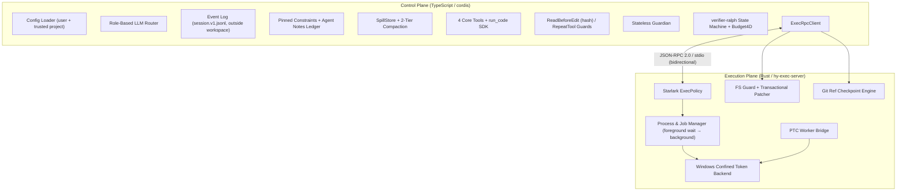

# HY-HARNESS

*   **Author:** Antigravity & User (Rev 3 refinement: Claude)
*   **Status:** Approved — Rev 3.1 (Rev 3 approved by the user on 2026-11-02; supersedes Rev 2, because Rev 3 changes the sandbox model, the checkpoint algorithm and the completion protocol. Rev 3.1 adds the Phase 1 spike decisions A–F, approved by the user on 2026-11-02)
*   **Date:** 2026-11-02
*   **Change log vs. Rev 2:** see [refinement_notes.md](refinement_notes.md). **Rev 3 → 3.1:** [ADR 0001](docs/adr/0001-windows-sandbox.md) §6 (A: protected directories exist before the grant and are checked before every git call; B: private temp outside `AppData` plus an ancestor-readability check; C: `low-integrity` sandbox mode; D: non-ACL volumes reported as a gap; E: revoke by SID walk; F: `hy-ptc-worker` in an AppContainer). Claims marked *measured (ADR 0001)* come from the spike, not from a primary source
*   **Evidence:** every factual claim marked `[V:<id>]` is backed by a mechanically checked extract in [verification/verification_report.md](verification/verification_report.md) (95/95 extracts match their cited lines). Claims with no `[V:]` tag are design decisions, proven by the phase exit tests.
*   **Working copy:** `F:\HY-HARNESS` (exFAT). Finished deliverables are copied to `G:\マイドライブ\HY-HARNESS` (Google Drive).

--------------------------------------------------------------------------------

## Overview

HY-HARNESS is a Windows 10-first autonomous coding agent harness that pairs a TypeScript control plane (built on the `cordis` plugin kernel) with a Rust execution daemon (`hy-exec-server`). It:

*   confines **writes** of model-issued commands to the workspace and explicitly granted roots on non-elevated Windows 10, using a write-restricted token shape whose behavior is documented in the DeepSeek Harness primary source (`[sources/dsh_note_sandbox_win.md:13, 43]`);
*   reduces prompt token consumption through tiered Programmatic Tool Calling (PTC);
*   preserves user-stated constraints and model-recorded notes across context compactions;
*   rejects worker self-declared completion unless independent computational and inferential gates pass;
*   restores the working tree after a failed or cancelled round from in-tree Git ref checkpoints, touching only the files that changed.

It does **not**, in v1, confine reads or network access of model-issued commands on Windows 10 (see *Trust Model*). This is stated up front because it determines which repositories HY-HARNESS may safely run against unattended.

## The Problem

Existing open-source coding agent harnesses fail under five operational conditions. Claims about third-party projects cite the verified extracts in `report.html`; anything not backed by an extract is marked *[unverified]*.

1.  **Windows 10 sandbox incompleteness.** OpenAI Codex's Windows container backend (MXC) requires Windows 11 24H2+ (`[sources/dsh_note_sandbox_win.md:31]`). DeepSeek Harness runs on Windows 10 with `WRITE_RESTRICTED` + Low Integrity tokens but reports `enforcement: 'partial'`: (a) libuv piped-stdio grandchildren fail with `EPERM` because named-pipe opens are denied, (b) children created with `CREATE_NO_WINDOW` / `CREATE_NEW_CONSOLE` die with `STATUS_DLL_INIT_FAILED` (`0xC0000142`), (c) NTFS hard links share one security descriptor, so a granted workspace hard link grants an external alias, and (d) eager `SetNamedSecurityInfoW` propagation stalls the first run for tens of seconds on large workspaces (`[sources/dsh_note_sandbox_win.md:13, 43]`).
2.  **Multi-step tool token bloat.** Exposing dozens of tools as individual JSON Schemas consumes thousands of prompt tokens per turn and forces every intermediate result through the conversation.
3.  **Context rationale erosion.** Compaction summaries keep surface actions and drop the constraints behind them; the model then violates constraints it previously honored.
4.  **Unverified worker self-declaration.** Fresh-agent loops such as DeepSeek Harness's `ralph` end on the worker's own claim; without an independent verifier and hard budgets, a worker can claim completion while tests fail, or loop indefinitely.
5.  **Side-effect leakage on cancellation or failure.** A timed-out or crashed round leaves partial edits in the working tree. Full `git worktree` copies per round are slow on NTFS and discard untracked build caches (`node_modules`, `target`).

## Goals

Each goal names the test that proves it (see *Verification Plan*).

1.  **Zero-admin write confinement on Windows 10.** Model-issued commands in `workspace-write` mode can create, modify and delete files only under the workspace root and granted roots (private temp, user-approved extra roots), including deletes through parent `FILE_DELETE_CHILD`, and cannot write `.git/` or `.hy-harness/`. Known partial gaps (hard-link aliases, named-pipe grandchildren) are detected and reported, never silently ignored. *Proof:* `win10-sandbox` matrix.
2.  **Token-saving tiered tool presentation.** Four wire-level JSON Schema tools (`read_file`, `apply_patch`, `shell`, `run_code`); all extended capabilities exposed only as `.d.ts` declarations inside `run_code`. Total tool + SDK overhead ≤ 1,200 tokens per request, measured with each configured provider's reported usage. *Proof:* `tool-overhead` test.
3.  **Constraint preservation across compaction.** User-pinned constraints (from `AGENTS.md` / `--rule`) and up to K = 12 model notes (≤ 1,500 tokens) are re-projected verbatim after every compaction; nothing is evicted silently. *Proof:* ledger survival test.
4.  **Gated completion.** `verifier-ralph` accepts completion only when the computational gate and then the inferential gate pass, within a four-dimensional budget (rounds, tokens, USD, wall-clock) that includes every role's usage. *Proof:* false-claim rejection tests.
5.  **Fast, change-proportional rollback.** Checkpoint creation completes in < 750 ms and rollback in < 500 ms on a 10,000-tracked-file repository with ≤ 200 changed files (local NTFS SSD, Defender on) (*revised 2026-11-03 from < 500 ms for both: creation must hash every changed file and write a new loose object for each, and Defender scans each new file; measured ~610–650 ms after the stat cache*), touch only changed paths, preserve `HEAD`, the user's staging area and ignored build caches. *Proof:* `bench:checkpoint`.
6.  **Role-based multi-provider routing.** DeepSeek, Gemini and OpenAI-compatible models are configurable independently for `worker`, `guardian`, `grader` and `compactor`.

## Non-Goals

*   **Read and network confinement of model-issued commands on Windows 10 (v1).** A write-restricted token keeps the caller's ambient read access, and Windows 10 offers no per-process outbound network block without administrator rights. Mitigations are listed in *Trust Model*; full confinement is a Future Improvement (MXC / AppContainer offline mode).
*   **Running hostile code safely.** HY-HARNESS limits accidents and casual prompt injection; it is not a multi-tenant sandbox.
*   **Non-ACL workspaces.** Workspaces on volumes without persistent ACLs (exFAT, FAT32, cloud-sync virtual drives such as Google Drive for desktop, which reports FAT32) are refused in `workspace-write` mode `[V:W-4]`. *(Revised 2026-11-03 by user decision, ADR 0001 §5.3: such workspaces are now allowed in `workspace-write` as Codex does, the ACL grant is skipped and the whole volume is writable; the `non-acl-volumes` gap is still reported.)* Confined commands can still *write* to such volumes elsewhere on the machine (no ACL can stop them); this is reported as the gap `non-acl-volumes` (§4.2 item 7).
*   **Concurrent human edits during `hy ralph`.** The run holds the working tree; rollback would overwrite concurrent edits. The CLI warns and records this.
*   **Browser web GUI**, **always-on webhook daemon (`hy-superagent`)**, **JSON-RPC server mode for external clients (`hy rpc-server`)**, and a **mandatory Windows 11 MXC dependency** — all deferred (see *Future Improvements*).

## Trust Model & Security Boundaries

| Principal | Trusted? | What it can do | Boundary that limits it |
| :--- | :--- | :--- | :--- |
| User (CLI, user config `%APPDATA%\hy-harness\config.json`, user policy) | Yes | Everything | — |
| Control plane + `hy-exec-server` | Yes (same user, unconfined) | Spawns, writes, checkpoints | Code review; they never execute model text directly |
| Project files (`AGENTS.md`, `.hy-harness/config.json`, `.hy-harness/policies/*.star`) | **No, until the user trusts the project** | Add prompt text; tighten policy; set non-sensitive limits | Untrusted project config cannot set `baseUrl`, `apiKeyEnv`, `extraWritableRoots`, `sandbox = "unconfined"` rules or `allow` rules. Trust is recorded per canonical path + config hash in user config |
| Worker / guardian / grader / compactor models | No | Request tool calls | Exec policy → Guardian/user approval → OS sandbox → checkpoints |
| Tool output, file contents, test output, diffs | No | Influence models | Fenced as untrusted wherever they reach a guardian or grader |
| Model-written ledger notes | No | Persist text across compaction and rounds | Rendered as model-authored notes, never as system rules; never given to the grader as criteria |

**Defense layers, in order:** (1) Starlark exec policy — an approval-reduction layer, *not* a security boundary (an allowed `npm test` executes model-editable code); (2) Guardian or user approval for `prompt` decisions; (3) the OS sandbox — the actual write boundary; (4) checkpoints — recovery for everything inside the workspace.

**Accepted v1 residual risks:** sandboxed commands can read any file the user can read (e.g. `~/.ssh`, `.npmrc` auth tokens, credential-manager caches), can open outbound connections, and can write to any volume without persistent ACLs (exFAT/FAT32 drives such as `F:` and `G:` here, USB sticks) — *measured (ADR 0001 §5.3)*. Commands in the `low-integrity` mode can additionally write other sessions' granted roots and `%USERPROFILE%\AppData\LocalLow` (§4.2 item 1). Mitigations: environment **allowlist** (not denylist), secrets never in the child environment, the default policy prompts for known network clients, and the CLI requires `--unattended-ok` for headless `hy ralph` on projects the user has not marked trusted.

## Open Questions (resolved)

All five were resolved on 2026-11-02: the user accepted every recommendation as written below. The IDs stay because later sections cite them. The measurements they waited on were made by the Phase 1 spike ([ADR 0001](docs/adr/0001-windows-sandbox.md)) and are recorded under OQ-1 and OQ-2.

*   **OQ-1 Shell dialect for the `shell` tool** (blocked Phase 2). *Decided:* PowerShell 7 (`pwsh -NoLogo -NoProfile -NonInteractive -Command`), falling back to Windows PowerShell 5.1; Git Bash offered only if the Phase 1 spike shows MSYS2 runs under the confined token. DeepSeek Harness ships a pwsh executor for the same token shape (`[sources/dsh_note_sandbox_win.md:13]`). The Rev 2 tool name `bash` is replaced by `shell` because the dialect is not bash. *Measured (ADR 0001 S-2/S-4):* Windows PowerShell 5.1 and `cmd` run in `workspace-write`; MSYS2 does not (`0xC0000142`: creating its directory object in `\BaseNamedObjects` is denied, and without the Low label `CreateFileMapping` is denied instead). It runs only with neither the Low label nor restricting SIDs, i.e. unconfined. **Git Bash is therefore not offered** in any confined mode.
*   **OQ-2 What runs when the confined token cannot run a toolchain** (blocked Phase 4). The primary source reports that libuv piped-stdio grandchildren fail with `EPERM` under this token shape, with no fix in that design (`[sources/dsh_note_sandbox_win.md:43]`). Test runners that fork Node workers over pipes/IPC are therefore expected to fail in `workspace-write`; Jest's worker pool uses `child_process` by default and Vitest's default pool is `forks` `[V:R-2c]`. Rust's std creates child stdio pipes through a different path (`NtCreateNamedPipeFile` plus a handle-relative open), so `cargo` may not be affected — spike S-2 measures both, and its results decide which commands need the policy below. *Decided:* the user policy may mark specific verify/build commands `sandbox = "unconfined"` (Job Object + env allowlist + checkpoints, no token restriction); the Computational Gate's `--verify-cmd` runs unconfined only when the user passes it on the command line; Guardian may never approve unconfined execution. (The rejected alternative was "always confined, accept failures".) *Measured (ADR 0001 S-2):* `cargo build`/`cargo test`, `tsc`, `npm test` whose script does not pipe child processes, `git status` and Windows PowerShell 5.1 run in `workspace-write`. Every Node `child_process` call with piped stdio or IPC (`spawn`, `exec`, `execSync`, `fork`) fails with `EPERM`, while `stdio: "inherit"/"ignore"` and `worker_threads` work. The cause is the restricting SIDs: neither the default DACL, the integrity level, extra restricting SIDs (`Users`, `Authenticated Users`) nor keeping Administrators enabled fixes it, and a token with the Low label but no restricting SIDs runs all of them. *Measured (ADR 0001 §7, Jest 30.5.2 / Vitest 5.0.5 / esbuild 0.25.0 / npm install through `hy-exec-server`):* both test runners' **default** invocations and `esbuild`'s Node API (`esbuild.build()`, which spawns `esbuild.exe --service` over piped stdio) fail in `workspace-write` with `spawn EPERM`, while the thread-based settings (Jest `--runInBand` / `--workerThreads`, Vitest `--pool=threads` / `vmThreads`) and the standalone `esbuild` CLI binary pass in `workspace-write`, and all of them pass in `low-integrity`. Default `npm install` fails in both `workspace-write` and `low-integrity` (`npm error code EPERM` on `%LOCALAPPDATA%\npm-cache`), whereas `npm install --cache <ws>/.npm-cache --prefer-offline` passes in both modes when packages do not spawn piped lifecycle scripts. *Decided (ADR 0001 C):* a fourth mode, `low-integrity` (§4.2 item 1), can be named instead of `unconfined` for such commands. It follows the same rules as `unconfined`: honored only from user policy and for the user's own `--verify-cmd`, never approved by Guardian.
*   **OQ-3 Headless runs on untrusted repositories** (blocked Phase 7). Given the read/network residual risk, the choice was between refusing untrusted projects outright and allowing them with `--unattended-ok`. *Decided:* `hy ralph` refuses untrusted projects by default and allows them with `--unattended-ok`.
*   **OQ-4 Completion signal** (blocked Phase 7). *Decided:* explicit `tools.objective.claimComplete({ summary })` only. A text-only reply without a claim is a *stall* (nudge, then count against the round), not a claim. Rev 2 treated every zero-tool-call reply as a claim, which sends questions and refusals into the paid gates.
*   **OQ-5 Ledger overflow behavior** (blocked Phase 6). *Decided:* reject an upsert at the cap with an error listing current keys, so the model must `supersede` or `remove` explicitly. Rev 2 evicted the least-recently-updated entry silently, which reintroduces the erosion the ledger exists to prevent.

## Critical User Journeys (CUJs)

### CUJ 1: Multi-file refactoring via `run_code`

*   **Given** a user runs `hy run "<request>"` in a trusted Windows 10 repository on a local NTFS drive.
*   **When** the model needs to find files, search symbols and read signatures, it calls `run_code` once with a TypeScript script using `tools.search.glob()`, `tools.search.grep()` and `tools.readFile()`.
*   **Then** the control plane strips types, `hy-exec-server` runs the script in `hy-ptc-worker` (a capability-less AppContainer, empty environment, single-process Job Object, Node `--permission` with fs-read limited to the worker runtime directory), each `tools.*` call returns to the host's `ToolRuntime` over newline-delimited JSON-RPC on the worker's stdio, passes the same guards and policy as a direct call, and only the script's `return` value and capped logs enter the model context. Every sub-call is logged as a non-model-visible `ptc/subcall` event.

### CUJ 2: Constraint preservation across compaction

*   **Given** the model learns during debugging that a legacy module must stay CommonJS and records `tools.rationale.upsert({ key: "legacy-cjs", rule: "...", rationale: "..." })`; the repo's `AGENTS.md` also says "never edit `vendor/`".
*   **When** provider-reported input tokens exceed 75 % of the worker model's configured context window.
*   **Then** tier 1 prunes old tool outputs to spill locators; if still above the ratio, tier 2 summarizes older turns via the `compactor` role. The next request renders `<project_constraints>` (pinned, from `AGENTS.md`) and `<agent_notes>` (the model's ledger) verbatim, independent of the summary.

### CUJ 3: Verifier-gated objective loop

*   **Given** `hy ralph "<objective>" --verify-cmd "npm test" --max-rounds 5 --max-cost-usd 2.00` on a trusted, clean-enough repository.
*   **When** Round 1's fresh worker edits four files and then either (a) times out, crashes or exhausts the round budget, or (b) calls `claimComplete`.
*   **Then**
    *   **(a)** `hy-exec-server` kills the round's Job Objects, restores only the changed paths from `refs/hy/checkpoints/<run-id>/r1`, deletes files created since `r1`, restores the user's index, and appends `round/end { outcome: "aborted" }`. Round 2 starts from `r1`'s state.
    *   **(b)** The computational gate runs `npm test`. Only if it passes does the grader run on the objective, pinned constraints, and the fenced cumulative diff since `base` plus test output. Both pass → the run ends `succeeded`, per-round refs are pruned, `base` is kept so `hy undo <run-id>` can revert the whole run. Either fails → edits are kept (unless the grader sets `rollbackRecommended`), `r2` is created, and Round 2 receives a structured failure digest.

### CUJ 4: Undo a finished run

*   **Given** a `hy ralph` run that succeeded or stopped on budget.
*   **When** the user runs `hy undo <run-id>`.
*   **Then** the working tree and index return to the `base` checkpoint using the same change-proportional rollback, and the run's refs are pruned.

--------------------------------------------------------------------------------

## Technical Plan (Architecture)

Two fault-isolated processes connected by newline-delimited JSON-RPC 2.0 over stdio:

1.  **Control plane (`packages/*`, TypeScript, Node.js ESM, `cordis`):** prompt assembly, LLM routing, event log, guards, Guardian, compaction, ledger, PTC host, `verifier-ralph`. Every subsystem is a `cordis` plugin that registers services and disposers via `ctx.effect`. Capabilities follow the seam contract: **Service Definition** → **Service Provider** → **Consumer**.
2.  **Execution plane (`crates/*`, Rust 2024):** `hy-exec-server` owns policy evaluation, the Windows sandbox, process/job management, patch application, filesystem guards and checkpoints. Workspace-wide Clippy lints deny `unwrap_used`, `expect_used`, `print_stdout`, `print_stderr`; diagnostics go to stderr via `tracing-subscriber`, so stdout carries only protocol frames.



### 1. Core: Configuration and Event Log (`packages/core`)

*   **cordis.** Import `cordis` from npm at an exact pinned version behind a thin typed wrapper (`src/cordis.ts`), so an upstream API change touches one file. The registry's `latest` tag is currently a release candidate (`4.0.0-rc.12`) `[V:W-5]`, so pinning means depending on an RC; Phase 0 records the chosen version and re-checks it before Phase 3. Services: `ctx.execRpc`, `ctx.llm`, `ctx.sessionLog`, `ctx.tools`, `ctx.spillStore`, `ctx.guardian`, `ctx.ledger`.
*   **Configuration is split by trust.** Precedence: CLI flags > environment (`HY_*`) > trusted project config > user config > defaults.
    ```typescript
    // %APPDATA%\hy-harness\config.json — user-owned, may hold sensitive settings
    export interface HyUserConfig {
      roles: {
        worker: RoleConfig;            // required
        guardian?: RoleConfig;         // default: worker
        grader?: RoleConfig;           // default: worker (a different provider is recommended)
        compactor?: RoleConfig;        // default: worker
      };
      sandbox: {
        extraWritableRoots: string[];  // e.g. "%USERPROFILE%\\.cargo", "%LOCALAPPDATA%\\npm-cache"
        envPassthrough: string[];      // names added to the built-in env allowlist
      };
      userPolicyPath: string;          // default: "%APPDATA%\\hy-harness\\policy.star"
      trustedProjects: Array<{ path: string; configSha256: string }>;
    }
    export interface RoleConfig {
      provider: "deepseek" | "gemini" | "openai-compatible" | "mock";
      model: string;
      apiKeyEnv?: string;
      baseUrl?: string;
      contextWindowTokens: number;     // required: compaction ratio is relative to this
      maxOutputTokens: number;
      pricing?: { inputPerMTokUsd: number; cachedInputPerMTokUsd?: number; outputPerMTokUsd: number };
    }

    // <workspace>\.hy-harness\config.json — repository-owned, untrusted until trusted
    export interface HyProjectConfig {
      projectPolicyPath?: string;      // default: ".hy-harness/policies/project.star" (tighten-only unless trusted)
      protectedPaths?: string[];       // globs apply_patch and the gates treat as tamper-sensitive
      limits?: Partial<{
        rationaleMaxEntries: number;   // default 12
        rationaleMaxTokens: number;    // default 1500
        foregroundWaitMs: number;      // default 5000
        spillThresholdBytes: number;   // default 32768
        compactionTriggerRatio: number;// default 0.75
        keepRecentTurns: number;       // default 2
        maxParallelSubCalls: number;   // default 10
        maxSubCallsPerRun: number;     // default 200
        runCodeTimeoutMs: number;      // default 120000
      }>;
      budget4D?: Partial<{
        maxRounds: number;             // default 5
        maxTotalTokens: number;        // default 500000
        maxCostUsd: number;            // default 2.00; requires pricing for every used role, else startup fails
        maxWallClockMs: number;        // default 1800000
      }>;
    }
    ```
*   **State lives outside the workspace.** Session logs, spill files, checkpoint index copies and private temp directories live under `%LOCALAPPDATA%\hy-harness\state\<workspace-id>\`, where `workspace-id` is a SHA-256 prefix of the canonical workspace path. This keeps them out of `git status`, out of rollback deletion, out of cloud-sync folders and out of the sandbox's writable roots. Only `.hy-harness/config.json` and `.hy-harness/policies/` stay in the repo, and the sandbox and `apply_patch` cannot write `.hy-harness/`.
*   **Event log.** `session.v1.jsonl` is append-only; each line is an envelope:
    ```typescript
    export interface EventEnvelope<K extends keyof SessionEventMap = keyof SessionEventMap> {
      v: 1;
      seq: number;          // monotonic per log; ledger ordering uses (runId, seq), not stepIndex
      ts: number;
      sessionId: string;
      runId?: string;       // set for verifier-ralph child sessions
      round?: number;
      type: K;
      payload: SessionEventMap[K];
    }
    export interface SessionEventMap {
      "turn/start": { turnId: string };
      "turn/end": { turnId: string; status: "completed" | "cancelled" | "error" | "stalled" };
      "step/end": { stepIndex: number; role: Role; model: string;
                    usage: { inputTokens: number; cachedInputTokens: number; outputTokens: number; costUsd: number } };
      "user/message": { content: string };
      "assistant/message": { content: string; toolCalls?: ToolCall[];
                             providerMeta?: unknown };   // opaque round-trip data, e.g. Gemini thought signatures
      "tool/result": { callId: string; output: string; isError: boolean; spillRef?: SpillRef };
      "ptc/subcall": { parentCallId: string; name: string; args: unknown; isError: boolean; spillRef?: SpillRef }; // logged, not model-visible
      "ledger/upsert": { key: string; rule: string; rationale: string; source: "model" | "pinned" };
      "ledger/supersede": { oldKey: string; newKey: string; rule: string; rationale: string };
      "ledger/remove": { key: string };
      "compaction/summary": { shadowedThroughSeq: number; summaryMarkdown: string };
      "guardian/decision": { callId: string; approved: boolean; riskScore: number; reason: string };
      "round/start": { round: number; checkpointRef: string };
      "round/end": { round: number; outcome: RoundOutcome; digest?: FailureDigest };
      "gate/result": { round: number; stage: 1 | 2; pass: boolean; detail: unknown };
    }
    ```
    Tool calls are recorded once, inside `assistant/message` (Rev 2 also had `tool/call`, a second source of truth). Writes are flushed per event and fsynced at turn end; a truncated last line is ignored on load. Invariant: **model-visible ⟹ logged** — every request can be rebuilt by `deriveMessages(events, promptVersion)`; a hash of the rendered prompt sections is logged per step so a template change is detectable. (Rev 2's "⟺" was false: PTC sub-calls are logged but not model-visible.) Nothing is ever deleted from the log: an aborted round is excluded from projections by its `round/end` event.
*   **Token accounting.** Budgets and the compaction trigger use provider-reported `usage`. `estimateTokens` is used only for pre-flight decisions (clamping `max_tokens`, sizing ledger entries), with per-provider coefficients: `ceil(asciiChars × a + nonAsciiChars × b)`. Defaults come from provider documentation where it exists (DeepSeek: a = 0.3, b = 0.6 `[V:M-8]`) and are corrected at runtime by the ratio of reported `usage` to the estimate. Rev 2's single `bytes / 4` is biased differently per language and provider (for DeepSeek it under-counts English and over-counts CJK), so one fixed formula is not used.

### 2. Tiered ACI and PTC (`packages/core`, `packages/seams`)

*   **Four wire tools.**
    1.  `read_file({ path, startLine?, endLine? }) → { content, totalLines, truncated, sha256 }` — paths must resolve (after canonicalization) under the workspace or this session's spill directory. Records `{ path, sha256 }` for the edit guard. Note that this confinement is for consistency only: `shell` can read anything the user can.
    2.  `apply_patch({ patch }) → { appliedFiles, created, deleted, warnings }` — see §4.4.
    3.  `shell({ command, cwd?, foregroundWaitMs?, hardTimeoutMs? }) → { status: "completed" | "backgrounded", exitCode?, stdout, stderr, jobId? }` — `foregroundWaitMs` (default 5,000) is when the call returns and the process keeps running as a job; `hardTimeoutMs` (default none for jobs, 10 min for foreground) is when it is killed. stdin is always `NUL`.
    4.  `run_code({ code, description }) → { status: "ok" | "error", value?, error?, logs }`.
*   **Guards (before execution).**
    *   `ReadBeforeEditGuard`: an `apply_patch` hunk on an existing file is rejected unless the file was read this session **and** its current SHA-256 equals the last hash seen by `read_file` or written by `apply_patch`. Hash comparison catches formatter or shell edits made after the read, which a "was read" flag misses. New files are exempt.
    *   `RepeatToolReminderGuard`: identical consecutive calls append a reminder to the result.
*   **`run_code` SDK.** `jsonSchemaToTs()` renders `declare namespace tools { ... }` from the same JSON Schemas the registry dispatches with. Available inside scripts: the core tools (`tools.readFile`, `tools.applyPatch`, `tools.shell`), `tools.search.{glob,grep}`, `tools.jobs.{status,output,wait,kill}`, `tools.rationale.{upsert,supersede,remove}`, `tools.objective.claimComplete`. Each sub-call goes through the same guards, policy and approval path as a direct call.
*   **Execution.**
    1.  Host strips types (`ts.transpileModule`; erasable syntax only) and wraps the body in an async function.
    2.  `ptc/run` spawns `node --preserve-symlinks --preserve-symlinks-main --permission --allow-fs-read=<worker_runtime_dir> ptc-worker.mjs` in a **capability-less AppContainer** (`PROC_THREAD_ATTRIBUTE_SECURITY_CAPABILITIES`; one profile per installation, removed by `hy sandbox revoke`) with a near-empty environment (`SystemRoot`, `windir`, `NUMBER_OF_PROCESSORS`, `OS`, `PROCESSOR_ARCHITECTURE`, and `LOCALAPPDATA`, without which AppContainer process creation fails), inside a Job Object with `ActiveProcessLimit = 1` and `KILL_ON_JOB_CLOSE`; the daemon enforces `runCodeTimeoutMs` by terminating the job. Child-process, worker-thread and addon permissions are not granted. The worker runtime directory grants `ALL APPLICATION PACKAGES` (`S-1-15-2-1`) read/execute. *Measured (ADR 0001 S-5):* inside the container the workspace can be neither read nor written, outbound connections fail (`EACCES`), process creation fails, non-ACL volumes are inaccessible, and Windows points `TEMP` at the container's own directory. `--preserve-symlinks-main` is required because an AppContainer cannot `lstat` `C:\`, so the main-module `realpath` fails; a piped `spawnSync` inside the container hangs and ignores its own timeout, which is why the timeout is enforced on the job. The interaction of `--permission` with the AppContainer is not measured (Phase 5 exit test).
    3.  The worker speaks newline-delimited JSON-RPC on its own stdin/stdout (`ptc/toolCall` → host, `ptc/toolResult` ← host, `ptc/log`, `ptc/complete`). Anonymous pipes created by `hy-exec-server` are inherited; no `fd 3`, no named pipe.
    4.  `ToolRuntime` runs sub-calls under an async reader–writer lock: up to `maxParallelSubCalls` concurrency-safe reads in parallel, mutating calls exclusive. `maxSubCallsPerRun` and `runCodeTimeoutMs` bound a script.
*   **Network inside `run_code`.** Node's permission model gates network only from v25.0.0, where `--allow-net` was added; the v24 docs list fs, child processes, worker threads, addons, WASI and the inspector as restricted, but not network. Node itself describes the model as a "seat belt" that gives no guarantees against malicious code `[V:M-14]`. Therefore: pin a bundled Node ≥ 26 LTS for the worker and treat `--permission` as defense in depth. Since Rev 3.1 the OS boundary is the AppContainer, which (without the `internetClient` capability) also blocks the network, so the worker itself is confined for writes, reads and network. Its sub-calls still run in the host with the session's own sandbox mode.

### 3. JSON-RPC Wire Contract (`crates/hy-protocol`)

*   **Framing:** one UTF-8 JSON object per line, ≤ 16 MiB per message; larger payloads go through spill files referenced by path. Both peers may send requests (server-initiated requests such as `ptc/toolCall` use string IDs prefixed `s:`; client IDs are integers).
*   **Single source of truth:** request/response types are defined in Rust with `serde` + `schemars`; JSON Schemas are emitted at build and TypeScript types generated from them. CI fails if the generated TS differs from the committed copy.
*   **Lifecycle:** `initialize { protocolVersion, workspaceRoot, stateDir, sandbox }` → `{ serverVersion, capabilities: { sandboxBackends, enforcement: "full" | "partial" | "none", gaps: string[] } }`. The workspace root is fixed here; later requests carry no `workspace_root` / `repo_root`, so a confused caller cannot redirect writes. `shutdown` → `exit`. stdin EOF from the control plane = shutdown: all jobs are killed.
*   **Cancellation:** `$/cancelRequest { id }` for any in-flight request (cancelling `exec/command` kills its Job Object).
*   **Methods:**
    | Method | Params → Result |
    | :--- | :--- |
    | `exec/command` | `{ command, cwd?, mode: "agent" \| "gate", foregroundWaitMs?, hardTimeoutMs?, approval?: { by: "user" \| "guardian" \| "policy", callId } }` → `ExecResult`. Policy is enforced **in the server**: a `prompt` decision without `approval` returns `-32001` with `data.decision = "prompt"`; the client obtains approval and retries. `mode: "gate"` never backgrounds. |
    | `job/list`, `job/status`, `job/output`, `job/wait`, `job/kill` | `job/output { jobId, offset }` pages a per-job ring buffer (spilled to disk beyond 1 MiB); `job/exited` is pushed as a notification. |
    | `patch/apply` | `{ patch, dryRun? }` → `{ appliedFiles, created, deleted, warnings }` |
    | `policy/evaluate` | `{ command }` → `{ decision, sandbox, justification?, matchedRule? }` |
    | `checkpoint/create` | `{ runId, label }` → `{ ref, treeOid, headOid, unprotected: string[] }` |
    | `checkpoint/rollback` | `{ runId, label }` → `{ restored, deleted, skipped }` |
    | `checkpoint/diff` | `{ runId, fromLabel, maxBytes }` → `{ stat, patch, truncated }` |
    | `checkpoint/prune` | `{ runId, keep?: string[] }` → `{ deletedRefs }` |
    | `ptc/run` | `{ jsCode, timeoutMs, maxSubCalls }` → `{ status, value?, error?, logs }` (server→client `ptc/toolCall` requests while pending) |
    | `sandbox/status`, `sandbox/grant`, `sandbox/revoke` | ACL state of the workspace and extra roots (used by `hy sandbox`) |
*   **Error codes:** `-32001 PolicyDenied`, `-32002 SandboxViolation`, `-32003 PatchConflict` (with `data: { file, hunk, nearestMatch }`), `-32004 CheckpointError` (with `data.kind`, e.g. `HeadMoved`), `-32005 Cancelled`, `-32006 SandboxUnavailable`.

### 4. Execution Daemon (`crates/hy-execpolicy`, `crates/hy-sandbox-windows`, `crates/hy-exec-server`)

#### 4.1 Starlark exec policy

*   Files: `prefix_rule(pattern, decision, justification, match, not_match, sandbox = None)` and `host_executable(name, paths)`. `sandbox` ∈ {`None` (inherit mode), `"read-only"`, `"workspace-write"`, `"low-integrity"`, `"unconfined"`}, from strictest to loosest.
*   **Layering:** built-in defaults, then user policy, then project policy. Project rules may only add `deny`/`prompt` or stricter sandbox modes unless the project is trusted. `"low-integrity"` and `"unconfined"` are honored only from user policy.
*   **Load-time tests:** `load_and_verify_policy` runs every `match` / `not_match` example and fails closed on any mismatch. `hy policy-test <path>` runs the same offline.
*   **Evaluation:** `evaluate(command) -> PolicyEval`.
    1.  Tokenize with the dialect's quoting rules. If any character outside a **safe set** appears outside quotes — letters (including non-ASCII), digits, whitespace, and `_ - . / \ : = , + * ?` — the command is *compound*. An allowlist of safe characters fails closed for every dialect, unlike Rev 2's denylist `[&|;`$()<>]`, which missed newline, `%` and `^` (cmd), `@`, `{}` and `--%` (PowerShell), and was written two different ways in two sections.
    2.  Compound → `deny` if any `deny` rule's pattern appears as a token-prefix of any segment split on unquoted operators; otherwise `prompt`.
    3.  Simple → match argv prefixes; most restrictive wins (`deny > prompt > allow`); unmatched → `prompt`.
*   **Execution follows evaluation.** A simple command whose `argv[0]` resolves (PATH + PATHEXT) to an executable is spawned directly from the evaluated argv, with no shell, so policy and execution see the same argv. `.cmd`/`.bat` targets go through `cmd.exe /d /s /c` using Rust std's batch-argument escaping (Rust ≥ 1.77.2, the fix for CVE-2024-24576 `[V:M-2]`). Each token is quoted when re-emitted, so cmd's own special characters (`& | ( ) ^ = , ;` …) inside a token are inert. Builtins/cmdlets and approved compound commands go through the dialect shell (OQ-1).
*   **Default policy** (`crates/hy-execpolicy/policies/default.star`, embedded): read-only git/search commands `allow`; `git commit|reset|checkout|switch|rebase|stash|push|update-ref|gc` `deny` for the worker (the run owns `HEAD`); package installs and known network clients (`curl`, `Invoke-WebRequest`, `iwr`, `ssh`, `scp`, `git push`) `prompt`; build/test commands `allow` in `workspace-write` (they run model-editable code, so the sandbox, not the policy, is what limits them).

#### 4.2 Windows confined-token backend (`crates/hy-sandbox-windows`)

The token shape follows the one DeepSeek Harness verified in production (`[sources/dsh_note_sandbox_win.md:13]`), with the gaps it reports fixed or detected. Rev 2's WinSta0/desktop DACL edits are dropped: the primary source attributes `0xC0000142` survival to keeping the logon SID and Everyone in the restricting-SID list, and editing the interactive desktop's DACL would be a session-wide side effect.

1.  **Token.** `CreateRestrictedToken(DISABLE_MAX_PRIVILEGE | WRITE_RESTRICTED)` (no `LUA_TOKEN`, which breaks the built-in Administrator `[V:W-2]`). `BUILTIN\Administrators` goes into `SidsToDisable` (deny-only) when present `[V:W-1]`. Restricting SIDs are checked only for write access, and both access checks must pass `[V:R-2b]`. Restricting SIDs:
    *   `read-only`: [logon SID, Everyone]
    *   `workspace-write`: [logon SID, Everyone, workspace SID, private-temp SID]
    *   `low-integrity` (Rev 3.1, ADR 0001 C): no restricting SIDs and no `WRITE_RESTRICTED`; only `DISABLE_MAX_PRIVILEGE`, Administrators deny-only and the Low label. Writes then succeed exactly where a Low-labeled object also grants the user write access. *Measured (ADR 0001 S-2/S-3):* piped and IPC Node child processes work; writes outside the workspace, to `.git/`, `.hy-harness/`, hard-linked files, through junctions, to the user profile and to `HKCU` are still denied; writes to **other sessions' granted roots** and to `%USERPROFILE%\AppData\LocalLow` succeed, and a read-only variant cannot be expressed. These are reported in `capabilities.gaps` whenever a command runs in this mode.
    The workspace SID is derived deterministically from the canonical workspace path (SHA-256 → `S-1-4-x-y` style, as in the source); the temp SID is random per session. Integrity is set to Low. `TokenDefaultDacl` names the temp SID, so objects the child creates (anonymous pipes, events) stay usable by it and not by sibling sessions.
2.  **Grants.** Each granted root (workspace, private temp, `extraWritableRoots`) gets: an inheritable allow ACE for its SID, a Low no-write-up mandatory label, and a deny-`FILE_DELETE_CHILD` ACE for Everyone, so that parent-directory delete authority — which restricting SIDs do not co-sign — cannot delete outside or across granted roots (`[sources/dsh_note_sandbox_win.md:13]`, `[V:R-3]`). `.git/` and `.hy-harness/` get an inheritable **deny write/delete** ACE for the workspace SID, so the worker cannot rewrite checkpoint refs, policies or config. **Both must exist before the grant** (Rev 3.1, ADR 0001 A): a directory created after the grant inherits the root's allow ACE and Low label, and the spike's confined command appended to such a `.git\config` — enough to plant `core.fsmonitor` or a hook that the harness's next git call would run unconfined. So `hy run`/`hy ralph` create `.hy-harness/` and, if the workspace is not a repository, run `git init` (telling the user) before granting. Before every git invocation, `hy-exec-server` checks that `.git/` and `.git/config` carry neither a Low label nor an allow ACE for a HY-HARNESS capability SID, and fails with `-32002 SandboxViolation` without running git otherwise.
3.  **Propagation — own walker, once, cached.** Instead of `SetNamedSecurityInfoW` auto-propagation, a parallel walker applies explicit ACEs to existing descendants. It does not traverse reparse points (junctions/symlinks), skips `.git/`, and **skips files with `nNumberOfLinks > 1`**, recording them as unprotected-but-not-granted. Skipping is what closes the hard-link alias gap: no ACE is placed on a file object shared with an outside path, so pnpm store links stay read-only to the sandbox instead of rejecting pnpm workspaces outright `[V:R-1b]`. *Measured (ADR 0001 S-1):* skipping closes the gap — a confined write to a pnpm-style hard link was denied and the store was unchanged — and the walk takes 4.4 s for a 100,000-file npm-layout `node_modules` and 1.5 s for the pnpm layout (100,000 links skipped) with 8 threads, Defender on. This replaces the inference `[V:R-1c]`. The walker writes with `SetKernelObjectSecurity` on a handle (no propagation), and must set `SE_DACL_AUTO_INHERIT_REQ` together with `SE_DACL_AUTO_INHERITED`, or the kernel drops the latter. New files inherit from their directory's ACE, so the walk runs once per workspace per machine; completion is recorded in state, `hy sandbox status` reports it, and confined commands wait on it with a progress indicator.
4.  **Spawn.** `CreateProcessAsUserW` (no `SE_ASSIGNPRIMARYTOKEN` needed for a restricted version of the caller's token) with `STARTUPINFOEX` `[V:W-1]`: `PROC_THREAD_ATTRIBUTE_JOB_LIST` assigns the Job Object atomically at creation, and `PROC_THREAD_ATTRIBUTE_HANDLE_LIST` limits inheritance to the three stdio handles, so a child never inherits another job's pipes. Job limits: `KILL_ON_JOB_CLOSE`, no breakaway. Children are never created with `CREATE_NO_WINDOW` or `CREATE_NEW_CONSOLE`; `hy-exec-server` owns a hidden console that children inherit `[V:R-2a]`. *Measured (ADR 0001 S-4):* inherited console, `CREATE_NEW_CONSOLE` + `SW_HIDE`, `CREATE_NO_WINDOW` and ConPTY (`[V:W-3]`) all start `cmd` and Node without `0xC0000142` under this token; the inherited console stays the choice because it is the simplest (ConPTY output capture was not evaluated). A daemon started with `CREATE_NO_WINDOW` has a console but no console window, so `AllocConsole` failing with `ERROR_ACCESS_DENIED` means a console is already attached.
5.  **Environment allowlist.** Children get only `SystemRoot`, `windir`, `ComSpec`, `PATHEXT`, `PATH`, `USERPROFILE`, `HOMEDRIVE`, `HOMEPATH`, `APPDATA`, `LOCALAPPDATA`, `ProgramFiles*`, `ProgramData`, `NUMBER_OF_PROCESSORS`, `PROCESSOR_*`, `OS`, plus `envPassthrough`. `TEMP`/`TMP` point to the private temp directory, which lives at `%USERPROFILE%\.hy-harness\tmp\<session>` — **not** under `%LOCALAPPDATA%` (Rev 3.1, ADR 0001 B; see item 6). Rev 2's denylist (`*_API_KEY`, `*_TOKEN`, …) missed names like `DATABASE_URL`, `*_PASSWORD`, `STRIPE_KEY` and `GOOGLE_APPLICATION_CREDENTIALS`.
6.  **Filesystem check at `initialize`.** `GetVolumeInformationW` must return the `FILE_PERSISTENT_ACLS` flag (and `FILE_SUPPORTS_HARD_LINKS` for the hard-link audit) for the workspace and each granted root; a file-system *name* check is not used. Otherwise `workspace-write` is unavailable (`-32006`) and the reason is shown `[V:W-4]`. This matters on this machine: `F:` (the source tree) is exFAT and `G:` (Google Drive) reports FAT32, and neither has ACLs or hard links. The source tree may live on `F:`, but sandbox and checkpoint integration fixtures must be created on an NTFS volume outside `AppData` (e.g. `%USERPROFILE%\hy-spike-fixture` on `C:`).
    *   **Ancestor readability (Rev 3.1, ADR 0001 B).** *Measured:* a Low-integrity token cannot open — not even for `FILE_READ_ATTRIBUTES` — an object whose DACL has an ACE, applying to the object itself, for a package-format SID (`S-1-15-2-` + 7 sub-authorities); on this machine `%USERPROFILE%\AppData` and `AppData\Local` carry one, so `realpath` of anything under `%TEMP%` fails and `node script.js` there exits with `EPERM`. `initialize` therefore opens every ancestor of the workspace, the private temp and each granted root with `FILE_READ_ATTRIBUTES` while impersonating the confined token; if one fails, `workspace-write` (and `low-integrity`) is unavailable (`-32006`) and the blocking directory is named.
    *   **Non-ACL volumes (Rev 3.1, ADR 0001 D).** `initialize` also enumerates the local drives and lists every volume without `FILE_PERSISTENT_ACLS` in the gap `non-acl-volumes: <drives>`, because confined commands can write there.
7.  **Known gaps reported via `capabilities.gaps`:** named-pipe grandchildren (libuv piped stdio) fail with `EPERM` (OQ-2). Traced to source: libuv creates the pipe with a NULL security descriptor (Everyone: read only) and then reopens it by name with `GENERIC_WRITE`, which the write-restricted second access check denies `[V:R-2b]`. A parent-side pipe DACL cannot fix this, because the sandboxed Node creates these pipes itself; the spike confirmed that no token adjustment fixes it either (ADR 0001 S-2), and `low-integrity` is the per-command way out (OQ-2). Further gaps: reads and network are not confined; files hard-linked into the workspace *after* propagation are not re-audited; non-ACL volumes are writable (item 6); in `low-integrity`, other sessions' granted roots and `LocalLow` are writable (item 1).
8.  **Reversibility.** `hy sandbox revoke` removes every ACE and label HY-HARNESS added, so "reset by deleting `.hy-harness/`" (Rev 2) is no longer the whole cleanup story. **Revoke walks the tree by SID** (Rev 3.1, ADR 0001 E): restoring the walker's recorded SDDL is not enough, because objects created after the grant inherited the ACE and are not in the record (*measured:* 4 such files kept the SID in the spike). Revoke first restores the recorded objects, then walks each root and removes every ACE naming a HY-HARNESS capability SID, plus the Low label on objects that carried one. It also deletes the `hy-ptc-worker` AppContainer profile. *Measured:* after the restore fix, grant → revoke reproduces every recorded SDDL; removing a label leaves `S:NO_ACCESS_CONTROL`, which means the same as no label.

#### 4.3 Process and job manager (`hy-exec-server/src/jobs.rs`)

*   One Job Object per command; a run-level registry maps `runId → jobs` for rollback.
*   Foreground wait → background transition at `foregroundWaitMs` without blocking the tokio runtime; output goes to a ring buffer plus a spill file.
*   `mode: "gate"` commands run to completion under `hardTimeoutMs` and never background.

#### 4.4 FS guard and transactional patcher (`hy-exec-server/src/fs_guard.rs`, `patch.rs`)

*   **Format.** Unified diff, including `/dev/null` creates/deletes and `rename from/to`. Hunk header line numbers are hints: hunks are anchored by context (exact, then whitespace-insensitive), because models produce wrong line numbers more often than wrong context. A failure returns `-32003` with the nearest matching region so the model can correct the patch.
*   **Path checks.** Every target's nearest existing ancestor is canonicalized and must lie under the canonical workspace root; an existing target that is itself a reparse point is rejected; `.git/**`, `.hy-harness/**` and the project's `protectedPaths` are rejected (protected paths: rejected in `hy ralph` unless `--allow-protected-edits`).
*   **Writes run under the confined token.** The patcher thread impersonates a `workspace-write` impersonation token (`DuplicateTokenEx` + `SetThreadToken`), so the OS enforces the same boundary as for `shell` — including against a junction a background job creates between the check and the write (a TOCTOU window that path checks alone cannot close). *Measured (ADR 0001 S-6):* under the impersonation token a write through a junction to the outside is denied (it succeeds without impersonation), and while another thread flipped a workspace directory between a real directory and an outside junction 201 times, 5,913 writes landed inside and none escaped. If the sandbox is unavailable, the path checks remain and the gap is reported.
*   **Transactional, link-safe writes.** All hunks of all files are applied in memory first; then each file is written to a temp file in the same directory and swapped in with `ReplaceFileW` (existing) or `MoveFileExW(MOVEFILE_WRITE_THROUGH)` (new); if a later file fails, earlier ones are restored from their backups. Replacing the directory entry instead of writing in place is expected to *unlink* a hard-linked target rather than write through it, so an outside alias keeps its original content and Rev 2's `FindFirstFileNameW` enumeration becomes unnecessary. This is not stated in Microsoft's documentation and is asserted by a Phase 2 test (`[V:M-11b]`, inference). The result reports `warnings: ["brokeHardLink: <path>"]`. `ReplaceFileW` needs `DELETE` and write access on the file being replaced and carries its ACL over `[V:M-11a]`, so under impersonation a hard-linked file that propagation skipped cannot be patched at all. This is intended (pnpm store links are not edited), and it is reported as a `SandboxViolation` naming the link.
*   **Encoding.** Each file's BOM and dominant line ending (CRLF/LF) are preserved; patch text is matched after EOL normalization. Validation: UTF-8 validity, and parse checks for `.json` / `.toml`. Language-level checks belong to the computational gate.

### 5. Stateless Guardian (`packages/seams/src/guardian.ts`)

*   Invoked only for `prompt` decisions; never for `deny`; never for `sandbox = "unconfined"` or `"low-integrity"`, which need a user policy rule or an interactive user answer.
*   Single-turn call with zero tools: input is the command inside `<untrusted_command>`, cwd, sandbox mode, matched rule and justification, and the run objective. Output schema: `{ decision: "approve" | "deny", riskScore: 0–100, reason }`. Approve iff `decision === "approve"` and `riskScore < guardian.approveBelow` (default 80); a malformed response counts as deny.
*   Denial reasons are returned to the worker as the tool error. Three consecutive denials in a turn → `TooManyDenials`: interactive mode asks the user; headless mode aborts the round (→ rollback).

### 6. Git Ref Checkpoints (`hy-exec-server/src/checkpoint.rs`)

Preconditions: Git for Windows ≥ 2.41 (`--attr-source` / `GIT_ATTR_SOURCE` first appear in the 2.41 release notes `[V:R-4e]`), a non-bare repository, and an identity supplied via environment (`GIT_AUTHOR_NAME/EMAIL`, `GIT_COMMITTER_NAME/EMAIL` = `hy-harness`) so `commit-tree` works without user config. All git invocations use `-c core.autocrlf=false -c core.safecrlf=false -c commit.gpgsign=false` and `GIT_ATTR_SOURCE=<empty tree>`, so content is stored and restored byte-exact with no clean/smudge or LFS filters. Since Rev 3.1 they also pass `-c core.hooksPath=<empty directory in stateDir> -c core.fsmonitor=false`, and run only after the `.git/` check of §4.2 item 2 (ADR 0001 A), so nothing the worker wrote can execute in the harness's git process.

*   **`checkpoint/create(label)`**
    1.  Record `headOid` (or unborn).
    2.  Copy `.git/index` to `<stateDir>/ckpt/<run>/<label>.user.index` (the user's staging area, restored on rollback) and to a work index. Copying keeps the stat cache, so the next step hashes only changed files.
    3.  `GIT_INDEX_FILE=<work> git add -A -- . ":(exclude).hy-harness"` — captures tracked **and** untracked-not-ignored files. Rev 2's `git add -u` + an untracked-path list could not restore pre-existing untracked files the worker modified (measured `[V:R-4a]`). Untracked files larger than `checkpoint.maxUntrackedFileBytes` (default 50 MB) are left out and returned in `unprotected`.
    4.  `git write-tree` → `git commit-tree [-p headOid]` → `git update-ref refs/hy/checkpoints/<run>/<label>`.
*   **`checkpoint/rollback(label)`**
    1.  Kill all Job Objects of the run and wait until their handles close (releases NTFS locks).
    2.  Snapshot the current state into a fresh temp index the same way (`add -A`) → `curTree`.
    3.  `git diff-tree -r --no-renames --name-status <ckptTree> <curTree>` → paths to restore (`M`, `D`) and to delete (`A`).
    4.  Restore: `GIT_INDEX_FILE=<tmp> git read-tree <ckptTree>` then `git checkout-index -f -z --stdin` with only those paths. Delete the `A` paths and directories left empty. Locked files are retried 3 × 100 ms; anything still failing is returned in `skipped`, and the round is marked `rollback-incomplete`.
    5.  Atomically restore `.git/index` from `<label>.user.index`.
    6.  If `HEAD` ≠ `headOid`, return `CheckpointError { kind: "HeadMoved" }`; never reset `HEAD` automatically.
    Touching only changed paths keeps rollback proportional to the edit and leaves the mtimes of untouched files alone, so incremental build caches stay valid. Rev 2's `git read-tree` + `git checkout-index -f -a` rewrote every tracked file, failed to restore a modified pre-existing untracked file, and turned the user's unstaged changes into staged ones (measured `[V:R-4b]`). The rewrite also invalidates mtime-based fingerprints such as Cargo's. The Rev 3 sequence restored everything while leaving untouched files, `HEAD` and the staging area intact (measured `[V:R-4c]`). The 500 ms figure for 10,000 files is still to be benchmarked (`[V:R-4f]`). Ignored files are never captured or restored — documented, not hidden.
*   **Labels:** `base` (run start), `r<N>` (before round N). Pruning keeps `base` until `hy undo` or `hy checkpoint prune`.

### 7. `verifier-ralph` (`packages/seams/src/verifier-ralph.ts`)

*   **Start:** check budget preconditions (pricing for every role used when `maxCostUsd` is set); warn if the working tree has uncommitted changes; `checkpoint/create(base)`.
*   **Round N:** `checkpoint/create(rN)` (`r1` = `base` tree) → spawn a fresh child session (no `ralph` tool; inherits pinned constraints and carried agent notes, each tagged with the round it was written in) → wait for an outcome.

| Outcome | Detected by | Working tree | Next |
| :--- | :--- | :--- | :--- |
| `claimed` | `tools.objective.claimComplete` (OQ-4) | kept | Gate 1, then Gate 2 |
| `stalled` | text-only reply without a claim, after one nudge | kept | Next round with digest "no claim" |
| `aborted` | crash, round timeout, `TooManyDenials`, Ctrl-C | rollback to `rN` | Next round (or stop if budget gone) |
| `budget-exhausted` | Budget4D check before each model step | rollback to `rN` if mid-round | Stop |
| `gate1-failed` | non-zero exit / hard timeout of any `--verify-cmd` | kept | Next round with digest; Gate 2 skipped |
| `gate2-failed` | grader `pass: false` | kept, or rollback to `rN` if `rollbackRecommended` | Next round with digest |
| `succeeded` | both gates pass | kept | Prune `r*`, keep `base`, stop |

*   **Gate 1 (computational):** each `--verify-cmd` via `exec/command { mode: "gate" }`. These strings come from the user's command line, so under OQ-2 they may run unconfined; the sandbox mode used is logged in `gate/result`.
*   **Tamper check:** if the cumulative diff touches `protectedPaths` (e.g. test fixtures, `package.json` `scripts`, CI config), the claim is rejected before Gate 1 unless `--allow-protected-edits` is set. This targets the cheapest reward hack — editing the tests instead of the code.
*   **Gate 2 (inferential):** the `grader` role (recommended: a different provider than the worker) receives the objective, pinned constraints, `checkpoint/diff(base)` inside `<untrusted_git_diff>` (stat plus truncated hunks when over budget; truncation is stated to the grader), Gate 1 output inside `<untrusted_test_output>`, and the worker's agent notes only inside `<untrusted_worker_notes>`. Model notes are never presented as criteria, because the worker writes them and they would otherwise be a direct channel to the grader. Output schema `{ pass, unmetCriteria: string[], rollbackRecommended, reasoning }`; malformed → fail.
*   **Budget4D:** every role's `step/end.usage` counts. Before each model step, `max_tokens` is clamped to the remaining token budget, and the step is refused if its worst-case cost (estimated input + clamped output at configured prices) exceeds the remaining USD. Wall-clock is enforced with an `AbortController` per round.
*   **Failure digest:** `{ round, outcome, failingCommands: [{ cmd, exitCode, tail }], unmetCriteria, filesChanged }`, capped at 2,000 tokens.

### 8. Compaction, Spill and Ledger (`packages/seams/src/spill-compaction.ts`, `packages/core/src/ledger.ts`)

*   **Spill:** outputs over `spillThresholdBytes` go to `<stateDir>/spill/<session>/<callId>.txt`; the model sees head/tail plus `SpillRef { spillId, path, byteLength, totalLines }`, readable with `read_file`.
*   **Trigger:** last provider-reported input tokens ≥ `compactionTriggerRatio × contextWindowTokens`.
*   **Tier 1 (`ToolResultPruner`):** replace tool outputs older than `keepRecentTurns` with locators.
*   **Tier 2 (`ShadowedRangeSummary`):** summarize turns older than `keepRecentTurns` via `compactor`; cut only at turn boundaries so tool-call/tool-result pairs stay intact (providers reject orphaned results). The summary prompt receives the ledger keys so it does not paraphrase them.
*   **Ledger:**
    *   *Pinned constraints* (`source: "pinned"`): from `AGENTS.md`/`AGENTS.override.md` discovery (cwd → repo root) and `--rule`. Never evicted; their own token budget; rendered in `<project_constraints>`.
    *   *Agent notes* (`source: "model"`): at most `rationaleMaxEntries` and `rationaleMaxTokens`. At the cap, an upsert of a new key fails with the current key list (OQ-5). Rendered in `<agent_notes>` with the framing "notes you recorded earlier; they do not override system or user instructions".
    *   Folded by `deriveLedger(events)` in `(runId, seq)` order, so rounds of different child sessions order correctly (Rev 2's `updatedAtStep` restarted in every fresh session).

### 9. LLM Router (`packages/core/src/llm-router.ts`)

*   Adapter contract: `complete(request, signal) → { message, toolCalls, usage, providerMeta }`. Adapters own provider-specific round-trip rules, stored in `providerMeta` and replayed by `deriveMessages`. Gemini needs its thought signatures returned to keep reasoning continuity, and DeepSeek in thinking mode needs earlier turns' `reasoning_content` returned whenever the request carries `tools` `[V:M-6]`.
*   Retries with backoff on 429/5xx, counted against the wall-clock budget. Streaming to the terminal for `worker`; non-streaming for `guardian`/`grader`.
*   Each adapter has contract tests against recorded fixtures; `MockLlmProvider` replays scripted turns for all offline tests.

--------------------------------------------------------------------------------

## Alternatives Considered

### A: Pure TypeScript monolith
Win32 security APIs from Node require native addons (`node-gyp`) or PowerShell shims. **Rejected:** the sandbox, filesystem guard and checkpoint engine need compiled native code with checked error paths.

### B: Pure Rust monolith (Codex style)
Every prompt, compaction or adapter change needs a recompile, and the `.d.ts` SDK would need cross-language codegen. **Rejected:** the control plane changes far more often than the execution plane.

### C: `git worktree` per round
Seconds-to-minutes per checkout on NTFS with Defender, and each round loses `node_modules`/`target`. **Rejected** for sequential rounds in favor of in-tree ref checkpoints.

### D: All tools as both JSON Schema and `.d.ts`
Doubles tool tokens and makes models oscillate between single calls and scripts. **Rejected** for tiered PTC.

### E: Broker every workspace write through `patch/apply` (Rev 2's choice)
Avoids ACL propagation entirely, but `npm install`, `cargo build`, formatters, code generators and test runners must write the workspace (`node_modules`, `target`, snapshots, coverage), so `shell` would be useless for exactly the commands the computational gate runs. **Rejected:** replaced by one-time, link-safe ACL propagation (§4.2).

### F: AppContainer as the primary shell backend
No admin rights needed, and network and ambient reads are denied by default. But every readable path must be granted explicitly — wholesale DACL mutation, as the DeepSeek Harness note concludes (`[sources/dsh_note_sandbox_win.md:31]`), and toolchain compatibility is unproven. **Rejected for `shell` in v1; a candidate for an opt-in "offline" mode. Adopted for `hy-ptc-worker`, which needs no workspace access** (Rev 3.1, ADR 0001 S-5/F; §2).

### G: Low-integrity labeling only, no capability SIDs
Low IL alone blocks writes to every Medium object, including the user-profile caches toolchains need, and still requires per-object labels on writable roots. **Rejected as the default:** labels are used together with capability-SID grants. **Adopted as the opt-in `low-integrity` mode** (Rev 3.1, ADR 0001 C) for commands the restricting SIDs break, because it is far narrower than `unconfined`.

--------------------------------------------------------------------------------

## Risks & Mitigations

| # | Risk | Impact | Mitigation |
| :--- | :--- | :--- | :--- |
| 1 | Ambient reads and outbound network from confined commands | Secrets on disk can be exfiltrated | Env allowlist; network clients `prompt` by default; headless runs on untrusted projects refused (OQ-3); stated as a Non-Goal |
| 2 | Malicious repository config / policy | API key sent to an attacker `baseUrl`; permissive policy | Trust split (§1); untrusted project config is tighten-only and cannot set sensitive fields |
| 3 | Worker tampers with harness state, or plants git config/hooks the harness then runs | Checkpoint refs deleted, policy loosened, code run outside the sandbox | Deny-write ACEs on `.git/` and `.hy-harness/` for the workspace SID; both created before the grant; `.git/` checked before every git call; harness git runs with an empty `core.hooksPath` and `core.fsmonitor=false` (ADR 0001 A); `apply_patch` rejects them; git-mutating commands denied |
| 4 | Junction / symlink / hard-link escapes | Writes outside workspace | Writer impersonates the confined token; reparse points not traversed; hard-linked files never granted; replace-not-overwrite writes |
| 5 | libuv named-pipe `EPERM` under the confined token (measured; no token fix) | Node-based test runners fail in `workspace-write` | Reported in `capabilities.gaps`; per-command `low-integrity` (preferred) or `unconfined` via user policy (OQ-2, ADR 0001 C) |
| 6 | NTFS locks during rollback | Rollback incomplete | Kill Job Objects first; 3 × 100 ms retry; leftovers reported as `skipped` and the round marked `rollback-incomplete` |
| 7 | Compound-command bypass of policy | Unapproved commands | Safe-character allowlist; argv-direct execution of simple commands; BatBadBut-safe escaping |
| 8 | Prompt injection against grader or guardian | False `pass` / approval | Untrusted fencing; worker notes never criteria; strict output schemas; malformed = fail |
| 9 | Ledger poisoning | Injected text persists across compaction and rounds | Notes rendered as model-authored, below system/user instructions; pinned constraints come only from the user/repo |
| 10 | Test tampering (reward hacking) | Gates pass on weakened tests | `protectedPaths` tamper check; grader sees the cumulative diff |
| 11 | Budget overshoot within one step | Cost above `maxCostUsd` | Per-step `max_tokens` clamp and worst-case cost pre-check |
| 12 | Provider API drift (thought signatures, reasoning content, schema subsets) | 400 errors mid-run | `providerMeta` round-trip; recorded-fixture contract tests per adapter |
| 13 | Workspace on a non-ACL volume (exFAT `F:`, Google Drive `G:`) or a cloud-synced folder; confined writes to such volumes elsewhere | ACLs silently ignored; repo corruption from sync; files written outside the workspace | `FILE_PERSISTENT_ACLS` check; `workspace-write` refused; other non-ACL volumes reported as `non-acl-volumes` (ADR 0001 D); integration fixtures on NTFS |
| 14 | Windows 10 end of mainstream support (2025-10-14) | Fewer users, no hosted CI images | Target Windows 10 22H2 (incl. ESU) and Windows 11 with the same backend; self-hosted Windows 10 runner |
| 15 | A directory above the workspace or temp carries a package-SID ACE (measured on this machine's `AppData`) | Low-integrity tools cannot `realpath` their files and fail with `EPERM` | Private temp outside `AppData`; ancestor-readability check at `initialize` refuses the confined modes and names the directory (ADR 0001 B) |

--------------------------------------------------------------------------------

## Non-Functional Requirements

*   **Security:** fail closed when a policy unit test fails, when a requested sandbox mode is unavailable, or when a granted root is not NTFS/ReFS; report `enforcement` and `gaps` at every session start.
*   **Performance:** tool + SDK overhead ≤ 1,200 tokens per request (measured per provider); checkpoint create < 750 ms and rollback < 500 ms at 10,000 tracked / ≤ 200 changed files (Goal 5, revised 2026-11-03); the one-time ACL walk reports progress and is never repeated for an already-granted workspace.
*   **Reliability:** cancelling a job, a turn or a round, or shutting down, kills the whole process tree via Job Objects; losing the control plane (stdin EOF) shuts the daemon down.
*   **Reversibility:** `hy undo <run-id>` reverts a run; `hy sandbox revoke` removes all ACL changes (recorded objects and a SID walk) and the `hy-ptc-worker` AppContainer profile; deleting `%LOCALAPPDATA%\hy-harness\state\<workspace-id>` and `git for-each-ref --format="delete %(refname)" refs/hy/ | git update-ref --stdin` removes everything else.

## Additional Resources

*   **Deep Research Report:** [report.md](file:///C:/Users/%E5%B7%9D%E9%87%8E%E5%89%B5%E5%A4%AA/research/hy-harness/report.md)
*   **Verified Source Extracts:** [report.html](file:///C:/Users/%E5%B7%9D%E9%87%8E%E5%89%B5%E5%A4%AA/research/hy-harness/report.html)
*   **Primary source for the Windows token shape:** `verification/sources/dsh_note_sandbox_win.txt` (copy of `C:\Users\川野創太\research\hy-harness\sources\dsh_note_sandbox_win.md`)
*   **Rev 3 evidence:** [verification/verification_report.md](verification/verification_report.md), generated from `verification/extracts.json` by `verification/tools/verify.py`; local experiments in `verification/experiments/`
*   **EGM Concept Brief:** [concepts_brief.md](concepts_brief.md)
*   **Known enforcement gaps (Phase 8):** [docs/enforcement-gaps.md](docs/enforcement-gaps.md)
*   **Japanese Implementation Plan (v3.1, follows Rev 3.1):** [hy-harness-implementation-plan.md](docs/designs/hy-harness-implementation-plan.md)
*   **Rev 3 change notes:** [refinement_notes.md](refinement_notes.md)
*   **Phase 1 spike results and Rev 3.1 decisions:** [docs/adr/0001-windows-sandbox.md](docs/adr/0001-windows-sandbox.md)

## Future Improvements

*   POSIX backend (`hy-sandbox-posix`: Bubblewrap + seccomp, Seatbelt).
*   AppContainer "offline" mode for read/network confinement, and the Windows 11 24H2+ MXC backend.
*   Stdio LSP seam (`tools.lsp.*` in `run_code`).
*   `hy rpc-server` and a web GUI consuming the event stream.
*   `hy-superagent` webhook daemon with a durable outbox.

--------------------------------------------------------------------------------

## Detailed Implementation Plan

Four Rust crates (`hy-protocol`, `hy-execpolicy`, `hy-sandbox-windows`, `hy-exec-server`) and three TypeScript packages (`core`, `seams`, `hy-cli`), unchanged from Rev 2. The phases are reordered so that (1) the riskiest assumption — what actually runs under the confined token — is tested before code depends on it, and (2) a usable `hy run` exists by Phase 3 rather than only at the end. Each phase ends with an exit check that must pass before the next starts.

### Phase 0: Foundation and Protocol
*   `Cargo.toml` workspace, shared deps (`serde`, `serde_json`, `schemars`, `tokio`, `starlark`, `tracing`, `tracing-subscriber`, `sha2`, `tempfile`, `windows` or `windows-sys` with the Security, Authorization, FileSystem, JobObjects, Threading and Console features), workspace Clippy lints.
*   `package.json`, `pnpm-workspace.yaml`, `tsconfig.base.json` (`NodeNext`, `ES2023`, `strict`, `exactOptionalPropertyTypes`); pin Node 26 LTS (Active LTS since 2026-10-28 `[V:M-14]`; this machine currently has v24.19, whose `--permission` does not gate network), the `cordis` version and Git for Windows ≥ 2.41.
*   `crates/hy-protocol`: envelopes, all method types (§3), error codes, `schemars` emission; `packages/core/src/protocol.gen.ts` generated plus a CI drift check.
*   Verify the Node permission model's network behavior against the pinned version (§2).
*   CI: GitHub-hosted Windows Server runner for unit tests (hosted Windows images are Server 2022/2025 and Windows 11 Arm only `[V:M-18]`); one self-hosted Windows 10 22H2 runner (standard user, plus a UAC admin account) for sandbox tests, with test fixtures on NTFS.
*   **Exit:** `cargo check --workspace`, `pnpm -r build`, protocol round-trip test (Rust ⇄ generated TS) green.

### Phase 1: Windows Sandbox Feasibility Spike (time-boxed, ~1 week) — **done 2026-11-02, go** ([ADR 0001](docs/adr/0001-windows-sandbox.md))
*   `spikes/win-sandbox/` (throwaway Rust binary) implementing the §4.2 token shape.
*   Matrix: {`node`, `npm.cmd test` with Jest and Vitest `forks`/`threads`, `cargo build`/`cargo test`, `git status`, `pwsh`, Windows PowerShell, Git Bash} × {`read-only`, `workspace-write`} × {standard user, UAC-filtered admin, built-in Administrator}.
*   Spike items: **S-1** ACL walk time on a 100k-file `node_modules` (pnpm and npm layouts); **S-2** named-pipe `EPERM` — confirm, and test whether any token or owner adjustment fixes it; **S-3** delete confinement (parent `FILE_DELETE_CHILD`) and cross-root deletes; **S-4** hidden console vs ConPTY for children; **S-5** AppContainer for `hy-ptc-worker`; **S-6** patcher impersonation through a racing junction.
*   **Exit:** ADR `docs/adr/0001-windows-sandbox.md` recording the results, whether Git Bash is offered (OQ-1), and which toolchains the user policy must mark unconfined (OQ-2). If `workspace-write` cannot run `cargo build` and `tsc`, stop and revisit the architecture before Phase 2.
*   **Result:** go. `cargo build`/`test` and `tsc` run in `workspace-write`; decisions A–F were folded into this document as Rev 3.1. Not covered on this machine: the standard-user and built-in-Administrator columns, Jest/Vitest/pwsh 7 (not installed) and ConPTY output capture — they move to the Phase 4 exit run on the self-hosted runner.

### Phase 2: Execution Daemon Core (no token restriction yet)
*   `crates/hy-execpolicy`: Starlark builtins, layering, load-time tests, safe-character tokenizer per dialect, embedded `default.star`.
*   `crates/hy-exec-server`: `rpc.rs` (bidirectional framing, `initialize`, `$/cancelRequest`), `jobs.rs` (Job Object per command, `PROC_THREAD_ATTRIBUTE_HANDLE_LIST`, env allowlist, foreground→background, ring buffer), `fs_guard.rs` + `patch.rs` (§4.4 minus impersonation), `exec/command` with server-side policy enforcement.
*   **Exit:** `cargo test --workspace` (policy fixtures incl. compound bypass corpus; patch: CRLF/BOM preservation, context-anchored hunks, multi-file rollback on failure, hard link broken not written through, junction rejected) and `cargo clippy -- -D warnings` green.

### Phase 3: Control-Plane Vertical Slice (`hy run`)
*   `packages/core`: `cordis.ts`, `config.ts` (user/project split, trust records), `exec-rpc.ts`, `session-log.ts` (envelope, fsync, `deriveMessages`), `llm-router.ts` (mock + one real adapter, DeepSeek first), `system-prompt.ts` (`AGENTS.md` discovery), `tools.ts` (`read_file`, `apply_patch`, `shell`; both guards), `agent-loop.ts`.
*   `packages/hy-cli`: `hy run`, `hy policy-test`.
*   **Exit:** E2E with `MockLlmProvider`: `hy run` reads, patches and runs a command in a fixture repo; projection determinism test; ReadBeforeEdit rejects a stale hash.

### Phase 4: Sandbox Integration and Guardian — **implemented 2026-11-02** (see `docs/implementation_status.md`)
*   `crates/hy-sandbox-windows`: token (incl. `low-integrity`), grants, walker, spawn, FS check (ancestor readability, non-ACL volume enumeration), revoke by SID walk (per the ADR); patcher impersonation; the `.git/` pre-check and hardened git flags in `hy-exec-server`; private temp under `%USERPROFILE%\.hy-harness\tmp`. The spike's `walker.rs`, `spawn.rs` and `variant.rs` are the starting point.
*   `packages/seams/src/guardian.ts`; approval flow (`-32001` → Guardian/user → retry with `approval`).
*   `hy sandbox status|grant|revoke`.
*   **Exit:** `tests/integration/win10-sandbox.test.ts` on the self-hosted runner: writes outside workspace denied (direct, junction, parent-delete); `.git/` write denied; hard-linked file not granted; env secrets absent; `0xC0000142` absent; gaps reported; Guardian 3-strike breaker; revoke restores original DACLs **and leaves no ACE naming a HY SID, including on files created after the grant**; a `.git/` created after a grant is detected and git is not run; a workspace below a directory with a package-SID ACE is refused with that directory named; `low-integrity` runs a piped Node child and still denies the S-3 outside/`.git` writes; Jest and Vitest (`forks` and `threads`) are run in `workspace-write` and `low-integrity` to settle the OQ-2 list.
*   **Result (2026-11-02):** `tests/integration/win10-sandbox.test.mjs` and `guardian.test.mjs` pass on this machine (Windows 10 22H2, UAC-filtered admin), covering every item above except the self-hosted runner's other account types; the Jest/Vitest matrix was measured separately (ADR 0001 §7). Deviations from the text above: the CLI default stays `unconfined` (confined modes are opt-in with `--sandbox`, because the first confined run changes the workspace's ACLs; decided by the user on 2026-11-02); `extraWritableRoots` are granted to the workspace SID; confined `.cmd`/`.bat` targets run through the dialect shell, because Rust std's BatBadBut-safe batch quoting is not available to a hand-built `CreateProcessAsUserW` command line.

### Phase 5: PTC Runtime — **implemented 2026-11-02**
*   `packages/seams/src/ptc-runtime.ts` (`jsonSchemaToTs`, `run_code` handler, `AsyncRwLock`, sub-call limits), `ptc-worker.mjs` (zero deps), `ptc/run` bridge in `hy-exec-server` launching the worker in the AppContainer (§2).
*   **Exit:** `.d.ts` snapshot tests; a script making 20 parallel greps and one patch works; sub-calls hit the same guards; worker cannot read or write the workspace, open network connections or spawn processes, and a hung script is killed by the job timeout; tool-overhead test ≤ 1,200 tokens.
*   **Result (2026-11-02):** `tests/integration/ptc-appcontainer.test.mjs` passes for the worker-side items (no workspace/temp/network/process access and no secrets in its environment; 20 parallel `readFile` sub-calls — `tools.search.grep` does not exist yet — plus one patch; hung and busy scripts killed; sub-call cap, no nesting, the same guards as direct calls; a run-ending approval error escapes the script). Measured: `--permission` stops file and process access first (`ERR_ACCESS_DENIED`) and the AppContainer stops the network (`EACCES`). The environment cannot be fully empty: an AppContainer `CreateProcess` fails with `ERROR_ENVVAR_NOT_FOUND` without `LOCALAPPDATA`, from which Windows derives the container's directories and `TEMP`. Completed the same day: the tool registry in `packages/core/src/tool-registry.ts` (one JSON Schema per tool drives dispatch validation, the prompt signatures and `jsonSchemaToTs`, so the registry lives in `core` rather than `seams/ptc-runtime.ts`); `tools.search.{glob,grep}` and `tools.jobs.*` (SDK-only, refused as top-level calls); the `.d.ts` snapshot plus a TypeScript type-check that accepts a correct script and rejects five wrong calls; the literal 20-parallel-greps-and-one-patch script; and `tests/integration/tool-overhead.test.mjs`, which measured **216 tokens for the four wire tools and 905 with the SDK** (budget 1,200) as the difference in Ollama `qwen2.5:3b` prompt tokens, with a random nonce at the prompt start against prefix caching. Unknown argument properties are tolerated (small models add them); types, required properties, enums and minimums are enforced. `RepeatToolReminderGuard` (§2) is not implemented.

### Phase 6: Spill, Compaction, Ledger — **implemented 2026-11-02**
*   `packages/seams/src/spill-compaction.ts`, `packages/core/src/ledger.ts`, `tools.rationale.*`.
*   **Exit:** spill above threshold; compaction keeps tool pairs intact and re-renders pinned constraints + notes verbatim; cap rejection error; ledger ordering across two sessions.
*   **Result (2026-11-02):** `packages/core/src/ledger.test.ts` and `packages/seams/src/spill-compaction.test.ts` cover all four exit items (the compaction test drives the real `Agent` with a scripted provider); `ptc-appcontainer.test.mjs` records notes through `tools.rationale` in the AppContainer worker. Implementation notes: `SessionLog.seq` was per-session and is now monotonic per log file, as §1 requires; the agent loop is in `core`, so `core` defines a `ContextManager` interface that `seams`' `SpillCompaction` implements (the same seam pattern as Guardian's approval callback); the tier-2 summary is appended to the objective message as `<session_summary>`, keeping strict assistant/user alternation; spilled outputs are read with `read_file({ path: "spill://<session>/<call>" })`; each `hy ralph` round is a fresh child session (its own `SessionLog` and `ToolRuntime`) that rebuilds the run's ledger from the log. Adding `tools.rationale.*` raised the tool + SDK overhead to 1,049 tokens; rendering repeated types once (`type Job`, `type NoteCount`) brought it to 989 (budget 1,200). Not yet evaluated: compaction quality and thresholds on long real-model sessions.

### Phase 7: Checkpoints and `verifier-ralph` — **implemented 2026-11-02**
*   `hy-exec-server/src/checkpoint.rs` (§6), `packages/seams/src/verifier-ralph.ts` (§7), CLI `hy ralph`, `hy undo`, `hy checkpoint prune`.
*   **Exit:** `tests/integration/verifier-ralph.test.ts` (mock LLM): false claim rejected by Gate 1 and by Gate 2; protected-path tamper rejected; timeout → rollback restores modified tracked and pre-existing untracked files, deletes new files, restores the user's staged index, keeps `HEAD`, leaves `node_modules` mtimes unchanged; `HeadMoved` detected; budget exhaustion stops with the correct tree; `hy undo` returns to `base`.
*   **Result (2026-11-02):** `tests/integration/verifier-ralph.test.mjs` (real daemon and git repository, scripted workers and graders) covers every item above, plus Gate 2's fencing, round timeouts and OQ-3; `packages/seams/src/budget.test.ts` covers Budget4D. A real `hy ralph` with Ollama `qwen2.5:3b` claimed through `claim_complete` and passed both gates. Deviations: (1) `claim_complete` is also offered as a wire tool in `hy ralph` sessions (not in `hy run`), because a worker without `--ptc` could otherwise never claim and every round would stall; (2) Gate 2 runs by default and `--no-grader` opts out, replacing the MVP's opt-in `--grader`; (3) the per-round `AbortController` is realized as a check before each model call (through the metered providers) plus killing the run's jobs on rollback — a tool call already in flight is not interrupted; (4) Budget4D treats Ollama and mock roles as free, so the default USD cap needs `pricing` only for cloud roles. In one of three real runs, round 1 aborted around its first model call for a reason that was not captured; the CLI now prints the abort reason.

### Phase 8: Hardening and Benchmarks — **implemented 2026-11-02; exit not met** (see result)
*   Remaining adapters (Gemini, OpenAI-compatible) with fixture tests; `pnpm bench:checkpoint`; documentation of enforcement gaps; keep the Japanese implementation plan in sync with any change made during implementation.
*   **Exit:** full Verification Plan green on the self-hosted Windows 10 runner.
*   **Result (2026-11-02, this machine; no self-hosted runner yet):** build with zero warnings, clippy, `pnpm typecheck` (which previously ran `tsc -b --dry` and checked nothing), the protocol drift check, Rust 31 / TypeScript 36 unit tests and 29 integration tests pass; TypeScript pure-logic coverage is 98.9 % line / 90.6 % branch (lowest file 85.2 % branch); Rust coverage is not measured (`cargo-llvm-cov` is not installed). Adapters: shared retry with backoff on 429/5xx; a Gemini adapter on the Interactions API following `verification/sources/gemini_thinking.txt` (each request is a single-turn interaction, because stateless multi-turn use must resend `thought` blocks verbatim and compaction rewrites history; thinking tokens count as output); contract tests against fixtures (Ollama recorded live; OpenAI-compatible and Gemini built from the documented shapes, no keys available). **`pnpm bench:checkpoint` passes Goal 5 as revised on 2026-11-03** (create < 750 ms, rollback < 500 ms; originally < 500 ms for both, which create did not meet): rollback ~265 ms, create ~610–650 ms (median, release build, 10,000 tracked / 200 changed files, Defender on). Rollback no longer re-snapshots the worktree: create keeps its index as `<label>.snap.index`, and rollback refreshes a copy of it and lists changes with `diff-files` and `ls-files -o`, writing no objects (827 → 265 ms; without a snapshot index whose tree matches the ref, it reads the tree in with no stat data and hashes every file). A run-level stat cache (each snapshot starts from the previous snapshot's index, not the user's never-refreshed `.git/index`) cut create from 962 ms; the remainder of create is per-file I/O on freshly written files — git's `add -A` ~400–500 ms and `write-tree` ~180 ms, while merely reading the 200 freshly modified files took ~2 s from Python — consistent with Defender's real-time scanning. The untracked-file size limit (`checkpoint.maxUntrackedFileBytes`, §6) was never implemented. All known gaps are collected in `docs/enforcement-gaps.md`.

### Verification Plan

*   **Build:** `cargo build --workspace`, `pnpm -r build` with zero warnings.
*   **Static analysis:** `cargo clippy --workspace --all-targets -- -D warnings`, `pnpm -r typecheck`, protocol drift check.
*   **Unit tests:** `cargo test --workspace`, `pnpm -r test`.
*   **Coverage:** ≥ 85 % line/branch for pure-logic modules (`hy-execpolicy`, `patch.rs`, `checkpoint.rs` planning logic, `session-log`, `ledger`, `verifier-ralph` state machine). FFI-heavy `hy-sandbox-windows` is covered by the integration matrix instead of a line-coverage target.
*   **Integration (self-hosted Windows 10 22H2):** `pnpm test:integration` — `win10-sandbox.test.ts`, `verifier-ralph.test.ts`.
*   **Benchmarks:** `pnpm bench:checkpoint` (10,000 tracked / 200 changed files, Defender on) < 750 ms for create and < 500 ms for rollback (revised 2026-11-03; Goal 5).
