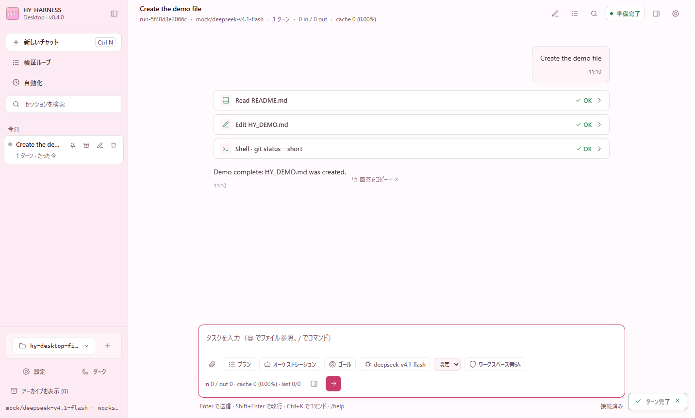
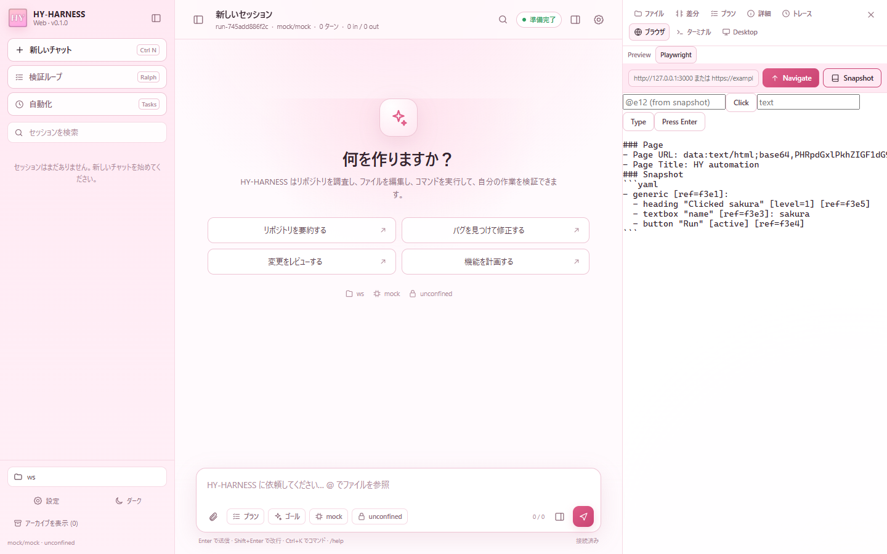
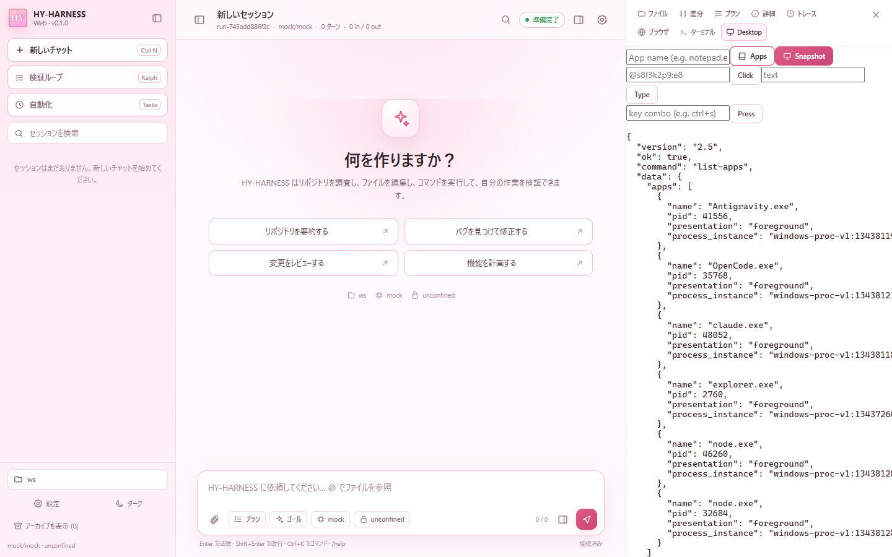
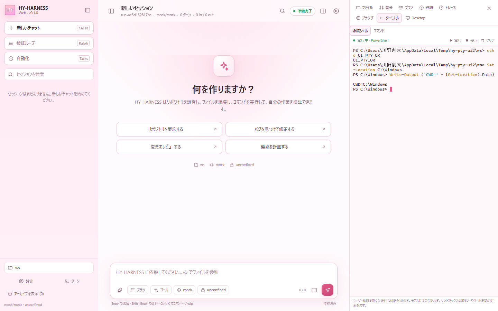
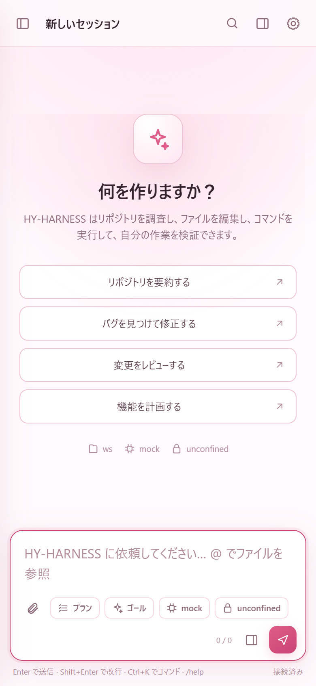
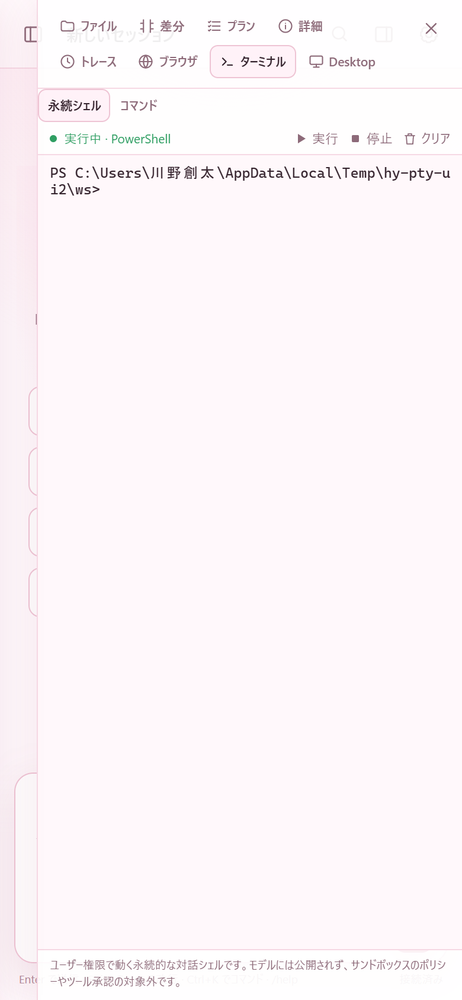
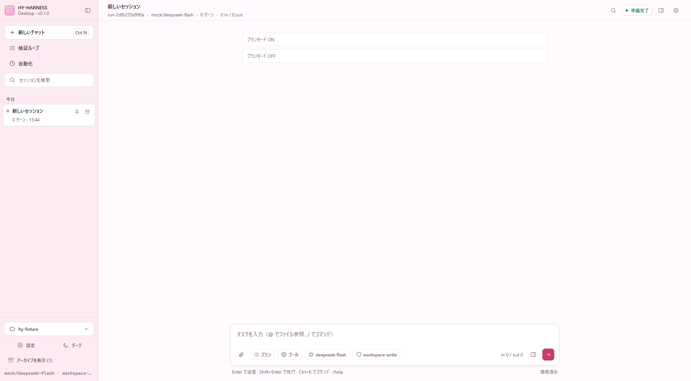
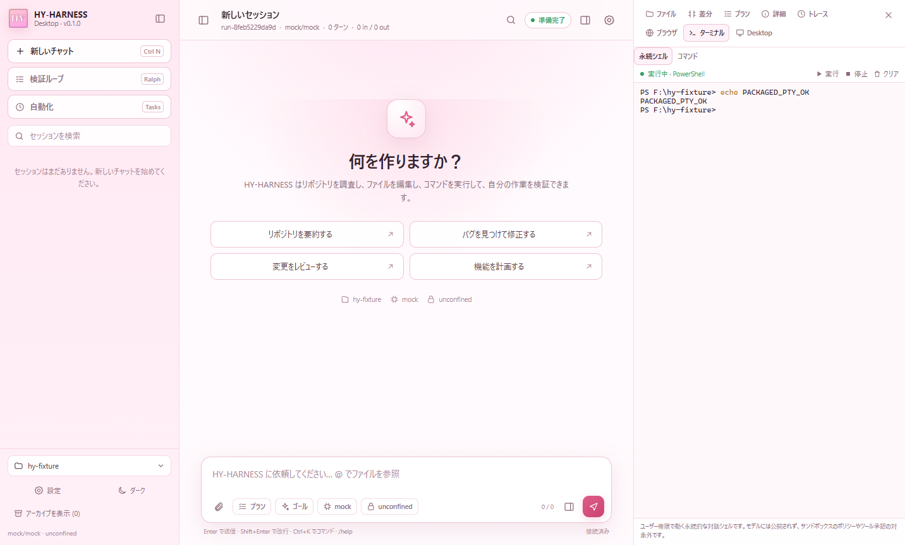
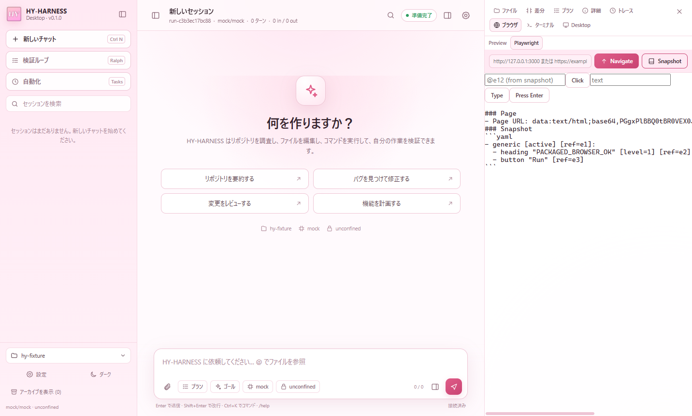
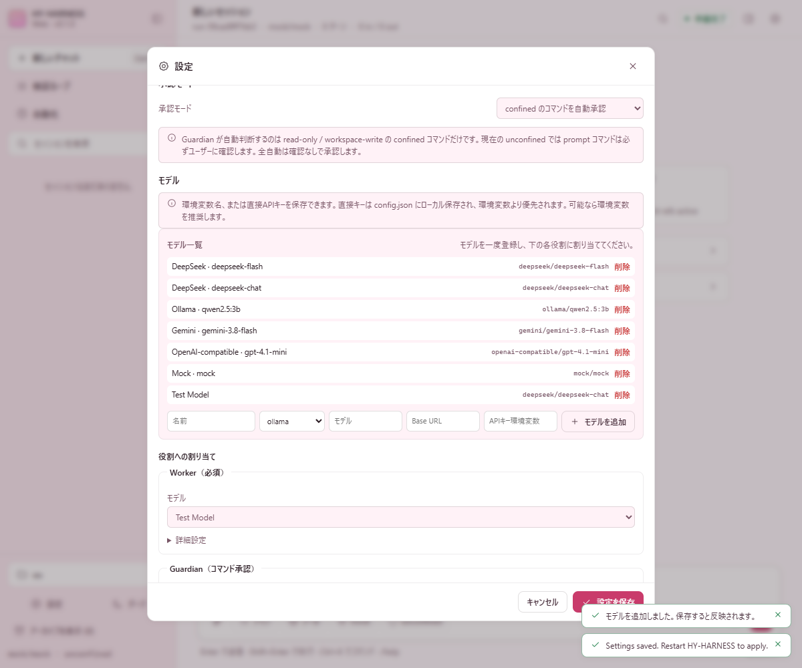

# HY-HARNESS Desktop GUI（DSH 準拠・承認済みスコープ）

- **状態**: 実装済み（2026-11-03、承認済みスコープで完成）
- **対象**: Electron デスクトップアプリと、同じ画面を提供する `hy web`
- **原型**: DeepSeek Harness の Web UI / Desktop（3 カラム、セッションサイドバー、会話、右パネル、ツールカード、承認）
- **実装**:
  - `packages/desktop` — Electron メインプロセス、preload、メニュー、ネイティブダイアログ
  - `packages/hy-cli/src/web-server.ts` — ローカル HTTP + SSE API
  - `packages/hy-cli/src/chat-projection.ts` — セッションログから会話 UI を再構築
  - `packages/hy-cli/web` — 3 カラムのブラウザ UI（TypeScript + CSS、外部 UI 依存なし）
  - `packages/hy-cli/src/session-app.ts` — CLI と GUI が共有するセッション処理
- **検証**: `tests/integration/web-ui.test.mjs`（7 件）、`tests/integration/automation-mcp.test.mjs`（1 件）、`pnpm desktop:screenshot`、`pnpm typecheck`

## 1. 起動

```powershell
# Electron（デスクトップ）。バイナリが未取得なら先に pnpm desktop:install
pnpm desktop

# 同じ UI をブラウザで
pnpm build
node packages\hy-cli\dist\main.js web --cwd C:\work\my-repo

# 同一 tailnet のスマホから開く
node packages\hy-cli\dist\main.js web --tailscale --cwd C:\work\my-repo

# スクリーンショット検証（モック + デモセッション）
pnpm desktop:screenshot

# 配布用 exe（Node / pnpm はビルド時だけ必要）
pnpm desktop:package       # release\HY-HARNESS-0.1.0-portable.exe
pnpm desktop:package:dir   # release\win-unpacked\HY-HARNESS.exe
```

ポータブル exe は起動時に一時ディレクトリへ展開され、通常の Electron GUI を開く。初回はワークスペース選択が出る。`hy-exec-server.exe`、node-pty、xterm.js、Playwright / agent-desktop MCP を同梱する。コード署名は未設定なので SmartScreen の警告が出る場合がある。

`hy web` は既定で `http://127.0.0.1:3080` を開く。`--port 0` で空きポート、`--host`、`--no-open` も指定できる。`--tailscale` は `tailscale ip -4` の IPv4 にだけバインドし、ブラウザの自動オープンを止めて、スマホ用 URL を表示する。PWA マニフェストによりホーム画面へ追加できる。

## 2. 画面構成

DSH と同じ 3 カラム。

1. **左: セッションサイドバー**
   - New chat、Verifier loop、検索、日付グループ、実行中インジケーター
   - ピン留め / アーカイブ（`<stateDir>/ui-state.json` に永続化、アーカイブの表示切替）
   - ワークスペース切替（Electron は最近使ったワークスペース + ネイティブフォルダ選択）
   - Settings / 言語（English / 日本語 / 中文）/ テーマ切替（既定は白色 / 桜色、任意で night sakura）/ モデルプリセット・自動上限値・サンドボックスの表示
2. **中央: 会話**
   - ユーザー / アシスタントのメッセージ、Markdown（コード、表に近いリスト、リンク）
   - ツールカード（read_file、apply_patch、shell、run_code、検索、delegate、MCP、update_plan、claim_complete）
   - 実行中スピナー、成功 / 失敗、展開した引数・出力・差分
   - 承認カード（コマンド、ルール、サンドボックス、承認 / 拒否理由）
   - 質問カード（`ask_user`）
   - ゴールバナー、プランモード、停止 / 送信、画像添付、`@file` 参照候補
   - トークン使用量（プロバイダーが返した実測値をカンマ区切りで表示。累計と直近ターンの in / out）、接続状態、run id
3. **右: パネル**
   - Files（ツリー、ファイルプレビュー）
   - Diff（run 開始時からの変更）
   - Plan（update_plan / plan mode）
   - Details（セッション、ゴール、ジョブ、サブエージェント、ノート、スキル、MCP、プラグイン、ワークスペースメモリ、サンドボックス、ロール）
   - Trace（生のセッションイベント、DSH の Trajectory に相当する簡易ビュー）
   - Browser（Preview: URL バー + サンドボックス化した iframe。Playwright: Playwright MCP による Navigate / Snapshot / Click / Type / Press）
   - Terminal（永続シェル: PowerShell / cmd を xterm.js + node-pty で操作。単発コマンド: セッションのサンドボックス / ポリシーで実行）
   - Desktop（agent-desktop MCP によるアプリ一覧 / アクセシビリティツリー / Click / Type / Press。Windows のみ）

## 3. 操作

- メッセージ送信: Enter / 送信ボタン。Shift+Enter は改行。
- 停止: 実行中の Stop ボタン。`AbortSignal` → `$/cancelRequest` で実行中の `shell` / `run_code` / `job_wait` を即時終了する。
- スラッシュコマンド: `/new`、`/help`、`/status`、`/diff`、`/undo`、`/notes`、`/plan`、`/compact`、`/model`、`/review`、`/init`、`/settings`、`/export`。
- キーボード: `Ctrl+N` 新規、`Ctrl+B` サイドバー、`Ctrl+K` コマンドパレット、`Esc` モーダルを閉じる。
- 承認: 承認カードで Approve / Deny。拒否理由はツールエラーとしてモデルに返る。
- ピン留め / アーカイブ: セッション行のアクションから切り替える。ピン留めは先頭グループ、アーカイブは既定で非表示（`Show archived` で表示）。
- ゴール: セッションゴールを設定すると、以後の各ユーザーメッセージの先頭に `[session goal: …]` が付く。
- プランモード: 読み取り専用ツールだけで計画する。
- モデル: Settings → Models の「モデル一覧」にプロバイダー / モデル / Base URL / API key env を登録し、「役割への割り当て」で Worker / Guardian / Grader / Compactor にプルダウンで割り当てる。Provider を変えると既定値が入り、Context window / Max output はモデルごとの値が読み取り専用で適用される。APIキーは環境変数名と直接キーの両方に対応する。`/model` で切り替えたモデルは新規セッションの既定としても保存される。ヘッダーと入力欄にはプロバイダーの `usage` に基づく実測トークン数（累計と直近ターンの in / out）を表示する。
- 承認: Settings の `承認モード` で手動 / confined 自動承認 / 全自動を選ぶ。Guardian が判断できるのは read-only / workspace-write の confined コマンドだけで、unconfined の prompt コマンドはユーザー確認になる。
- レビュー: 読み取り専用サブエージェントで未コミット差分をレビューする。
- Verifier loop: 既存の `hy ralph` を子プロセスで起動し、検証コマンドと grader の 2 段ゲートを GUI から実行する。
- 画像: png/jpeg/webp/gif を最大 8 枚まで添付。Ollama / OpenAI 互換の vision モデルに渡る。
- `@file`: 入力中に `@` でワークスペースのファイル候補を検索し、パスを挿入する。
- プラグイン: Settings でモジュールパスを編集し、`Reload plugins` で ESM キャッシュを避けて再読み込みする。Electron では `Add plugin file…` で `.mjs` / `.js` を選べる。読み込み済みツールとエラーは Settings / Details に表示する。既存の会話は読み込み時のツール表を保持する。
- 言語: Settings の Language で English / 日本語 / 中文 を切り替える。初回は `navigator.language` から自動判定し、選択は `localStorage` に保存する。
- テーマ: 既定は白色 / 桜色（`data-theme="light"`）。サイドバー、右パネル、送信ボタン、選択状態、フォーカスリングを桜色で統一する。任意で night sakura のダークテーマに切り替えられる。
- アイコン: `HY_icon.png` を Electron のウィンドウ / タスクバーアイコン、Web の favicon、サイドバーのブランドマークに使う。画像は `packages/desktop/assets/HY_icon.png` と `packages/hy-cli/web/HY_icon.png` に同梱する。
- Browser: Preview は URL を入力して iframe でプレビューする。`sandbox` 属性で親ページから隔離し、外部ページは `http(s)` のみ。Playwright モードは Settings の `automation.browser.enabled` を再起動後に有効化すると使える。既定ブラウザは Chrome で、`automation.browser.browser` で `msedge` / `chromium` / `firefox` / `webkit` に変更できる。Snapshot が返す ref（例 `f3e4`）を Click / Type に渡す。
- Desktop: Settings の `automation.desktop.enabled` を有効化すると、アプリ一覧、スナップショット、Click / Type / Press を GUI から実行できる。Windows UI Automation を使うため Windows 専用。
- 自動操作の直接 API は `playwright` と `agent-desktop` の 2 サーバーだけに制限する。それ以外は 403、未有効化は 400 を返し、任意の MCP ツールを GUI から呼べる汎用プロキシにはしない。
- Terminal: 永続シェルは `node-pty` で PowerShell（または `$SHELL`）を1つ起動し、xterm.js で入出力する。`cd`、環境変数、対話型プログラムの状態が残る。GUI ユーザーだけが起動・入力でき、モデルのツールには公開しない。ユーザー権限で直接動くため、サンドボックスのポリシーやツール承認の対象外である（画面上にも注記する）。「単発コマンド」は従来どおり `exec/command` をユーザー承認付きで呼び、ポリシーの `deny` とサンドボックスモードに従う。
- スマホ: `hy web --tailscale` で Tailscale IPv4 にだけバインドし、起動 URL を表示する。PWA マニフェストと Apple touch icon を同梱し、同一 tailnet のスマホから「ホーム画面に追加」できる。Funnel / パブリック公開は使わない。トークンは起動ごとに変わるため、再起動後は新しい URL を開く。初回接続が Windows Firewall に阻まれる場合は、Node.js の受信を Private / Tailscale プロファイルで許可する（README に昇格 PowerShell の例がある）。

## 4. アーキテクチャ

```text
Electron main (packages/desktop/src/main.ts)
  ├─ startWebServer(...)  ← packages/hy-cli/src/web-server.ts
  │    ├─ openClient()    ← 既存の hy-exec-server への JSON-RPC
  │    ├─ Conversation    ← CLI と同じセッション処理
  │    └─ HTTP + SSE on 127.0.0.1 (random token)
  └─ BrowserWindow (contextIsolation, sandbox, no nodeIntegration)
       └─ packages/hy-cli/web  ← 同じ静的 UI を hy web も配信
```

- Electron メインプロセスはレンダラーから分離し、Node API を直接公開しない。
- preload は `chooseWorkspace`、`openPath`、`showItemInFolder`、`notify`、`onMenu` だけを `contextBridge` で公開する。
- レンダラーは `window.hyDesktop` の有無でデスクトップ / Web を切り替える。
- サーバーは `startWebServer` を 1 つだけ起動し、ワークスペース切替時は旧サーバーを閉じて新しいポートで起動する。
- セッションログは従来どおり `%LOCALAPPDATA%\hy-harness\state\<workspace-id>\session.v1.jsonl`。GUI はログを `projectChat` で投影し、再接続時も同じ会話を復元する。
- ピン留め / アーカイブは同じ state ディレクトリの `ui-state.json` に保存する。セッション一覧はピン留め優先で並べ、アーカイブはクエリ `archived=1` のときだけ返す。
- 言語辞書は `packages/hy-cli/web/src/i18n.ts`。テンプレートの主要ラベルを `tr()` 経由にし、`document.documentElement.lang` も切り替える。
- プラグインの再読み込みは `loadPlugins(..., { cacheBust: true })` で行い、ワークスペース切替時は `startServices` がプラグイン / MCP の構成キーを比較して再読み込みする。
- Browser / Desktop の自動操作は `startServices` が起動した MCP サーバーを共有する。GUI は `/api/sessions/:id/mcp-call` にサーバー名・ツール名・引数を送り、結果のテキストをパネルに表示する。MCP サーバーの起動失敗は Details / Settings のエラーに出す。
- 永続PTYは `packages/hy-cli/src/pty.ts` の `PersistentPty` が担当し、Web セッションごとに1プロセスを保持する。出力は最大 256 KiB をリング状に保存して SSE 再接続時に再生する。サーバー終了時に全 PTY を破棄する。xterm.js は CSP のため CDN ではなく `packages/hy-cli/web/vendor` に同梱する。

## 5. 認証とセキュリティ

- サーバーは既定で `127.0.0.1` にだけバインドする。`--tailscale` を明示したときだけ、`tailscale ip -4` が返す IPv4 にバインドする（`0.0.0.0` にはしない）。
- 起動ごとに 24 バイトのランダムトークンを生成する。起動 URL の `?token=...` を一度だけ受けて、`HttpOnly; SameSite=Strict` の Cookie に交換し、`/` へ 302 する。Cookie は 1 年間有効。Tailscale の URL は資格情報として扱い、共有しない。
- API は Cookie または `Authorization: Bearer <token>` を要求する。`/api/bootstrap` などを無認証で叩くと 401。
- CSP: `default-src 'self'`、`script-src 'self'`、`connect-src 'self'`。外部 CDN を使わない。
- Electron: `contextIsolation: true`、`sandbox: true`、`nodeIntegration: false`。権限要求（カメラ、マイク、通知など）は既定で拒否。外部リンクだけ `shell.openExternal` に渡す。
- パスは `safeWorkspacePath` でワークスペース外への `..` と realpath の外側を拒否する。ファイル読み取りは 512 KiB、リクエスト本文は 32 MiB まで。
- 設定の保存先はユーザーの `config.json` のみ。プロジェクト設定は書き換えない。API キーは環境変数名を保存する方式と、直接キーを `config.json` にローカル保存する方式の両方に対応する。直接キーは環境変数より優先されるため、可能なら環境変数を推奨し、UI にもその旨を表示する。設定モーダルは背景クリックだけでは閉じず、× / キャンセルで閉じる（ドラッグ中に誤って閉じない）。
- Browser の iframe は `sandbox="allow-scripts allow-forms allow-popups allow-modals"`（`allow-same-origin` なし）で、親ページの DOM / Cookie に触れない。外部ページは信頼しない。
- Terminal の単発コマンドはユーザーが明示的に実行したコマンドを `approval: { by: "user" }` で送る。`deny` ポリシーは回避できず、サンドボックスモードはセッション設定に従う。
- 永続PTYはユーザーがターミナルを開いたときだけ起動し、`/api` の Cookie / Bearer 認証を必須とする。モデル向けのツール一覧には含めない。サンドボックス外でユーザー権限のシェルが動くため、UI に警告を表示し、停止ボタンを用意する。出力はセッションごとに分離し、サーバー終了時に破棄する。
- プラグインの再読み込みはユーザーが設定したモジュールを実行する（プラグインコードはユーザーと同じ権限）。信頼できるパスだけを登録する。

## 6. API

| Method | Path | 用途 |
| :--- | :--- | :--- |
| GET | `/api/bootstrap` | ワークスペース、設定、セッション一覧、サンドボックス |
| POST | `/api/sessions` | 新しい run |
| GET | `/api/sessions/:id` | 会話のスナップショット |
| GET | `/api/sessions/:id/events` | SSE（snapshot + ライブイベント） |
| POST | `/api/sessions/:id/turn` | メッセージ送信（画像可） |
| POST | `/api/sessions/:id/cancel` | 実行中ターンの中断 |
| POST | `/api/sessions/:id/approval` | 承認 / 拒否 |
| POST | `/api/sessions/:id/answer` | `ask_user` の回答 |
| POST | `/api/sessions/:id/undo` / `compact` / `plan-mode` / `model` / `goal` / `review` | セッション操作 |
| POST | `/api/sessions/:id/pin` / `archive` | ピン留め / アーカイブ |
| POST | `/api/sessions/:id/terminal` | 単発ターミナルコマンド（ユーザー承認） |
| GET | `/api/sessions/:id/pty` | 永続シェルの状態・出力バッファ |
| POST | `/api/sessions/:id/pty/start` / `input` / `resize` / `clear` / `stop` | 永続シェルの操作 |
| GET | `/api/sessions/:id/pty/events` | 永続シェルの SSE（snapshot + data + exit） |
| GET | `/api/plugins` / `POST /api/plugins/reload` | プラグインのカタログ / 再読み込み |
| GET | `/api/sessions/:id/diff` / `plan` / `notes` / `status` / `skills` / `export` | 表示・書き出し |
| GET | `/api/sessions/:id/jobs` / `jobs/:jobId/output` | バックグラウンドジョブ |
| POST | `/api/sessions/:id/jobs/:jobId/kill` | ジョブ停止 |
| GET | `/api/sessions/:id/subagents` / `subagents/:subId` | サブエージェント |
| GET | `/api/sessions/:id/trajectory` / `mcp` / `plugins` / `memory` | 詳細パネル |
| POST | `/api/sessions/:id/mcp-call` | Playwright / agent-desktop MCP の直接操作（他のサーバーは 403） |
| GET | `/api/files/tree` / `search` / `files?path=` | ファイルツリー、`@file` 検索、プレビュー |
| GET/PUT | `/api/settings` | ユーザー設定の表示・保存 |
| POST | `/api/ralph` | Verifier loop の開始 |
| GET | `/api/ralph/:id` | 出力のポーリング |
| POST | `/api/ralph/:id/cancel` | Verifier loop の停止 |

## 7. テスト

- `packages/hy-cli/src/chat-projection.test.ts`
  - ログから user / assistant / tool / plan / final を再構築
  - goal 前置きの除去と画像数の復元
  - ライブの tool-start → tool 完了更新
- `tests/integration/web-ui.test.mjs`（7 件）
  - 認証、bootstrap、ファイル、設定（ロール、プラグイン、メモリ、Web、自動化プリセット）
  - PWA マニフェストの配信と MIME、GUI の `mcp-call` 制限（403 / 400）
  - 永続PTYの起動、SSE snapshot、入力、`cd` の保持、リサイズ、クリア、停止
  - プラグインのカタログと再読み込み
  - スケジュール / Webhook の作成・実行・削除
  - チャット、ゴール、サブエージェント、バックグラウンドジョブ、SSE、Trace、MCP、メモリ、ターミナル
  - 実行中 `shell` のキャンセル
  - 承認要求 → 拒否 → ツールエラー
  - Verifier loop（mock、Gate 1 + Gate 2）
- `tests/integration/automation-mcp.test.mjs`（1 件）
  - Playwright MCP と agent-desktop MCP の起動とツール検出
- `pnpm desktop:screenshot`
  - Electron を起動し、モックのデモセッションを実行して `screenshots/desktop.png` を書き出す。
- 手動 / Playwright 検証（2026-11-03）
  - 自動化を有効にした実サーバーで Browser パネルの Navigate → Snapshot → Type → Click → Snapshot を通し、`Clicked sakura` を確認。
  - Desktop パネルの Apps で `desktop_list_apps` の `ok: true` を確認。
  - Terminal の永続シェルに GUI から `echo UI_PTY_OK`、`Set-Location C:\Windows`、`Write-Output ('CWD=' + (Get-Location).Path)` を入力し、`CWD=C:\Windows` を確認。
  - パッケージ版 `HY-HARNESS.exe` を起動し、`echo PACKAGED_PTY_OK` と Chrome の `PACKAGED_BROWSER_OK` を確認。
  - Settings で Provider を DeepSeek に変更すると Base URL / API key env / モデル / 自動上限値が切り替わること、Preset で `deepseek-chat` を選べること、ドラッグでモーダルが閉じないこと、保存後に `config.json` へ反映されることを確認。
  - 390 px 幅で本文 390 px・入力欄 366 px、サイドバー開閉、右パネル 359 px オーバーレイ、PTY 幅 358 px を確認。





















## 8. DSH との差分（2026-11-03 ユーザー承認済みの対象外）

以下は HY-HARNESS のバックエンドに対応する機能がない、または DSH 固有のため、GUI にも置いていない。実装済みの Browser / Desktop 自動操作、スケジュール / Webhook、永続PTY、Tailscale 経由の個人端末アクセスはここに含まない。以下の5項目は 2026-11-03 にユーザーが対象外として確定した。

- プラグインマーケット / Creator mode（HY-HARNESS のプラグインはユーザー設定のモジュールパス。Settings で管理・再読み込みはできる）
- SSH 先での実行（ローカルの永続PTYは Terminal タブで実装済み）
- クラウド実行、ChatGPT ログイン
- マルチユーザー / パブリック公開（個人の tailnet 内アクセスは `--tailscale` で可能。Funnel は使わない）
- IDE 拡張
- DSH の完全な React プラグインスロット体系（HY-HARNESS は単一の TypeScript UI。上記のプラグイン対象外に含む）

これらは `docs/feature-parity.md` の「HY-HARNESS にないもの」にまとめている。

## 9. 完成条件（承認済みスコープ）

この GUI の完成条件は、DSH の全機能を実装することではなく、次の承認済みスコープを満たすこととする。

- 3 カラム（セッション / 会話 / 右パネル）、ツールカード、承認 / 質問、ゴール、プランモード、ジョブ、サブエージェント、Files / Diff / Plan / Details / Trace / Browser / Terminal / Desktop が動作する。
- Browser / Desktop 自動操作、スケジュール / Webhook、永続PTY、English / 日本語 / 中文、Tailscale 経由のスマホアクセスが動作する。
- §8 の5項目（プラグインマーケット / Creator、SSH、クラウド、マルチユーザー / パブリック公開、IDE 拡張）は、2026-11-03 のユーザー承認により対象外とする。
- `pnpm build`、`pnpm typecheck`、`pnpm test`、`pnpm test:integration`、`pnpm desktop:screenshot` が成功する。
- `pnpm desktop:package` が `release\HY-HARNESS-0.1.0-portable.exe` を生成し、パッケージ版が起動して PTY とブラウザ自動操作を実行できる。
- §7 の手動 / Playwright 検証（PTY の `cd` 保持、Browser の Navigate → Snapshot → Type → Click、Desktop のアプリ一覧、モバイル幅）が成功する。

これは「DSH の全機能に対する完全準拠」ではなく、**承認済みスコープにおける DSH 準拠**である。
