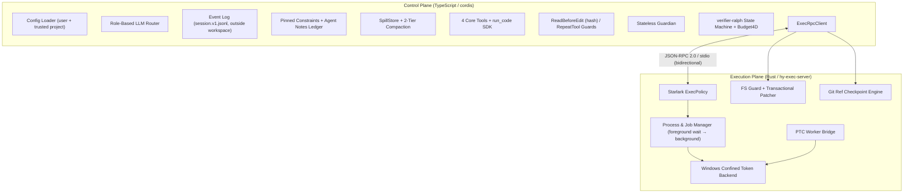

# HY-HARNESS アーキテクチャ設計および実装計画書（v3.1 — Rev 3.1 対応版）

- **文書ステータス**: v3.1。設計書 Rev 3.1 の日本語版の実装計画です。Rev 3 は 2026-11-02 にユーザーが承認し、Rev 3.1 で Phase 1 スパイクの結果（[ADR 0001](../adr/0001-windows-sandbox.md) の変更案 A〜F、2026-11-02 にユーザーが承認）を反映しました。
- **作成・更新日**: 2026-11-02
- **正本**: 英語の設計書 [design_draft_rev3.md](../../design_draft_rev3.md) です。食い違いがあれば設計書を優先し、この文書を直します。
- **関連成果物**:
  - Rev 2 からの変更点: [refinement_notes.md](../../refinement_notes.md)
  - Phase 1 スパイクの結果と Rev 3.1 の変更点: [ADR 0001](../adr/0001-windows-sandbox.md)
  - 一次ソースによる裏取り: [verification_report.md](../../verification/verification_report.md)（抜き書き 95 件をすべて機械照合済み）
  - EGM ブレインストーム統合ブリーフ: [concepts_brief.md](../../concepts_brief.md)
  - `deep_research` 統合レポート: [report.md](file:///C:/Users/%E5%B7%9D%E9%87%8E%E5%89%B5%E5%A4%AA/research/hy-harness/report.md)
- **根拠の示し方**: `[V:<id>]` は `verification/extracts.json` の項目 ID です。一次ソースの行と照合済みの事実を指します。タグのない記述は設計上の判断で、各フェーズの完了テストで確かめます。

### v2.0 からの主な変更

| 項目 | v2.0 | v3.0（Rev 3） |
| :--- | :--- | :--- |
| シェルツール | `bash` | `shell`（既定は pwsh 7） |
| ワークスペースへの書き込み | 方針があいまい | シェルにも書き込みを許し、OS のトークンで範囲を限る |
| libuv の EPERM | 親側のパイプ DACL で直す | 直せないことを libuv のソースで確認 `[V:R-2b]`。既知の制約として報告し、ユーザーポリシーで指定したコマンドだけ制限なしで動かす |
| `0xC0000142` | WinSta0 / Desktop の DACL を変更 | 変更しない。子プロセスを `CREATE_NO_WINDOW` で作らず、隠しコンソールを継承させる `[V:R-2a]` |
| ハードリンク | 書き込み時にリンクを列挙して拒否 | ACL の付与時にリンク数が 2 以上のファイルを飛ばす。書き込みは一時ファイルと `ReplaceFileW` で置き換える |
| チェックポイント | `git reset --hard` 相当の全ファイル書き戻し | 変化したパスだけを戻し、ユーザーのステージングと `HEAD` を保つ（実験で確認 `[V:R-4c]`） |
| 完了の合図 | ツール呼び出しのない応答 | `claimComplete` による明示的な宣言のみ |
| Ledger の上限 | 古いものから自動退避（LRU） | 上限で新規追加をエラーにする |
| フェーズ | Phase 0〜5 | Phase 0〜8。Phase 1 にサンドボックスの実現性スパイクを置く |

### v3.0 からの変更（v3.1、Phase 1 スパイクの結果）

| 案 | 変更 |
| :--- | :--- |
| A | `.git/` と `.hy-harness/` は付与の前に用意する（リポジトリでなければ付与の前に `git init`）。ハーネスが git を実行する前に毎回 `.git/` を検査し、git は空のフックディレクトリと `core.fsmonitor=false` で実行する |
| B | 専用 temp を `%USERPROFILE%\.hy-harness\tmp\<session>` に置く（AppData の外）。`initialize` で祖先ディレクトリを偽装トークンで開けるか確かめる |
| C | サンドボックスモード `low-integrity`（制限 SID なし、Low のみ）を追加する。pipe や IPC で子プロセスを起動するツール用 |
| D | ACL のないボリュームを `capabilities.gaps` の `non-acl-volumes` で報告する |
| E | revoke は記録の復元に加え、ツリーを走査して HY-HARNESS の SID を名指しする ACE とラベルを取り除く |
| F | `hy-ptc-worker` を能力なしの AppContainer で起動する |

---

## 1. 前提（ユーザー合意事項）

1. **Windows 10 を第一の対象にし、管理者権限なしで動かす。** Windows 11 24H2 以降の MXC には依存しません。Windows 10 22H2 と Windows 11 で同じバックエンドを使います。
2. **TypeScript のコントロールプレーンと Rust の実行デーモンに分ける。** コントロールプレーンは `cordis` 上に作り、実行プレーンは `hy-exec-server` です。両者は stdio 上の JSON-RPC 2.0（1 行 1 メッセージ）で通信します。
3. **ロール別のマルチプロバイダ。** `worker`、`guardian`、`grader`、`compactor` の各ロールに、DeepSeek、Gemini、OpenAI 互換のモデルを個別に設定できます。
4. **トークン節約の Tiered PTC。** ワイヤーに出すツールは `read_file`、`apply_patch`、`shell`、`run_code` の 4 つだけです。拡張機能は `run_code` の中で使う `.d.ts` 宣言としてだけ見せます。
5. **Git ref チェックポイント。** 逐次のラウンドでは worktree を作らず、同じ作業ツリーの中で `refs/hy/checkpoints/<run>/<label>` を使います。
6. **上限付きの Ledger。** ユーザーが固定した制約と、モデルが書くメモ（最大 12 件、1,500 トークン）を分けて扱います。
7. **v1 では読み取りとネットワークを閉じ込めない。** 書き込み制限トークンは呼び出し元の読み取り権限をそのまま持ちます。Windows 10 には、管理者権限なしでプロセス単位に外向き通信を止める手段がありません。これは Non-Goal として明記し、軽減策を信頼モデルで定めます。

### 1.1 決定済みの Open Questions（2026-11-02、推奨案を採用）

| ID | 決定 | 実測で決まる残りの点 |
| :--- | :--- | :--- |
| OQ-1 | `shell` の方言は pwsh 7（`pwsh -NoLogo -NoProfile -NonInteractive -Command`）。なければ Windows PowerShell 5.1 | **実測済み（ADR 0001）**: Git Bash は提供しない。MSYS2 は Low でも制限 SID 付きでも起動しない（`0xC0000142`）。Windows PowerShell 5.1 は `workspace-write` で動く |
| OQ-2 | 制限トークンで動かないコマンドを `low-integrity`（v3.1 で追加、案 C）か制限なしで動かせるのは、ユーザーポリシーの `sandbox = "low-integrity"` / `"unconfined"` と、ユーザーが CLI で渡した `--verify-cmd` だけ。Guardian には許可させない | **実測済み（ADR 0001）**: `cargo build`/`test`、`tsc`、`npm test`（pipe を使わないスクリプト）、`git status` は `workspace-write` で動く。Node の `child_process` で pipe か IPC を使う呼び出しはすべて `EPERM`。原因は制限 SID で、トークンの調整では直らない。Jest 30.5.2、Vitest 5.0.5、`esbuild` 0.25.0、`npm install` もすべて実測済み（ADR 0001 §7）: **Jest / Vitest の既定の起動と `esbuild` の Node API（`esbuild.build()`）は `workspace-write` で `spawn EPERM`**。Jest の `--runInBand` / `--workerThreads`、Vitest の `--pool=threads` / `vmThreads`、`esbuild` CLI 直接起動は `workspace-write` で動き、`low-integrity` ではすべて動く。`npm install` は既定キャッシュ（`%LOCALAPPDATA%\npm-cache`）では `EPERM`、ワークスペース内キャッシュ（`--cache <ws>/.npm-cache`）では両モードとも動く |
| OQ-3 | 信頼していないリポジトリでの `hy ralph` は既定で拒否し、`--unattended-ok` で許可する | なし |
| OQ-4 | 完了は `tools.objective.claimComplete({ summary })` だけ。テキストだけの応答は stall として扱う | なし |
| OQ-5 | Ledger が上限に達したら、新しいキーの upsert を現在のキー一覧付きのエラーで拒否する | なし |

### 1.2 信頼モデル

| 主体 | 信頼 | 制限する仕組み |
| :--- | :--- | :--- |
| ユーザー（CLI、`%APPDATA%\hy-harness\config.json`、ユーザーポリシー） | する | — |
| コントロールプレーンと `hy-exec-server` | する（同じユーザー、制限なし） | モデルのテキストを直接実行しない |
| プロジェクトのファイル（`AGENTS.md`、`.hy-harness/config.json`、`.hy-harness/policies/*.star`） | ユーザーが信頼するまではしない | 未信頼の設定は制限を強める方向にしか効かない。`baseUrl`、`apiKeyEnv`、`extraWritableRoots`、`unconfined` や `allow` のルールは設定できない |
| 各ロールのモデル | しない | 実行ポリシー → Guardian またはユーザーの承認 → OS のサンドボックス → チェックポイント |
| ツール出力、ファイル内容、テスト出力、差分 | しない | Guardian や grader に渡すときは untrusted として囲う |
| モデルが書いた Ledger のメモ | しない | システムの規則としてではなく、モデルのメモとして表示する。grader の判定基準には使わない |

防御は次の順に重なります。Starlark の実行ポリシーは承認の手間を減らす層で、セキュリティ境界ではありません。実際の書き込み境界は OS のサンドボックスです。

1. Starlark 実行ポリシー
2. Guardian またはユーザーの承認
3. OS のサンドボックス
4. チェックポイント

v1 で受け入れる残りのリスク: サンドボックス内のコマンドは、ユーザーが読めるファイルをすべて読め、外部に接続でき、**ACL のないボリューム（exFAT / FAT32。このマシンの F: と G:、USB メモリなど）に書ける**（ADR 0001 §5.3）。`low-integrity` のコマンドは、さらに別セッションの付与ルートと `%USERPROFILE%\AppData\LocalLow` に書ける。

---

## 2. 全体アーキテクチャ



- **コントロールプレーン**（`packages/*`、TypeScript、Node.js ESM）: プロンプトの組み立て、LLM のルーティング、イベントログ、ガード、Guardian、Compaction、Ledger、PTC のホスト、`verifier-ralph` を担います。どのサブシステムも `cordis` のプラグインで、`ctx.effect` でサービスと後始末を登録します。
- **実行プレーン**（`crates/*`、Rust 2024）: ポリシー評価、Windows サンドボックス、プロセスとジョブの管理、パッチ適用、ファイルシステムのガード、チェックポイントを担います。Clippy で `unwrap_used`、`expect_used`、`print_stdout`、`print_stderr` を禁止し、stdout にはプロトコルのフレームだけを流します。
- **状態はワークスペースの外に置く。** セッションログ、スピルファイル、チェックポイント用のインデックスのコピー、専用の一時ディレクトリは `%LOCALAPPDATA%\hy-harness\state\<workspace-id>\` に置きます。`workspace-id` は正規化したワークスペースパスの SHA-256 の先頭部分です。リポジトリに残すのは `.hy-harness/config.json` と `.hy-harness/policies/` だけで、サンドボックスと `apply_patch` からは書き込めません。

---

## 3. 主要コンポーネントの仕様

### 3.1 設定とイベントログ（`packages/core`）

- **cordis**: npm の `latest` はリリース候補版（`4.0.0-rc.12`）です `[V:W-5]`。正確なバージョンを固定し、薄い型付きラッパー（`src/cordis.ts`）の奥に置きます。上流の API が変わっても直すのは 1 ファイルで済みます。Phase 0 でバージョンを記録し、Phase 3 の前に見直します。
- **設定は信頼の度合いで分ける**:
  - 優先順位は CLI フラグ > 環境変数（`HY_*`）> 信頼済みのプロジェクト設定 > ユーザー設定 > 既定値です。
  - ユーザー設定（`HyUserConfig`）にはロール、`extraWritableRoots`、`envPassthrough`、ユーザーポリシーのパス、信頼済みプロジェクトの一覧（パスと設定の SHA-256）を置きます。
  - プロジェクト設定（`HyProjectConfig`）に置けるのは `protectedPaths`、各種上限、`budget4D` だけです。型の定義は設計書 §1 にあります。
- **イベントログ**:
  - `session.v1.jsonl` は追記専用です。各行が `{ v, seq, ts, sessionId, runId?, round?, type, payload }` のエンベロープになります。
  - ツール呼び出しは `assistant/message` の中にだけ記録します。Rev 2 の `tool/call` は、同じ情報を二重に持つことになるので廃止しました。
  - 守る不変条件は「モデルに見えるものはすべてログにある（model-visible ⟹ logged）」です。逆向きは成り立ちません。PTC のサブ呼び出しはログには残りますが、モデルには見えないからです。
  - 中断したラウンドも削除はせず、`round/end` を使って投影から外します。
- **トークンの数え方**:
  - 予算と Compaction の発動判定には、プロバイダが報告する `usage` を使います。
  - 事前の見積もりには、プロバイダごとの係数で計算する `ceil(ASCII 文字数 × a + 非 ASCII 文字数 × b)` を使い、実際の `usage` との比で実行中に補正します。DeepSeek の既定値は a = 0.3、b = 0.6 です `[V:M-8]`。

### 3.2 Tiered ACI と PTC

- **ワイヤーに出す 4 ツール**:
  1. `read_file({ path, startLine?, endLine? })`: `sha256` を返し、編集ガードのために記録します。
  2. `apply_patch({ patch })`: 詳細は §3.4 です。
  3. `shell({ command, cwd?, foregroundWaitMs?, hardTimeoutMs? })`
     - `foregroundWaitMs`（既定 5,000 ms）を過ぎると、プロセスは動かしたまま呼び出しだけ返り、以後はジョブになります。
     - `hardTimeoutMs` を過ぎると終了させます。既定はフォアグラウンドで 10 分、ジョブは無制限です。
     - stdin は常に `NUL` です。
  4. `run_code({ code, description })`
- **ガード**:
  - `ReadBeforeEditGuard`: 既存ファイルへのパッチは、現在の SHA-256 が最後に `read_file` で読んだか `apply_patch` で書いたときの値と一致する場合だけ通します。新規ファイルは対象外です。
  - `RepeatToolReminderGuard`: 同じ呼び出しが続いたら、結果に注意書きを付けます。
- **`run_code` の SDK**: `jsonSchemaToTs()` で、ディスパッチに使うのと同じ JSON Schema から `declare namespace tools { ... }` を生成します。公開するのは次のとおりです。
  - コアツール（`tools.readFile`、`tools.applyPatch`、`tools.shell`）
  - `tools.search.{glob,grep}`
  - `tools.jobs.{status,output,wait,kill}`
  - `tools.rationale.{upsert,supersede,remove}`
  - `tools.objective.claimComplete`

  どのサブ呼び出しも、直接の呼び出しと同じガード、ポリシー、承認を通ります。
- **実行のしかた**:
  1. ホストが型を取り除きます（`ts.transpileModule`）。
  2. `hy-exec-server` が **能力（capability）なしの AppContainer** と、ほぼ空の環境変数（`LOCALAPPDATA` がないと起動に失敗するので残す）で、`node --preserve-symlinks --preserve-symlinks-main --permission --allow-fs-read=<worker_runtime_dir> ptc-worker.mjs` を起動します（v3.1、案 F）。
     - Job Object は `ActiveProcessLimit = 1` と `KILL_ON_JOB_CLOSE`。`runCodeTimeoutMs` はデーモンが Job を終了させて強制します。
     - ワーカーのディレクトリには `ALL APPLICATION PACKAGES`（`S-1-15-2-1`）の読み取り・実行を許可します。AppContainer は exFAT や通常のユーザーディレクトリを読めないためです。
     - AppContainer は `C:\` を `lstat` できず、メインモジュールの `realpath` が失敗するので、`--preserve-symlinks-main` が必要です。
     - 実測（ADR 0001 S-5）: 中からはワークスペースの読み書き、ネットワーク（`EACCES`）、子プロセスの起動がすべて拒否されます。`TEMP` は Windows がコンテナ専用のディレクトリに差し替えます。pipe を使う `spawnSync` はハングし、自身の timeout も効かないので、タイムアウトは必ず Job 側で強制します。
     - プロファイルは 1 インストールに 1 つで、`hy sandbox revoke` が削除します。`--permission` と AppContainer の組み合わせは未実測で、Phase 5 の完了テストで確かめます。
  3. ワーカーは自分の stdin / stdout で JSON-RPC を話します。fd 3 や名前付きパイプは使いません。
  4. サブ呼び出しは読み書きロックの下で実行します。読み取りは最大 `maxParallelSubCalls` 件まで並列、書き換えは排他です。
- **`run_code` の中のネットワーク**:
  - Node の permission model でネットワークを制限できるのは v25 で追加された `--allow-net` からです。Node 自身もこの仕組みを、悪意あるコードには保証のない「seat belt」と説明しています `[V:M-14]`。
  - そのため、ワーカーには Node 26 LTS 以上を同梱して固定し、`--permission` は多層防御の一つとして扱います。
  - v3.1 からは OS の境界が AppContainer になり、`internetClient` の能力を与えないのでネットワークも閉じます。ワーカー自身は書き込み・読み取り・ネットワークのすべてが閉じ込められます。サブ呼び出しはホスト側でセッションのサンドボックスモードのまま実行します。

### 3.3 JSON-RPC の契約（`crates/hy-protocol`）

- **フレーム**:
  - 1 行に 1 つの UTF-8 JSON を書き、1 メッセージは 16 MiB までです。それより大きいものはスピルファイルのパスで渡します。
  - 双方向にリクエストを送れます。サーバーから送るリクエストの ID は `s:` で始まる文字列、クライアントの ID は整数です。
- **型の正本は Rust 側に置く**: `serde` と `schemars` で JSON Schema を出力し、そこから TypeScript の型を生成します。CI は、生成結果がコミット済みのものと違えば失敗させます。
- **ライフサイクル**:
  - `initialize` でワークスペースのルートを固定します。以後のリクエストはルートを持たないので、混乱した呼び出し側が書き込み先を変えることはできません。
  - 応答の `capabilities` は `enforcement`（`full` / `partial` / `none`）と `gaps` を返します。
  - stdin が EOF になったら終了処理に入り、すべてのジョブを止めます。
- **主なメソッド**:
  - `exec/command`: ポリシーはサーバー側で強制します。`prompt` 判定の要求に承認が付いていなければ `-32001` を返し、クライアントが承認を得てから再送します。
  - `job/*`
  - `patch/apply`
  - `policy/evaluate`
  - `checkpoint/{create,rollback,diff,prune}`
  - `ptc/run`
  - `sandbox/{status,grant,revoke}`
- **エラーコード**:
  - `-32001` PolicyDenied
  - `-32002` SandboxViolation
  - `-32003` PatchConflict
  - `-32004` CheckpointError（`HeadMoved` など）
  - `-32005` Cancelled
  - `-32006` SandboxUnavailable

### 3.4 実行デーモン（`crates/hy-execpolicy`、`crates/hy-sandbox-windows`、`crates/hy-exec-server`）

**Starlark 実行ポリシー**

- **ルールの書き方**: `prefix_rule(pattern, decision, justification, match, not_match, sandbox = None)` と `host_executable(name, paths)` です。
- **重ねる順**: 組み込みの既定値、ユーザーポリシー、プロジェクトポリシーの順に重ねます。
  - 未信頼のプロジェクトが追加できるのは `deny`、`prompt`、より厳しいサンドボックスモードだけです。
  - `sandbox` は厳しい順に `"read-only"`、`"workspace-write"`、`"low-integrity"`（v3.1）、`"unconfined"` です。
  - `"low-integrity"` と `"unconfined"` はユーザーポリシーに書いた場合だけ有効です。
- **ロード時のテスト**: `match` / `not_match` の例が一つでも外れれば、ポリシーの読み込み自体を失敗させます。`hy policy-test` でも同じ検査を実行できます。
- **評価**:
  1. 方言ごとのクオート規則で字句に分けます。安全な文字（英数字と非 ASCII 文字、空白、`_ - . / \ : = , + * ?`）以外がクオートの外にあれば、複合コマンドとみなします。
  2. 複合コマンドの場合、どこかの区切りに `deny` ルールのパターンが現れれば `deny`、それ以外は `prompt` です。
  3. 単純なコマンドの場合、argv の先頭一致で判定します。強い方が勝ち（`deny > prompt > allow`）、どれにも一致しなければ `prompt` です。
- **評価したとおりに実行する**:
  - 単純なコマンドは、評価した argv のままシェルを通さずに起動します。
  - `.cmd` / `.bat` は `cmd.exe /d /s /c` を通し、Rust 1.77.2 以降のバッチ引数のエスケープを使います（CVE-2024-24576 の修正 `[V:M-2]`）。各トークンはクオートしてから渡します。
  - ビルトインのコマンドと、承認された複合コマンドは pwsh を通します。
- **既定のポリシー**: 次の表のとおりです。

  | 対象 | 判定 |
  | :--- | :--- |
  | 読み取り専用の git や検索コマンド | `allow` |
  | worker が使う `git commit/reset/checkout/switch/rebase/stash/push/update-ref/gc` | `deny` |
  | パッケージのインストールと既知のネットワーククライアント | `prompt` |
  | `workspace-write` でのビルドやテストのコマンド | `allow` |

**Windows の制限トークン**（`crates/hy-sandbox-windows`）

DeepSeek Harness が本番で確かめたトークン構成を土台にし、報告されている穴を塞ぐか、塞げないものは検出して報告します。

1. **トークン**:
   - `CreateRestrictedToken(DISABLE_MAX_PRIVILEGE | WRITE_RESTRICTED)` で作ります。`LUA_TOKEN` は built-in Administrator で壊れるので付けません `[V:W-2]`。
   - `BUILTIN\Administrators` は deny-only にします `[V:W-1]`。
   - 制限 SID が効くのは書き込みの検査だけで、検査は二重に行われ、両方を通る必要があります `[V:R-2b]`。
   - 制限 SID は、`read-only` では [logon SID, Everyone]、`workspace-write` ではそれに workspace SID と専用一時ディレクトリの SID を加えます。
   - **`low-integrity`**（v3.1、案 C）は制限 SID も `WRITE_RESTRICTED` も付けず、`DISABLE_MAX_PRIVILEGE`、Administrators の deny-only、Low ラベルだけにします。実測（ADR 0001 S-2/S-3）では、pipe と IPC の Node 子プロセスが動き、外部、`.git/`、`.hy-harness/`、ハードリンク、ジャンクション、ユーザープロファイル、HKCU への書き込みは拒否されました。別セッションの付与ルートと `LocalLow` には書けてしまい、`read-only` 相当は表現できません。このモードで動かすたびに `capabilities.gaps` で報告します。
   - 整合性レベルは Low です。`TokenDefaultDacl` に一時ディレクトリの SID を入れ、子プロセスが作ったパイプやイベントを子自身が使えるようにします。
2. **権限の付与**: 許可した各ルート（ワークスペース、専用一時ディレクトリ、`extraWritableRoots`）に次の 3 つを付けます。
   - その SID に対する継承可能な許可 ACE
   - Low の no-write-up ラベル
   - Everyone に対する `FILE_DELETE_CHILD` の拒否 ACE。親ディレクトリ経由の削除で、ルートの外やルートをまたいで消されるのを防ぎます `[V:R-3]`。

   `.git/` と `.hy-harness/` には、workspace SID に対する書き込み・削除の拒否 ACE を付けます。

   **どちらも付与の前に存在していなければなりません**（v3.1、案 A）。付与の後に作ったディレクトリはルートの許可 ACE と Low ラベルを継承し、スパイクではサンドボックスからその `.git\config` に追記できました。`core.fsmonitor` やフックを書かれると、ハーネスの次の git で封じ込めの外でコードが走ります。そのため次のようにします。
   - `hy run` / `hy ralph` は付与の前に `.hy-harness/` を作り、リポジトリでなければ `git init` します（ユーザーに表示する）。
   - `hy-exec-server` は git を実行する前に毎回、`.git/` と `.git/config` に Low ラベルも HY-HARNESS の capability SID の許可 ACE もないことを確かめ、あれば git を実行せず `-32002 SandboxViolation` を返します。
3. **伝播は自前の走査で 1 回だけ行う**:
   - `SetNamedSecurityInfoW` の自動伝播は使いません。並列の走査で既存のファイルに ACE を付けます。
   - リパースポイント（ジャンクションやシンボリックリンク）はたどらず、`.git/` も飛ばします。
   - **リンク数が 2 以上のファイルには ACE を付けません**。外部と共有しているファイルオブジェクトには権限を与えないということで、pnpm のストアへのリンクはサンドボックスから読み取り専用のままになります `[V:R-1b]`。**実測（ADR 0001 S-1）**: これで穴は塞がります。pnpm 形式のハードリンクへのサンドボックスからの書き込みは拒否され、ストアは変わりませんでした。走査は 8 スレッドで、10 万ファイルの npm 形式が 4.4 秒、pnpm 形式（10 万リンクを除外）が 1.5 秒でした（Defender 有効）。推論だった `[V:R-1c]` をこの実測で置き換えます。
   - ACE はハンドルに `SetKernelObjectSecurity` で書きます（伝播しない）。`SE_DACL_AUTO_INHERITED` は `SE_DACL_AUTO_INHERIT_REQ` と一緒に設定しないとカーネルが落とします。
   - 走査はワークスペースごと、マシンごとに 1 回だけで、終わったことを状態ディレクトリに記録します。
4. **起動**:
   - `CreateProcessAsUserW` と `STARTUPINFOEX` を使います `[V:W-1]`。
   - `PROC_THREAD_ATTRIBUTE_JOB_LIST` で作成と同時に Job Object へ入れ、`PROC_THREAD_ATTRIBUTE_HANDLE_LIST` で継承するハンドルを stdio の 3 つに限ります。
   - `CREATE_NO_WINDOW` と `CREATE_NEW_CONSOLE` は使いません。`hy-exec-server` が持つ隠しコンソールを継承させます `[V:R-2a]`。
   - 実測（ADR 0001 S-4）: 継承、`CREATE_NEW_CONSOLE` + `SW_HIDE`、`CREATE_NO_WINDOW`、ConPTY `[V:W-3]` のどれでも `cmd` と Node は `0xC0000142` なしで起動しました。最も単純な継承を採ります（ConPTY の出力の取り込みは未評価）。
   - `CREATE_NO_WINDOW` で起動されたデーモンはコンソールを持つがウィンドウを持たないので、`AllocConsole` が `ERROR_ACCESS_DENIED` を返したら既存のコンソールを使います。
5. **環境変数は許可リストで渡す**:
   - 子プロセスに渡すのは `SystemRoot`、`PATH`、`USERPROFILE`、`APPDATA`、`LOCALAPPDATA` などと `envPassthrough` だけです。
   - `TEMP` / `TMP` は専用の一時ディレクトリを指します。置き場所は `%USERPROFILE%\.hy-harness\tmp\<session>` で、`%LOCALAPPDATA%` の下には置きません（v3.1、案 B。項目 6 を参照）。
   - Rev 2 の禁止リスト方式は、`DATABASE_URL` や `*_PASSWORD` などを取りこぼしていました。
6. **ファイルシステムの検査**:
   - `GetVolumeInformationW` が `FILE_PERSISTENT_ACLS`（ハードリンクの検査には `FILE_SUPPORTS_HARD_LINKS` も）を返さなければ、`workspace-write` は使えません（`-32006`） `[V:W-4]`。
   - このマシンの F:（exFAT）と G:（Google ドライブ、FAT32 と表示）はどちらも該当します。ソースは F: に置けますが、サンドボックスとチェックポイントの結合テストのフィクスチャは NTFS の AppData の外（C: の `%USERPROFILE%\hy-spike-fixture` など）に作ります。
   - **祖先ディレクトリを開けるか**（v3.1、案 B）: 実測では、Low 整合性のトークンは、パッケージ形式の SID（`S-1-15-2-` + サブ権限 7 個）の ACE がそのオブジェクト自身に適用される DACL を持つディレクトリを、`FILE_READ_ATTRIBUTES` でも開けません。このマシンでは `%USERPROFILE%\AppData` と `AppData\Local` が該当し、`%TEMP%` 配下では `node script.js` が `EPERM` になりました。`initialize` で、ワークスペース、専用 temp、各付与ルートの祖先を偽装トークンで開き、開けなければ `workspace-write`（と `low-integrity`）を `-32006` で使えなくし、原因のディレクトリを表示します。
   - **ACL のないボリューム**（v3.1、案 D）: `initialize` でローカルドライブを列挙し、`FILE_PERSISTENT_ACLS` のないものを `non-acl-volumes: <ドライブ>` として `capabilities.gaps` に載せます。サンドボックスからも書けるためです。
7. **既知の穴は `capabilities.gaps` で報告する**:
   - libuv がパイプを使う孫プロセスは `EPERM` で失敗します。libuv は NULL のセキュリティ記述子（Everyone は読み取りのみ）でパイプを作り、名前で `GENERIC_WRITE` として開き直すので、書き込み制限の二度目の検査で拒否されます `[V:R-2b]`。パイプを作るのはサンドボックス内の Node 自身なので、親側の DACL では直せません。スパイクでは、トークンの調整でも直らないことを確かめました（ADR 0001 S-2）。コマンドごとに `low-integrity` で動かすのが逃げ道です（OQ-2）。
   - 読み取りとネットワークは閉じ込めません。
   - 伝播の後にハードリンクされたファイルは再検査しません。
   - ACL のないボリュームには書けます（項目 6）。`low-integrity` では、別セッションの付与ルートと `LocalLow` に書けます（項目 1）。
8. **元に戻せること**: `hy sandbox revoke` で、追加した ACE とラベルをすべて取り除きます。
   - **SID で走査して取り除きます**（v3.1、案 E）。付与の後に作られたオブジェクトは ACE を継承していて記録に載らないので、記録した SDDL を戻すだけでは足りません（スパイクでは 4 件が SID を持ったまま残った）。まず記録したオブジェクトを戻し、次に各ルートを走査して、HY-HARNESS の capability SID を名指しする ACE と、それを持つオブジェクトの Low ラベルを取り除きます。
   - `hy-ptc-worker` の AppContainer プロファイルも削除します。
   - 実測: 修正後、付与 → 取り消しで記録した SDDL がすべて一致しました。ラベルを消すと `S:NO_ACCESS_CONTROL` になりますが、意味は「ラベルなし」と同じです。

**ジョブ管理**（`jobs.rs`）

- コマンドごとに Job Object を 1 つ作ります。ラン単位の登録表（`runId → jobs`）を持ち、ロールバックで使います。
- `foregroundWaitMs` を過ぎたらバックグラウンドに移します。出力はリングバッファとスピルファイルに残します。
- `mode: "gate"` のコマンドはバックグラウンドに移さず、`hardTimeoutMs` まで待ちます。

**ファイルシステムのガードとトランザクション付きパッチ**（`fs_guard.rs`、`patch.rs`）

- **形式**:
  - unified diff を受け付けます（`/dev/null` による作成・削除と `rename` を含む）。
  - hunk はヘッダーの行番号ではなく、前後の文脈で位置を決めます。まず完全一致を試し、だめなら空白を無視して探します。
  - 失敗したら、最も近い一致箇所を付けて `-32003` を返します。
- **パスの検査**:
  - 存在する最も近い祖先を正規化し、それがワークスペースの下にあることを確かめます。
  - 書き込み先そのものがリパースポイントなら拒否します。
  - `.git/**`、`.hy-harness/**`、`protectedPaths` も拒否します。ただし `protectedPaths` を拒否するのは `hy ralph` の実行中だけで、`--allow-protected-edits` を付ければ許可します。
- **書き込みも制限トークンの下で行う**:
  - パッチを書くスレッドは `workspace-write` の偽装トークン（`DuplicateTokenEx` + `SetThreadToken`）で動きます。
  - パスを検査してから書くまでの間にバックグラウンドのジョブがジャンクションを作っても、OS が止めます。
  - 実測（ADR 0001 S-6）: 偽装トークンではジャンクション経由の外部への書き込みが拒否されました（偽装なしでは成功）。別スレッドがディレクトリとジャンクションを 201 回差し替える間の書き込み 5,913 件はすべてワークスペース内で、外に漏れたものは 0 件でした。
- **トランザクションでリンクにも安全に書く**:
  - すべての hunk をまずメモリ上で適用し、各ファイルを同じディレクトリの一時ファイルに書いてから、`ReplaceFileW`（既存ファイル）または `MoveFileExW(MOVEFILE_WRITE_THROUGH)`（新規ファイル）で入れ替えます。途中で失敗したら、それまでに書いたファイルをバックアップから戻します。
  - 置き換えはハードリンクを切り離し、外のリンク先は元の内容のまま残る見込みです。ただし Microsoft の文書には書かれていない推論なので、Phase 2 のテストで確かめます `[V:M-11b]`。
  - `ReplaceFileW` は置き換える側のファイルに `DELETE` と書き込みの権限が要り、ACL を引き継ぎます `[V:M-11a]`。そのため、伝播で飛ばしたハードリンクのファイルは偽装トークンでは書き換えられません。これは意図した動作で、`SandboxViolation` として報告します。
- **文字コード**: ファイルごとの BOM と主な改行コード（CRLF / LF）を保ちます。`.json` / `.toml` は構文も検査します。

### 3.5 Guardian（`packages/seams/src/guardian.ts`）

- 呼ぶのは `prompt` 判定のときだけです。`deny`、`unconfined`、`low-integrity` には使いません。
- ツールなしの 1 回の呼び出しです。
  - 入力は `<untrusted_command>` で囲ったコマンドと、実行場所、サンドボックスモード、一致したルール、実行の目的です。
  - 出力は `{ decision, riskScore, reason }` です。`approve` かつ `riskScore < approveBelow`（既定 80）のときだけ承認し、形式の壊れた応答は拒否とみなします。
- 1 ターンで 3 回続けて拒否したら `TooManyDenials` にします。対話モードではユーザーに尋ね、無人実行ではそのラウンドを中断してロールバックします。

### 3.6 Git ref チェックポイント（`hy-exec-server/src/checkpoint.rs`）

**前提条件**

- Git for Windows 2.41 以上が必要です（`--attr-source` / `GIT_ATTR_SOURCE` が入ったのが 2.41 `[V:R-4e]`）。
- コミットの作者名と作成者名は環境変数で `hy-harness` を渡します。
- どの git コマンドにも `-c core.autocrlf=false -c core.safecrlf=false -c commit.gpgsign=false` と `GIT_ATTR_SOURCE=<空ツリー>` を付けます。こうするとフィルターを通さず、バイト単位でそのまま保存・復元できます（実験で確認）。
- v3.1 からは `-c core.hooksPath=<状態ディレクトリ内の空ディレクトリ> -c core.fsmonitor=false` も付け、§3.4 の `.git/` の検査を通ってから実行します（案 A）。ワーカーが書いたものがハーネスの git の中で実行されないようにするためです。

**作成**

1. `headOid` を記録します。
2. `.git/index` をユーザーのインデックスとして状態ディレクトリに保存し、作業用にもう 1 つコピーします。
3. 作業用インデックスで `git add -A -- . ":(exclude).hy-harness"` を実行します。追跡済みのファイルと、無視されていない未追跡のファイルの両方が入ります。50 MB を超える未追跡ファイルは含めず、`unprotected` として返します。
4. `write-tree` → `commit-tree` → `update-ref refs/hy/checkpoints/<run>/<label>` の順に実行します。

**ロールバック**

1. ランのすべての Job Object を終了させ、ハンドルが閉じるまで待ちます。
2. 現在の状態を、作成と同じ方法で `curTree` にします。
3. `git diff-tree -r --no-renames --name-status` で、戻すパス（M、D）と消すパス（A）を求めます。
4. 戻すパスだけを `checkout-index -f -z --stdin` で戻し、A のファイルと空になったディレクトリを消します。ロックされていたら 100 ms 間隔で 3 回まで再試行し、それでも残ったものは `skipped` とし、ラウンドを `rollback-incomplete` にします。
5. `.git/index` をユーザーのインデックスに戻します。
6. `HEAD` が変わっていたら `HeadMoved` を返します。`HEAD` は自動では戻しません。

Rev 2 の方式には、未追跡ファイルが戻らない、関係のないファイルの更新日時が変わる、ステージしていない変更がステージ済みになる、という欠陥がありました（実験で再現 `[V:R-4b]`）。Rev 3 の方式では、すべてが正しく戻りました `[V:R-4c]`。10,000 ファイルで 500 ms 以内という目標は、まだ計測していません `[V:R-4f]`。

### 3.7 `verifier-ralph`（`packages/seams/src/verifier-ralph.ts`）

- **開始**:
  - `maxCostUsd` を設定する場合は、使うすべてのロールに価格を設定しておく必要があります。
  - 未コミットの変更があれば警告し、`checkpoint/create(base)` を作ります。
- **ラウンド N**: `checkpoint/create(rN)` を作ってから、新しい子セッションを起動します。子セッションには `ralph` ツールを渡さず、固定の制約とモデルのメモを引き継ぎます。

| 結果 | 検出のしかた | 作業ツリー | 次 |
| :--- | :--- | :--- | :--- |
| `claimed` | `claimComplete` | 保持 | Gate 1、続いて Gate 2 |
| `stalled` | 宣言のないテキスト応答（1 回促した後） | 保持 | 次のラウンド |
| `aborted` | クラッシュ、タイムアウト、`TooManyDenials`、Ctrl-C | `rN` に戻す | 次のラウンド（予算がなければ停止） |
| `budget-exhausted` | モデルの各ステップの前に予算を確認 | ラウンドの途中なら `rN` に戻す | 停止 |
| `gate1-failed` | いずれかの `--verify-cmd` が失敗 | 保持 | 次のラウンド |
| `gate2-failed` | grader が `pass: false` | 保持（`rollbackRecommended` なら戻す） | 次のラウンド |
| `succeeded` | 両方のゲートを通過 | 保持 | `r*` を削除して停止 |

- **Gate 1**: 各 `--verify-cmd` を `exec/command { mode: "gate" }` で実行します。OQ-2 の決定により、制限なしで実行される場合があります。どのモードで実行したかは `gate/result` に記録します。
- **改ざんの検査**: 累積の差分が `protectedPaths` に触れていれば、Gate 1 の前に完了宣言を却下します。
- **Gate 2**:
  - grader には次のものを渡します。差分、テスト出力、worker のメモは、それぞれ untrusted として囲います。
    - 目的
    - 固定の制約
    - `<untrusted_git_diff>`
    - `<untrusted_test_output>`
    - `<untrusted_worker_notes>`
  - worker のメモは判定基準として扱いません。
  - grader には worker と別のプロバイダを推奨します。
- **Budget4D**:
  - すべてのロールの使用量を数えます。
  - 各ステップの前に、`max_tokens` を残りのトークン予算に合わせて切り詰めます。最悪の場合の費用が残りの予算を超えるステップは実行しません。
  - 経過時間はラウンドごとの `AbortController` で制限します。

### 3.8 スピル、Compaction、Ledger

- **スピル**: 閾値を超えた出力は状態ディレクトリにファイルとして保存します。モデルには先頭と末尾、`SpillRef` だけを見せます。
- **発動の条件**: プロバイダが報告した入力トークン数が `compactionTriggerRatio × contextWindowTokens` 以上になったら発動します。
- **Tier 1**: 古いツール出力を、参照先だけに置き換えます。
- **Tier 2**: `compactor` で古いターンを要約します。区切るのはターンの境目だけにして、ツール呼び出しと結果の組を壊しません。
- **Ledger**:
  - **固定の制約**: `AGENTS.md`、`AGENTS.override.md`、`--rule` から読み込み、削除しません。`<project_constraints>` として表示します。
  - **モデルのメモ**: 最大 12 件、1,500 トークンまでです。上限では新しいキーを拒否します（OQ-5）。「以前に自分で書いたメモで、システムやユーザーの指示より優先されない」と添えて `<agent_notes>` として表示します。
  - **順序**: `(runId, seq)` の順に畳み込むので、別の子セッションのラウンドどうしも正しく並びます。

### 3.9 LLM ルーター

- **アダプタの契約**: `complete(request, signal) → { message, toolCalls, usage, providerMeta }` です。
- **プロバイダ固有の規則**: アダプタが `providerMeta` に保存し、`deriveMessages` で送り返します。
  - Gemini は thought signature を返す必要があります。
  - DeepSeek の thinking モードでは、`tools` を付けたリクエストに過去ターンの `reasoning_content` を含める必要があります `[V:M-6]`。
- **再試行**: 429 / 5xx は待ってから再試行し、その時間も経過時間の予算に数えます。
- **テスト**: 各アダプタは、記録したフィクスチャに対する契約テストを持ちます。オフラインのテストはすべて `MockLlmProvider` で動かします。

---

## 4. リポジトリ構成

```text
HY-HARNESS/
├── project.md                          # プロジェクト管理・意思決定・エラー対策記録
├── design_draft_rev3.md                # 設計書（正本、英語）
├── refinement_notes.md                 # Rev 2 → Rev 3 の変更点
├── verification/                       # 一次ソースによる裏取り（sources, extracts.json, tools, experiments）
├── docs/
│   ├── designs/hy-harness-implementation-plan.md   # 本書（v3.0）
│   └── adr/0001-windows-sandbox.md                 # Phase 1 の結果（Phase 1 で作成）
├── spikes/win-sandbox/                 # Phase 1 の使い捨てスパイク
├── crates/                             # Rust（Edition 2024）
│   ├── Cargo.toml                      # ワークスペース、Clippy lint
│   ├── hy-protocol/                    # JSON-RPC の型、エラーコード、schemars による JSON Schema 出力
│   ├── hy-execpolicy/                  # Starlark ポリシー、方言別の字句解析、policies/default.star
│   ├── hy-sandbox-windows/             # 制限トークン、付与、走査、起動、FS 検査、revoke
│   └── hy-exec-server/                 # rpc.rs, jobs.rs, fs_guard.rs, patch.rs, checkpoint.rs, ptc/run のブリッジ
├── packages/                           # TypeScript（Node.js ESM）
│   ├── core/src/                       # cordis.ts, config.ts, exec-rpc.ts, protocol.gen.ts, session-log.ts,
│   │                                   # llm-router.ts, system-prompt.ts, tools.ts, agent-loop.ts, ledger.ts
│   ├── seams/src/                      # guardian.ts, ptc-runtime.ts, ptc-worker.mjs, spill-compaction.ts, verifier-ralph.ts
│   └── hy-cli/                         # hy run / ralph / undo / sandbox / policy-test / checkpoint prune
└── tests/integration/                  # win10-sandbox.test.ts, verifier-ralph.test.ts
```

v2.0 から次の点を変えました。

- **後回しにしたもの**: `hy-sandbox-posix` と LSP シームは Future Improvements に移しました。
- **統合したもの**: `hy-checkpoint` は `hy-exec-server` の `checkpoint.rs` にまとめました。
- **TypeScript の構成**: 細かく分けていたパッケージを `core`、`seams`、`hy-cli` の 3 つにまとめました。

---

## 5. 段階的な実装ロードマップ（Phase 0〜8）

各フェーズは完了条件を満たしてから次に進みます。順序は次の 2 点を重視して決めました。

- 一番危うい前提（制限トークンの下で実際に何が動くか）を、コードがそれに依存する前に Phase 1 で確かめる。
- 使える `hy run` を最後ではなく Phase 3 で用意する。

| フェーズ | 内容 | 完了条件 |
| :--- | :--- | :--- |
| **Phase 0: 基盤とプロトコル** | Cargo ワークスペースと共通の依存。`package.json`、`pnpm-workspace.yaml`、`tsconfig.base.json`。Node 26 LTS（2026-10-28 から Active LTS `[V:M-14]`。このマシンは v24.19 で、その `--permission` はネットワークを制限しない）、`cordis` のバージョン、Git for Windows 2.41 以上を固定する。`hy-protocol` と生成した `protocol.gen.ts`、差分の検査。固定した Node でネットワーク権限の挙動を確かめる。CI は、単体テストを GitHub ホストの Windows Server ランナー（ホストの Windows イメージは Server 2022/2025 と Windows 11 Arm だけ `[V:M-18]`）、サンドボックスのテストを自前の Windows 10 22H2 ランナー（標準ユーザーと UAC 管理者、フィクスチャは NTFS）で動かす | `cargo check --workspace`、`pnpm -r build`、Rust ⇄ 生成した TS の往復テストが通る |
| **Phase 1: Windows サンドボックスの実現性スパイク（約 1 週間）** — **2026-11-02 完了、Go**（ADR 0001） | `spikes/win-sandbox/` で §3.4 のトークン構成を実装する。{`node`、Jest と Vitest（`forks` / `threads`）の `npm.cmd test`、`cargo build` / `cargo test`、`git status`、`pwsh`、Windows PowerShell、Git Bash} × {`read-only`、`workspace-write`} × {標準ユーザー、UAC で権限を落とした管理者、built-in Administrator} の組み合わせで試す。**S-1** 10 万ファイルの `node_modules`（pnpm と npm）での走査時間とハードリンクの扱い。**S-2** 名前付きパイプの `EPERM` の確認と、トークンや所有者の調整で直るか。**S-3** 親の `FILE_DELETE_CHILD` による削除の制限と、ルートをまたぐ削除。**S-4** 子プロセスに隠しコンソールと ConPTY のどちらを使うか。**S-5** `hy-ptc-worker` を AppContainer で動かせるか。**S-6** ジャンクションを競合させたときのパッチの偽装 | ADR `docs/adr/0001-windows-sandbox.md` に、結果、Git Bash を提供するか（OQ-1）、ユーザーポリシーで制限なしにするツールチェーン（OQ-2）を記録する。`workspace-write` で `cargo build` と `tsc` が動かなければ、Phase 2 に進まずアーキテクチャを見直す。**結果**: Go。案 A〜F を v3.1 に反映した。標準ユーザーと built-in Administrator、Jest / Vitest / pwsh 7、ConPTY の出力取り込みはこのマシンでは確かめられず、Phase 4 の完了テストに回した |
| **Phase 2: 実行デーモンの中核（トークン制限はまだ入れない）** | `hy-execpolicy`（Starlark のビルトイン、重ね合わせ、ロード時テスト、方言別の安全文字による字句解析、組み込みの `default.star`）。`hy-exec-server`（`rpc.rs`、`jobs.rs`、`fs_guard.rs` + `patch.rs`（偽装はまだ）、サーバー側でポリシーを強制する `exec/command`） | `cargo test --workspace`（複合コマンドでの回避を集めたテストを含むポリシーのフィクスチャ。パッチは CRLF / BOM の保持、文脈による hunk の位置決め、失敗時の複数ファイルのロールバック、ハードリンクを切り離して書き込みが伝わらないこと、ジャンクションの拒否）と `cargo clippy -- -D warnings` が通る |
| **Phase 3: コントロールプレーンの縦の一本（`hy run`）** | `packages/core`（`cordis.ts`、`config.ts`、`exec-rpc.ts`、`session-log.ts`、`llm-router.ts`（モックと DeepSeek）、`system-prompt.ts`、`tools.ts`、`agent-loop.ts`）。`hy-cli` の `hy run` と `hy policy-test` | `MockLlmProvider` を使った E2E で、`hy run` がフィクスチャのリポジトリで読み取り、パッチ、コマンド実行を行う。投影の決定性テスト。古いハッシュに対するパッチを ReadBeforeEdit が拒否する |
| **Phase 4: サンドボックスの統合と Guardian** — **2026-11-02 実装** | `hy-sandbox-windows`（ADR に従う。`low-integrity` を含むトークン、付与、走査、起動、祖先と ACL のないボリュームの検査、SID で走査する revoke）とパッチの偽装。`hy-exec-server` の `.git/` の事前検査と git の追加フラグ。専用 temp を `%USERPROFILE%\.hy-harness\tmp` に置く。スパイクの `walker.rs`、`spawn.rs`、`variant.rs` を下敷きにする。`guardian.ts` と承認の流れ（`-32001` → Guardian またはユーザー → `approval` を付けて再送）。`hy sandbox status / grant / revoke` | 自前のランナーで `win10-sandbox.test.ts` が通る。ワークスペース外への書き込みの拒否（直接、ジャンクション経由、親からの削除）、`.git/` への書き込みの拒否、ハードリンクのファイルに権限が付かないこと、環境変数に秘密がないこと、`0xC0000142` が起きないこと、穴が報告されること、Guardian の 3 回拒否、revoke で元の DACL に戻り、付与後に作られたファイルも含めて HY の SID を名指しする ACE が残らないことを確かめる。付与後に作られた `.git/` を検出して git を実行しないこと、パッケージ SID の ACE を持つディレクトリの下のワークスペースを、原因のディレクトリを示して拒否すること、`low-integrity` で pipe の Node 子プロセスが動き、S-3 の外部・`.git` への書き込みは拒否されることも確かめる。Jest と Vitest（`forks` / `threads`）を `workspace-write` と `low-integrity` で動かして OQ-2 の一覧を確定する。**結果**: このマシン（Windows 10 22H2、UAC 管理者）で `win10-sandbox.test.mjs` と `guardian.test.mjs` が成功。他のアカウント種別は未確認。Jest / Vitest は別に実測した（ADR 0001 §7）。設計との違い: CLI の既定は `unconfined` のまま（`--sandbox` で opt-in。2026-11-02 にユーザーが決定）、`extraWritableRoots` は workspace SID に付与、confined の `.cmd` / `.bat` はシェル経由で起動 |
| **Phase 5: PTC ランタイム** — **2026-11-02 実装** | `ptc-runtime.ts`（`jsonSchemaToTs`、`run_code`、`AsyncRwLock`、サブ呼び出しの上限）、`ptc-worker.mjs`（依存なし）、`hy-exec-server` の `ptc/run`（ワーカーを AppContainer で起動する。§3.2） | `.d.ts` のスナップショットテスト。20 並列の grep と 1 回のパッチを行うスクリプトが動く。サブ呼び出しが同じガードを通る。ワーカーがワークスペースを読み書きできず、ネットワークにつながらず、プロセスも起動できない。ハングしたスクリプトが Job のタイムアウトで終わる。**結果**: `ptc-appcontainer.test.mjs` がワーカー側の項目で成功（grep の代わりに 20 並列の `readFile`）。実測で、ファイルとプロセスの起動は `--permission` が、ネットワークは AppContainer が止める。環境変数は `LOCALAPPDATA` を残す必要がある（ないと `ERROR_ENVVAR_NOT_FOUND`）。同日中に残りも実装: ツールの登録表（`packages/core/src/tool-registry.ts`。1 つの JSON Schema から引数の検査、プロンプト、`jsonSchemaToTs` の `.d.ts` を作る）、`tools.search.*` と `tools.jobs.*`（`run_code` 専用）、`.d.ts` のスナップショットと TypeScript による型検査、20 並列の grep と 1 回のパッチ、トークン量の実測（直接呼べる 4 ツール 216、SDK 込み 905 トークン、`qwen2.5:3b`）。`RepeatToolReminderGuard` は未実装。ツールのオーバーヘッドが 1,200 トークン以下 |
| **Phase 6: スピル、Compaction、Ledger** — **2026-11-02 実装** | `spill-compaction.ts`、`ledger.ts`、`tools.rationale.*` | 閾値を超えたらスピルする。Compaction 後もツールの組が保たれ、固定の制約とメモがそのまま表示される。上限でエラーになる（OQ-5）。2 つのセッションをまたいでも Ledger の順序が正しい。**結果**: 4 項目とも `ledger.test.ts` と `spill-compaction.test.ts` で確認（Compaction は本物の `Agent` を台本どおりのモデルで動かして確認）。`seq` をログファイル単位の単調増加に直した。`core` に `ContextManager` を置き `seams` が実装。要約は目的のメッセージに `<session_summary>` として付ける。トークン量は 989（上限 1,200）。実モデルの長いセッションでの評価は未実施 |
| **Phase 7: チェックポイントと `verifier-ralph`** — **2026-11-02 実装** | `checkpoint.rs`（§3.6）、`verifier-ralph.ts`（§3.7）、`hy ralph`、`hy undo`、`hy checkpoint prune`。完了の合図は `claimComplete` のみ（OQ-4）、未信頼のリポジトリは既定で拒否（OQ-3） | `verifier-ralph.test.ts`（モックの LLM）が通る。偽の完了宣言を Gate 1 と Gate 2 のそれぞれが却下する。`protectedPaths` の改ざんを却下する。タイムアウト後のロールバックで、変更された追跡ファイルと既存の未追跡ファイルが戻り、新しいファイルが消え、ユーザーのステージングが戻り、`HEAD` が保たれ、`node_modules` の更新日時が変わらない。`HeadMoved` を検出する。予算切れのとき正しいツリーで止まる。`hy undo` で `base` に戻る。**結果**: `verifier-ralph.test.mjs`（本物のデーモンと git、台本どおりのワーカーと grader）で全項目を確認。Ollama `qwen2.5:3b` の実走で `claim_complete` → 両ゲート通過。設計との違い: `claim_complete` を ralph でだけ直接呼べるツールにも出す、Gate 2 は既定で実行（`--no-grader` で省略）、ラウンドの中断は次のモデル呼び出しの前とロールバック時のジョブ終了で実現、Ollama と mock は 0 円として扱う |
| **Phase 8: 仕上げとベンチマーク** — **2026-11-02 実装、完了条件は未達** | 残りのアダプタ（Gemini、OpenAI 互換）とフィクスチャのテスト。`pnpm bench:checkpoint`。サンドボックスの穴の文書化 | 自前の Windows 10 ランナーで、§6 の検証計画がすべて通る。**結果**（このマシン。ランナーは未用意）: ビルド警告 0、clippy・typecheck・プロトコル差分 OK、Rust 31・単体 36・結合 29 件成功、TypeScript のカバレッジ 行 98.9 %・分岐 90.6 %。Rust のカバレッジは未測定。`bench:checkpoint` は改訂後の目標（作成 750 ms 未満、ロールバック 500 ms 未満）を達成: ロールバック 約 265 ms（object を書かない方式に変更）、作成 約 610〜650 ms（当初の 500 ms 未満は未達）（Defender によるファイルごとの I/O が支配的。ラン単位の stat キャッシュで 33 % 短縮済み）。Gemini アダプタ（Interactions API）と契約テストを追加。穴の一覧は `docs/enforcement-gaps.md` |

---

## 6. 検証計画

- **ビルド**: `cargo build --workspace` と `pnpm -r build` が警告なしで通ること。
- **静的解析**: `cargo clippy --workspace --all-targets -- -D warnings`、`pnpm -r typecheck`、プロトコルの差分の検査。
- **単体テスト**: `cargo test --workspace`、`pnpm -r test`。
- **カバレッジ**:
  - 純粋なロジックのモジュールは行・分岐とも 85 % 以上にします。対象は `hy-execpolicy`、`patch.rs`、`checkpoint.rs` の計画部分、`session-log`、`ledger`、`verifier-ralph` の状態機械です。
  - FFI の多い `hy-sandbox-windows` は、カバレッジの数値ではなく結合テストの組み合わせで確かめます。
- **結合テスト**（自前の Windows 10 22H2 ランナー）: `pnpm test:integration` で `win10-sandbox.test.ts` と `verifier-ralph.test.ts` を実行します。
- **ベンチマーク**: `pnpm bench:checkpoint` で、追跡 10,000 ファイル・変更 200 ファイル（Defender 有効）のとき、作成が 750 ms 未満、ロールバックが 500 ms 未満であること（2026-11-03 に改訂。当初は両方 500 ms 未満。作成は変更ファイルをすべてハッシュして loose object を書く必要があり、Defender が新しいファイルを 1 つずつスキャンするため、stat キャッシュ後も 約 610〜650 ms だった）。

### 6.1 まだ実測していない点と、確かめるフェーズ

| ID | 内容 | フェーズ |
| :--- | :--- | :--- |
| R-1c | リンク数 2 以上のファイルを飛ばすだけでハードリンクの穴が塞がるか。走査にかかる時間 | **Phase 1 で実測済み**（塞がる。10 万ファイルで 4.4 秒） |
| R-2c | Jest と Vitest が実際に失敗するか。cargo は影響を受けないか | **実測済み**。cargo は動く（Phase 1）。Jest と Vitest は既定の起動が `workspace-write` で失敗し、スレッドの設定か `low-integrity` で動く（ADR 0001 §7） |
| ADR-1 | 標準ユーザーと built-in Administrator での動作、pwsh 7、ConPTY の出力取り込み | Phase 4 |
| ADR-2 | パッケージ SID の ACE で Low トークンが開けなくなる仕組み（一次ソース未確認、実測のみ） | Phase 4 |
| M-11b | `ReplaceFileW` がハードリンクを切り離すか（Microsoft の文書に記述なし） | Phase 2 |
| R-4f | 10,000 ファイルで 500 ms 以内 | **Phase 8 で実測**: ロールバック 約 265 ms で達成。作成は 約 610〜650 ms で 500 ms に届かず、目標を 750 ms 未満に改訂（2026-11-03）して達成（Defender 有効） |
| U-1 | タグのない設計判断全般 | 各フェーズの完了テスト |
